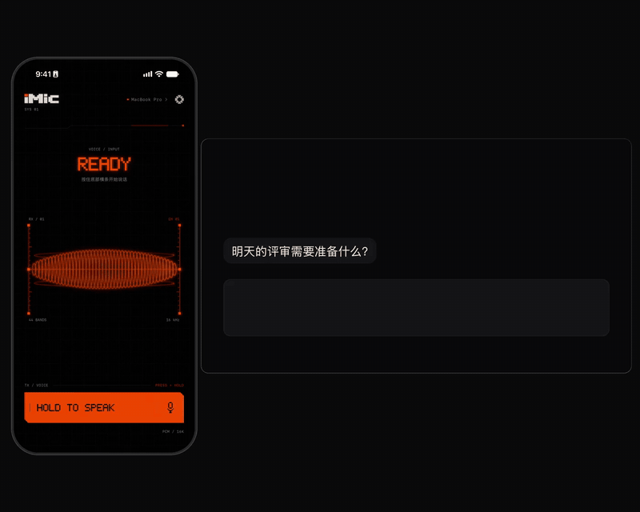

# iMic

**按住说话，松手即输入。**

iPhone 当 Mac 的麦克风。说完松手，文字直接打进你正在用的任何应用。

[官网](https://drafffffff.github.io/iMic/) · [下载 Mac 版](https://github.com/Drafffffff/iMic/releases/latest) · [反馈](https://github.com/Drafffffff/iMic/issues)

## 能做什么

- **按住说话，松手输入**：文字落到 Mac 当前光标处，任何能打字的应用都行。
- **弦手势**：下拉发送回车，上拨删字，左右移动光标。
- **AI 润色**：口语自动整理成书面文字，也能转成终端命令、文言文等。
- **隐私**：iPhone 直连你自己的 Mac，没有中转服务器。

## 开始使用

需要：macOS 13+ 的 Mac、iOS 17+ 的 iPhone、一个[阿里云百炼 API Key](https://bailian.console.aliyun.com/?tab=model#/api-key)，两台设备连同一个 Wi-Fi。

1. **Mac**：下载 [最新 DMG](https://github.com/Drafffffff/iMic/releases/latest)，拖进「应用程序」打开，按向导填入 Key 并开启辅助功能权限。
2. **iPhone**：TestFlight 即将开放，届时从[官网](https://drafffffff.github.io/iMic/#download)获取。
3. **配对**：iPhone 上选择你的 Mac，输入 Mac 显示的 6 位配对码。
4. **输入**：在 Mac 上点进输入框，按住 iPhone 底部橙色横条说话，松手即可。

遇到问题？看[官网常见问题](https://drafffffff.github.io/iMic/#faq)。开发者请看[开发文档](https://github.com/Drafffffff/iMic/blob/codex/ui-phosphor-wireframe/docs/DEVELOPMENT.md)。

GPL-3.0 · [隐私说明](https://github.com/Drafffffff/iMic/blob/codex/ui-phosphor-wireframe/docs/PRIVACY.md)
