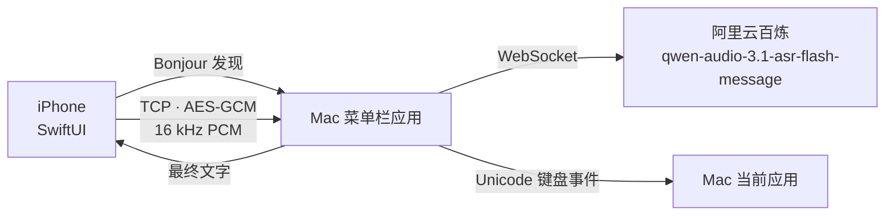

# 架构

## iPhone 端

| 文件 | 职责 |
| --- | --- |
| `LinkClient.swift` / `DeviceSelectionView.swift` | 带 TXT 的 Bonjour 发现、明确目标选择与持久化、每台独立令牌、TCP/BLE 定向重连、代际隔离 |
| `BLELinkClient.swift` | iOS BLE 中心端，完整保留音频字节；仅合并尚未开始的旧预览，保留加密分片和控制屏障 |
| `SpeechPreview.swift` | Apple Speech 每 45 秒滚动分段、保留文字前缀、处理提前 final/error、正常停录排空尾字 |
| `AudioCapture.swift` | 前台热麦、每代输入引擎与 sink 生命周期；请求 10ms IO，playAndRecord 允许触感与短弓弦声同时工作 |
| `IMicAudioInputBridge.h` / `.m` | 原生 sink 回调、预分配 SPSC 槽位、串行重采样与排空；向 Swift 交付有所有权的 16 kHz PCM16 数据 |
| `SessionModel.swift` | 按住 / 松开 / 取消 / 上传与识别超时、600 秒音频日志、本机临时文字、结果保留 |
| `HomeView.swift` | 主界面、线框转轴、波形、结果卡、按住横条手势 |
| `PairingSheet.swift` / `PolishPreferencesView.swift` | 六位配对码、波形复看与润色偏好入口；手机编辑当前 Mac 的完整偏好并等待确认，不保存第二套配置 |
| `DesignSystem.swift` / `Spectrum.swift` | 44 环频谱弦、共享几何、每环 3 槽的 160ms 落点脉冲；另保留本轮所有真实接触短弧的单位椭圆几何，蓄力时按张力批量提亮；共用 CADisplayLink、解析弹簧与删除状态机 |
| `ReceiverFlow.swift` | 有界预取字形、大字入场并缩小至吸附最小值、蓄力提亮、过中线后整批弹射并随上升放大；减少动态时保留静态字形，不向 Home 发布视效帧 |
| `WaveTextRenderer.swift` / `WaveText.metal` | 后台串行 CoreText 字形生成，直接写入上传缓冲；R8 单通道图集、按页批量实例绘制、三缓冲与有序上传；代际取消旧生成任务，无逐字视图或运行时着色器编译 |
| `WaveformTrace.swift` / `WaveformReplayView.swift` | 有界频谱缓存、原始响度统计与无音频复看 |
| `BowReleaseSound.swift` | 预缓存五档 72ms 弦响与上冲气流；同一个 Core Haptics pattern 协调音触，不支持时使用已预热播放器与单次系统触觉；重抓复用健康资源，后台/中断清理失效资源 |
| `PixelFont.swift` | 5×7 像素字模，避免引入第三方字体 |

麦克风在前台常驻，按下即可采集；未录音时只保留最近 150ms 预录。按下立即发送 `audio.start`，Mac 立刻进入「正在听」；音频仍要过 0.5 秒短按门限。每次录音最多 600 秒，音频按 20ms 切帧并保留完整会话日志用于补发；达到样本或墙钟上限时明确自动提交。波形缓存的 60 秒上限独立，不截断识别音频。

输入不再使用 `installTap`：即使请求较小 buffer，旧真机 tap 仍约每 100ms 批量回调。sink 直接消费硬件格式；IO 侧不创建 Swift 对象或 PCM buffer，不执行 FFT、重采样与日志，只复制到预分配的 64 个有界槽并唤醒串行 worker。worker 按序向 Speech 交付借用的原生 buffer、经复用的转换器输出 PCM。槽满、格式改变或转换失败会明确失败并取消本次录音，不静默跳帧；停止时先停引擎，再排空已接受槽与转换尾部。Swift 交付主线程使用 FIFO 队列和采集代际，旧引擎的迟到回调不能污染新会话。

FFT 使用最近 512 个 16 kHz 样本组成约 32ms 重叠窗，采集 hop 与窗长独立；提高的是新数据到达频率，不是把旧大块音频切小后伪造采样时刻。2026-10-25 的 iPhone 16 Pro 真机日志为 48 kHz、每次 480 个硬件样本，稳定约 100 次 IO 回调/秒，worker 同频、`pending=0`。这是实际输入回调频率，不是屏幕帧率；可视化缓存的 50Hz 上限独立。

界面状态完全由 `LinkClient.Phase` 与 `SessionModel.Phase` 两条轴决定：前者管连接，后者管一次输入。离线时底部横条变成 `LINK TO MAC`，不会误触开始录音。中心弦手势通过加密 `input` 消息交给 Mac 注入回车/删除/方向键；实时预览由 Apple Speech 生成 `preview` 消息，最终百炼结果替换临时文字。

中央弦只在 `TorusView` 局部订阅逐帧状态；拖拽使用连续软阻力，松手继承手指速度，解析阻尼弹簧按真实帧间隔采样，支持回弹中重新抓取。「减少动态效果」关闭纹理漂移，并使用无反复振荡的临界阻尼回位。左右连接点固定在标尺中线，拖拽、声音纹理与回弹均不能移动它们。弦身在受力点两侧用平滑正弦肩部连接至固定端，圆环随局部切线倾斜并轻微拉伸，上下横向轨道沿同一弦形弯曲，不再整体平移。投影额外预留拉伸半径与边界余量，避免极限拉力或回弹越界。

弦张力由 `StringSpring` 共享参数控制：`dragGain=0.72`、阻尼率 `7.0`、角频率 `27.5`，提高初段阻力并加快释放，保持手势门限与既有形变。解析过中线时刻和弹簧推进使用同一组参数，避免调手感后回车与画面错位。

波形保留原始 RMS dBFS，不给录音 PCM 增益：RMS ≤ −60dBFS 不产生语音能量，−48/−36/−24/−12dBFS 分别映射约 0.22/0.48/0.74/0.90。44 个预计算三角频带使用 Hann 窗相干增益校准，组合带内峰值与均值，并以当前最强频段以下 34dB 的相对窗口凸显频峰/频谷；绝对可听度与 RMS 门限防止放大底噪。展示时将相邻两频段按均方强度合为 22 组，低频居中、向两侧对称展开成 44 环；可视化强度平方和保持不变，不硬拉高频或伪造噪声，原始 44 段顺序与缓存不变。频段与亮度采用连续速度的解析临界阻尼包络，起音约 120ms 达九成，停音约 280ms 回落九成；每帧只计算一组共用系数，不降低采集频率。环高保留绝对包络，避免逐帧归一化抵消缓动。RMS 与 FFT 共用一次样本扫描。基础环线宽固定为 1.3pt，落点另绘局部强调短弧；保留静止锥形与上下横向轨道，拖拽不额外绘制跟手光点。

下拉释放只登记 `pendingReturn`。解析弹簧计算首次向上过中线的时刻，显示时钟抵达该点后消费待发动作，再投递回车、播放短发射声与触感；后续振荡不重发。重新触摸、后台、断线、弹窗、关闭功能或离开均作废待发动作。「减少动态效果」在一次有限时间回位后发送，不等待渐近零点。

实时文字来自独立的 `liveTranscript`，不依赖 Mac 预览开关；主页以布局锚点传递弦和横条坐标，不改变布局。新增非空白、非标点字素簇全部排队，最多向前准备 16 个字，每显示帧摄取至多 8 个已准备字形；重复假设不重飞。单个串行后台队列完成 CoreText 排版和光栅化，直接写入共享 Metal 上传缓冲，主线程不等待字体生成、不复制整张字形位图。重置作废旧代际与未开始任务；图集按 2048×2048 R8 分页，每字 128×128，单页 4MiB，768 个不同汉字使用三页约 12MiB。

字形以 `2.4` 倍入场，在约 430–495ms 的飞行中持续缩至 `0.38` 倍；吸附后不再缩小，也不以放大附着字制造落点冲击。实际接触角度亮起 160ms 暖白短弧与径向短火花，每环三槽，长帧自然过期；全部接触历史另行保留。有效下拉时，文字和接触短弧按张力一起提亮，45ms 平滑起亮并以 0.65–1.35Hz 呼吸，张力越大越快，不做频闪。无有效下拉或处于回摆时不蓄力；取消只清除蓄力亮度，保留载荷。

首次向上过中线排队发送回车后，附着文字以 0–12ms 的微小错峰整批释放，继承弦速并向上加速；从最小 `0.38` 倍随上升距离增长至顶部 `3.8` 倍，附加短拖尾与中途纵向拉伸。横向范围及顶部回收使用实际旋转字形和拖尾尺寸，避免变大后从侧边逃逸或过早消失。波形原位回弹，RX01 静态。减少动态效果时只保留静态字形与随拉力变化的亮度，不飞入、不循环呼吸、不弹射旧轨迹。

下拉越过阈值时播放轻短 `bowArmed` 扣点，并预热音效与缓存 Core Haptics player；松手只登记飞行并确认预热。过中线成功投递后，同一主线程内启动短弓声和一次强脆瞬态加 38ms 衰减尾韵。发射点不再创建 PCM、player 或启动触感引擎，音效不修改采集会话配置。两套硬件不保证采样级同步。重抓停止旧短音，后台与取消作废待发动作；不支持 Core Haptics 时保留系统反馈。

`SessionModel` 仅在一次正式录音期间向 `WaveformTraceStore` 写入频段、显示响度、原始 RMS 和相对采样时间；正常松手后异步落盘，取消则丢弃。缓存最多 50Hz、60 秒、最近 3 次，读取/保存时清除超过 24 小时的数据，使用文件保护并排除备份。真实麦克风与合成测试明确区分，静音 `rmsDB = -∞` 成对编码为 `"-Infinity"`。复看使用独立 `SpectrumStore`，不启动录音、链路或文字投递；清除代际阻止迟到的异步写入恢复已删除数据。

停录通过 `stopVisualInput` 结束视觉输入：清空 FFT 窗、作废预览定时器代际，将频谱和响度目标更新为零，让既有惯性自然收回。结果、失败、断链和超时同样释放目标；取消、过短与显式重置保留立即清空语义。非 listening 的迟到分析/合成回调不能重新写入峰值，DEBUG 处理中与结果预览也不固定展示有声尾帧。归零目标不写入波形缓存，不影响 Speech 尾字收尾、音频补发或最终识别。

上拨松手发送一次既有 `input/delete`；超过阈值保持 0.4 秒后，每次发送一字删除，间隔在约 2.2 秒内从 180ms 降至 60ms。方向变化使用 2.5pt 净位移迟滞以过滤手指微抖动；明显下移、退回阈值内或松手即停，进入连续模式后松手不额外删除。后台、弹窗、断线、功能关闭或视图离开均取消手势，不积压补发。

本机识别不受 Mac 预览显示开关控制；授权在空闲时请求，拒绝或不可用不阻塞百炼。Apple Speech 每 45 秒开启新分段，旧段继续排空并累计正文；提前 final/error 时仅重放未覆盖的音频尾部。正常停录先 flush 待发文字，排空本代 buffer 后 `endAudio()`，最多收尾 6 秒；`audio.end` 不等待它，百炼并行识别。取消、新会话、失败与断链作废旧代；成功回传不掐断本机尾字。失败和切换保留手机上可复制的文字；Mac 实时预览开启且支持范围核验或键盘兼容模式时，临时转写也可进入目标应用。

## Mac 端

| 文件 | 职责 |
| --- | --- |
| `LinkServer.swift` | `NWListener` Bonjour 广播、握手状态机、加密收发、心跳，并暴露回环端口给 BLE 桥 |
| `BLEBridge.swift` | Mac BLE 外设与回环桥；GATT 字节流复用 LinkServer |
| `DeepSeek.swift` / `shared/PolishOptions.swift` | 官方、百炼与自定义 OpenAI-compatible 润色；每来源独立模型和完整地址，官方与百炼关闭思考模式，自定义不发送供应商私有参数；失败回退完整原文，保留原意/问句守门 |
| `PairingStore.swift` | Mac 身份、配对设备令牌、六位码轮换、0600 持久化 |
| `ASR.swift` | 百炼 message ASR，流式 PCM 上传，最终文本聚合 |
| `Interface.swift` / `main.swift` | 菜单栏、主窗口、设置、权限引导、输入与状态机；润色强度/场景为两行带图标文字的单选按钮，选中即保存 |
| `Permissions.swift` | 辅助功能 / 事件投递权限说明与引导 |
| `InputTarget.swift` | 捕获录音起始输入框及选区；分别判断范围读取与 AX 改写能力，只校验和修改本轮 UTF-16 范围；只读 AX 可用键盘修订，不可验证的编辑器回退最终 Unicode 投递，不读写整框 `AXValue` |
| `Credentials.swift` | 非执行地解析和安全写入 `~/.zshrc`；官方与自定义润色 Key 独立，百炼润色复用 ASR Key，不跨来源兜底 |

Mac 活动条是实际接收 RMS 的 96 帧时间历史，不是 FFT。绘图始终铺满容器宽度，已有真实样本才点亮；约 −60dBFS 以下不产生能量，软门限与平方根压缩提高轻声辨识度，静音不注入最低柱高。会话更替、处理与断开清理旧历史。

BLE 两端使用串行状态队列、动态 MTU 与游标队列；无响应音频持续写到系统背压，有响应控制帧的末片 ATT 完成后才报告上传结束。身份特征只筛选明确目标，安全仍依赖原密钥握手；队列有界、错误明确失败。百炼启用静音 heartbeat，总资源期限覆盖有界录音及排空；`BailianASR.completionDeadline` 先表示上传截止，finish-task 送达后切换为最终 60 秒截止，Mac watchdog 不再用松手后固定 45 秒。

TCP 的传输就绪与应用层握手就绪分开处理：`NWConnection.State.ready` 到达即取消 3 秒 BLE 兜底，等待六位码期间不因 `LinkClient.ready == false` 而误切换。日志记录 TCP 接口与接收端 peer；设备页公开当前传输方式。仅在空闲且没有活动音频会话时允许显式「改用局域网」，使用最新发现结果定向重连原 Mac；录音、上传和识别期间不换链路。BLE 的最新未开始预览可原位替换，部分发送帧、带完成回调的控制帧和控制屏障不可替换；队列压缩同步维护索引与剩余字节数。

一次输入的时序：

1. `audio.start`：记录 Mac 前台应用（排除 iMic 自身），清空上一轮状态。
2. 音频帧到达：校验 `seq` 连续；发现首帧缺失或中间缺口时发送 `audio.need`，iPhone 从本地日志补发，补齐前不把尾段送进 ASR。`ShortClipGate` 攒够 0.5 秒后才创建百炼会话，之前的数据一次性补发。
3. 百炼返回：音频持续写入 WebSocket；累计上限 600 秒，上传与最终识别分别计时，避免握手或网络积压截断长句。
4. `preview` 与百炼流式结果驱动 Mac 预览和逐字输入，不等待确认句或录音结束。一旦收到手机非空预览，本次录音始终使用手机预览；百炼确认句只更新 `confirmedTranscript`，不在停顿时切断手机来源。没有手机预览时使用百炼流式结果。`sentence_end=true` 且序号连续的前缀用于取消时回退；缺号等待补齐，重复结束事件不重复提交。是否实时输入由本地 `InputTarget.Mode` 决定，不改变链路字段或功能位。
5. `audio.end` 排空后发送 `finish-task`，完整百炼正文校正临时结果，再可选润色。`InputTarget` 有三种模式：
   - `verified_range`：记录初始选区末端，核对同一应用、输入框、光标与本轮正文；可写 AX 精确替换尾部，只读 AX 使用键盘。`InputRangeMatcher` 处理有界快照内的显示换行和偏移，不忽略正文差异。`insert` 返回 `nil` 表示异步等待，每 20ms 重查；最终回写首次进入时重置确认时间。
   - `keyboard_compatibility`：用户明确授权的兼容路径。Otty 的 AX 位置属于渲染画面而非虚拟编辑光标，直接选此模式；缺少范围读取接口的目标也直接选此模式。范围模式持续 1.5 秒无法同步时，只有接管监视仍有效、用户未操作且前台未变，才切到此模式。按 `committedInputText` 的字符差量退格/追加，不读取 AX 光标或等待 AX 确认，事件投递完成即结束；`pasted=true` 不代表目标正文经过独立核验。
   - `final_only`：既无可靠范围修订能力、又不能安装接管监视时，不做实时修订，只投递最终结果。
   `NSEvent` 全局监视检测非 iMic 按键及点击，`NSWorkspace.didActivateApplicationNotification` 检测应用切换；任一接管信号冻结本轮，包括最终回写。兼容模式仅根据本轮投递记录维护尾部，不能保证目标自行改稿或丢弃按键时仍不误删；此风险在设置和 README 明示。两种实时路径都不全选、不设置整框 `AXValue`；取消、失败和新会话取消旧任务，撤回未确认尾部，保留已确认内容。初始选区未知时先发右方向键，避免直接替换原选区。
6. 润色偏好只由 Mac 保存。认证后的 `polish.settings` 经 `LinkServer` 的类型化回调原子更新开关、强度、场景与 Mac 控件，再发送完整 `polish.saved`；普通 `settings` 状态广播不能提前完成手机的在途保存。Mac 本地修改广播状态，手机断线清理在途状态并于重连后重新读取，不向另一台 Mac 重放修改。Key、来源、模型和地址均留在 Mac。

调试日志写在 Mac 的 `~/Library/Logs/iMic/iMic.log` 和 iPhone 应用容器的 `Library/Logs/iMic/iMic.log`（`scripts/pull-ios-log.sh` 可拉取）。只记录状态、会话号、帧序号、缺口与补发、ASR 阶段和字数，不记录令牌、音频或正文。

## 延迟来源

| 阶段 | 典型值 |
| --- | --- |
| iPhone 采集到 20ms 帧 | 20–80 ms |
| 本地 TCP | < 5 ms |
| 百炼端到最终文本 | 250–500 ms |
| 文字回传 iPhone | < 10 ms |
| 键盘事件输入 | < 20 ms |

实测试音频 7.16 秒：`end_to_final_ms` 约 244–412 ms，随网络与句子长度波动。

2026-10-25 手机与本机日志中的慢会话：录音 16.84 秒、842 帧、269,440 样本，松手后仍补传约 17.56 秒；本次 BLE 上行约 16–20 KB/s，低于 PCM16 加加密开销所需的至少 34,050 B/s。Mac 收齐后的 ASR 约 294ms、润色约 1,456ms，主瓶颈不是云端。配对时还观察到 TCP 建立后约 3 秒被 BLE 兜底打断；该误降级已改为按 TCP 传输状态判断，未压缩或丢弃音频。

## 安全模型

- 首次配对码 6 位，配合 ECDH 临时密钥；攻击者没有 ECDH 私钥时无法离线枚举，在线尝试限制 3 次。
- 配对成功后只使用 32 字节设备令牌；配对码立刻轮换。
- 每帧 AES-GCM 独立 nonce；帧类型、序号与长度都受完整性保护。
- iPhone 令牌存钥匙串（模拟器未签名构建回退到受数据保护的应用容器文件）；Mac 令牌存 0600 JSON。
- 不落盘录音与识别正文；日志不打印令牌、正文或音频。
- 不注册系统麦克风设备，不修改 TCC。

## 已知限制

- 无可用输入设备时无法验证 `AVAudioEngine` 的真实采集；本项目在 Mac mini（无麦克风）上用系统 TTS 走同一条编码/加密/上传路径完成联调。
- Bonjour 跨网段与 AP 隔离环境不可用。
- 识别依赖百炼云端，需要有效 Key 与网络。
- 自动输入依赖 macOS 辅助功能权限；未授权时文字保留在 Mac 窗口与 iPhone 上。
