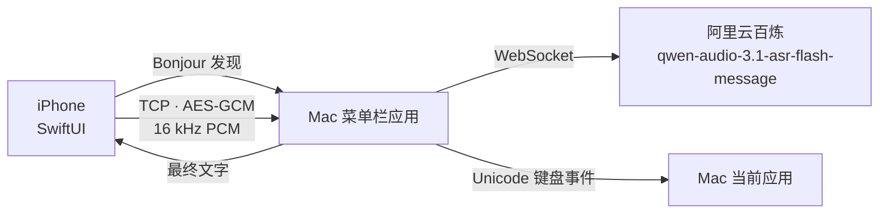

# 架构

## iPhone 端

| 文件 | 职责 |
| --- | --- |
| `LinkClient.swift` / `DeviceSelectionView.swift` | 带 TXT 的 Bonjour 发现、明确目标选择与持久化、每台独立令牌、TCP/BLE 定向重连、代际隔离 |
| `BLELinkClient.swift` | iOS BLE 中心端，完整保留音频字节；仅合并尚未开始的旧预览，保留加密分片和控制屏障 |
| `SpeechPreview.swift` | Apple Speech 每 55 秒滚动分段、保留文字前缀、处理提前 final/error、正常停录排空尾字 |
| `AudioCapture.swift` | 按需开麦、5 秒热启动窗口、每代输入引擎与 sink 生命周期；请求 10ms IO，playAndRecord 允许触感与短弓弦声同时工作 |
| `IMicAudioInputBridge.h` / `.m` | 原生 sink 回调、预分配 SPSC 槽位、串行重采样与排空；向 Swift 交付有所有权的 16 kHz PCM16 数据 |
| `SessionModel.swift` | 按住 / 松开 / 取消 / 上传与识别超时、600 秒音频日志、本机临时文字、结果保留 |
| `HomeView.swift` | 紧凑品牌/连接顶栏、状态、略下移的弦操作区与固定录音条；结果继续收起，原有录音与拨弦手势保留 |
| `InstrumentChrome.swift` / `Assets.xcassets/Wordmark.imageset` | 生图像素字标、代码绘制的像素齿轮/麦克风、统一 10pt 操作说明、切角录音条、复用活动时钟的 HUD 状态线 |
| `PairingSheet.swift` / `PolishPreferencesView.swift` | 设置页直接展示连接与润色开关、模式、语气、输出语言，支持滚动；波形复看保留独立入口。手机编辑当前 Mac 的完整偏好并等待确认，不保存第二套配置 |
| `DesignSystem.swift` / `Spectrum.swift` | 44 环频谱弦、共享几何、每环 3 槽的 160ms 落点脉冲；另保留本轮所有真实接触短弧的单位椭圆几何，蓄力时按张力批量提亮；共用按需唤醒的 CADisplayLink、解析弹簧与删除状态机 |
| `ReceiverFlow.swift` | 有界预取字形、大字入场并缩小至吸附最小值、蓄力提亮、过中线后按密度、屏宽计算字号与整批爆发冲量；减少动态时保留静态字形，不向 Home 发布视效帧 |
| `ReceiverFlightLayout.swift` | 弹射布局与纯数值飞行动力学：一帧内释放、最多 64 个均匀视觉抽样、拉力/弦速初速、平方阻力解析位移、完整子帧姿态与居中快门；不参与正文处理 |
| `WaveTextGeometry.swift` | Swift/Metal 共用的 48 字节字形实例和 32 字节子帧姿态；主应用和 GPU 回归测试共用 |
| `WaveTextRenderer.swift` / `WaveText.metal` | 后台串行 CoreText 字形生成，直接写入上传缓冲；R8 单通道图集、按页批量实例绘制、16–64 个完整姿态的归一化预乘 Alpha 曝光采样、三缓冲与有序上传；代际取消旧生成任务，无逐字视图或运行时着色器编译 |
| `WaveformTrace.swift` / `WaveformReplayView.swift` | 有界频谱缓存、原始响度统计与无音频复看 |
| `SoundDesign.swift` | 界面音效：启动后离线合成 19 个 8-bit lo-fi 短音（芯片声道 + 阶梯包络 + 降采样/降位深 + 低通），注册为系统声音播放；不触碰采集链路的 AVAudioSession，遵守静音开关，设置可关闭。方案见 `docs/design/2026-10-29-ios-sound-design.md` |
| `PixelFont.swift` | 5×7 像素字模，避免引入第三方字体 |

前台激活只准备授权，不启动输入引擎。按住时先给按下触感，再激活音频会话与引擎，采集准备好后给开始录音触感；久置后的首次启动存在设备延迟，不宣称零延迟。松手后保留约 5 秒热启动窗口，连续输入期间保留最近 150ms 预录；超时停止硬件 IO、排空 worker、释放输入引擎和音频会话、清除预录。窗口从结束录音开始计时，不因识别结果回来而续期；再次按住取消旧回收任务，旧任务不能中断新一轮录音。后台和页面离开立即回收；延迟返回的权限请求不能在后台开麦。按下立即发送 `audio.start`，Mac 立刻进入「正在听」；音频仍要过 0.5 秒短按门限。每次录音最多 600 秒，音频按 20ms 切帧并保留完整会话日志用于补发；达到样本或墙钟上限时明确自动提交。波形缓存的 60 秒上限独立，不截断识别音频。

输入不再使用 `installTap`：即使请求较小 buffer，旧真机 tap 仍约每 100ms 批量回调。sink 直接消费硬件格式；IO 侧不创建 Swift 对象或 PCM buffer，不执行 FFT、重采样与日志，只复制到预分配的 64 个有界槽并唤醒串行 worker。worker 按序向 Speech 交付借用的原生 buffer、经复用的转换器输出 PCM。槽满、格式改变或转换失败会明确失败并取消本次录音，不静默跳帧；停止时先停引擎，再排空已接受槽与转换尾部。Swift 交付主线程使用 FIFO 队列和采集代际，旧引擎的迟到回调不能污染新会话。

FFT 使用最近 512 个 16 kHz 样本组成约 32ms 重叠窗，采集 hop 与窗长独立；提高的是新数据到达频率，不是把旧大块音频切小后伪造采样时刻。2026-10-25 的 iPhone 16 Pro 真机日志为 48 kHz、每次 480 个硬件样本，稳定约 100 次 IO 回调/秒，worker 同频、`pending=0`。这是实际输入回调频率，不是屏幕帧率；可视化缓存的 50Hz 上限独立。

界面状态完全由 `LinkClient.Phase` 与 `SessionModel.Phase` 两条轴决定：前者管连接，后者管一次输入。离线时底部横条变成 `LINK TO MAC`，不会误触开始录音。中心弦手势通过加密 `input` 消息交给 Mac 注入回车/删除/方向键；实时预览由 Apple Speech 生成 `preview` 消息，最终百炼结果替换临时文字。

后台入口记录链路恢复标记，不主动拆掉仍在等待结果的连接。回到前台取消累积退避：健康 TCP/BLE 用加密 ping/pong 确认后复用；TCP 800ms 或 BLE 1500ms 未回应就立即更换连接，并刷新所选 Mac 的 Bonjour 发现。新握手前先向主线程交付旧会话断线，避免代际切换吞掉取消通知；探测按连接代际与 ts 匹配。`test-ios-reconnect.sh --long-background` 在本机直接运行生产 `LinkClient` / `LinkServer`，通过字节流代理验证正常复用、55 秒黑洞跨越 Mac 心跳超时、自动令牌认证、失败退避跳过与迟到定时器隔离；该测试不模拟真实 iOS 的进程挂起，也不代表无线环境或蓝牙性能。

待机显示时钟采用事件驱动：声音输入、手势、新文字、落点和释放会唤醒 60–120Hz 的共享 `CADisplayLink`；主页最后一次活动后保留 40 秒环境动效，再用 4 秒 smoothstep 渐隐扫描与短弧，并把装饰相位速度连续减到零。无声音和实际反馈时降为 30Hz；长按、弹簧尚未归位、待生成/飞行中的文字继续保活并延后闲置起点。减少动态效果与波形复看仍只保留 1.2 秒有限反馈收尾。完全静置后，纯附着文字不单独维持逐帧 Metal 提交。隐藏或后台立即暂停，重新唤醒重置时间戳，避免把闲置时长传入弹簧；新文字、异步字形完成前的有界摄取和完整曝光回收仍正常工作。复看播放的真实数据更新会持续唤醒同一时钟，暂停后也能静置。触感与发射音效引擎启用自动休眠，发射资源在拉弦时预热，不在打开主页时常驻预热。TCP/BLE 与 10 秒 ping/pong 保活保持不变，避免通过断连省电而增加下一次输入延迟。屏幕继续常亮，显示面板本身仍会耗电。

2026-10-26 节能验证：iPhone 16 Pro 的旧版待机日志为约 100 次音频 IO 回调/秒；新版实际录音松手后约 5 秒出现输入引擎停止与会话释放，下一次按住重新启动，本次冷启动日志约 296ms。独立 iPhone 16 Pro / iOS 27.0 模拟器在相同静置页面、相同录屏观察条件下各采样约 12 秒，应用进程 CPU 时间从约 4.27ms/秒降至 0.010ms/秒；这只衡量模拟器中应用进程的待机 CPU，不代表真机总功耗或电池续航比例。真机 Instruments 连接超时，尚无受控的电池/整机功率测量。上述 CPU 采样对应此前立即静置的策略；当前 40 秒延迟与渐隐策略只在完全静置后取得相同的零回调状态，不沿用旧数据声称等待阶段功耗。`test-ios-standby.sh` 验证 40 秒保持、4 秒连续渐隐、恢复渐入、实际显示回调停止、减少动态效果、手势立即唤醒、长按保活、弹簧归位、异步字形与落弦静置、弹射收尾、隐藏与恢复；所有诊断只在 DEBUG 构建启用。

中央弦在全屏 `TorusView` Canvas 内按主图布局锚点绘制，手势命中区仍是原主图；顶部扩展不会被原 Canvas 高度裁掉。竖向抓取后持续读取当前触点横坐标，映射到两个固定端点之间的实际弦跨度；受力点可在 6%–94% 范围跟随手指左右移动，圆环与附着文字共用该位置。横向移动不改上拉深度、不切成光标手势，碰顶与松手保留最后受力位置。`ClearDropZone` 随上拉深度亮起；进入 84pt 顶区时消费当前触摸，停止连删并发一次清空。`StringClearFeedback` 使用同一显示时钟播放碰顶短振、140ms 消隐及高张力解析阻尼回弹（释放后约 80ms 过中线、总反馈 700ms）；清空确认和抬手不打断收尾，减少动态效果时取消短振与过冲。普通初段沿用原阻力，后段平滑延伸至顶区，端点仍固定。上拉收细按受力点到顶部清空区的完整行程计算，使用后段加重的连续曲线：四分之一行程保留约 97% 厚度、一半约 83%、顶端约 32%；切线对齐独立于收细进度，轨道同步收窄，避免环交错；上拉每越过 22pt 新齿位给一次刚性触感，末段加重，停止或回退不重复，高速移动也不补发脉冲。Mac 的权威 `input.state` 租约覆盖润色、扫光、最终回写及写后收尾动画，期间手机停用整个弦手势，忙碌时开始的触摸不能在就绪后续拉。

中央弦只在 `TorusView` 局部订阅逐帧状态；拖拽使用连续软阻力，松手继承手指速度，解析阻尼弹簧按真实帧间隔采样，支持回弹中重新抓取。「减少动态效果」关闭纹理漂移，并使用无反复振荡的临界阻尼回位。左右连接点固定在标尺中线，拖拽、声音纹理与回弹均不能移动它们。弦身在受力点两侧用平滑正弦肩部连接至固定端，圆环随局部切线倾斜并轻微拉伸，上下横向轨道沿同一弦形弯曲，不再整体平移。投影额外预留拉伸半径与边界余量，避免极限拉力或回弹越界。

弦张力由 `StringSpring` 共享参数控制：`dragGain=0.72`、阻尼率 `7.0`、角频率 `27.5`，提高初段阻力并加快释放，保持手势门限与既有形变。解析过中线时刻和弹簧推进使用同一组参数，避免调手感后回车与画面错位。

波形保留原始 RMS dBFS，不给录音 PCM 增益：RMS ≤ −60dBFS 不产生语音能量，−48/−36/−24/−12dBFS 分别映射约 0.22/0.48/0.74/0.90。44 个预计算三角频带使用 Hann 窗相干增益校准，组合带内峰值与均值，并以当前最强频段以下 34dB 的相对窗口凸显频峰/频谷；绝对可听度与 RMS 门限防止放大底噪。展示时将相邻两频段按均方强度合为 22 组，低频居中、向两侧对称展开成 44 环；可视化强度平方和保持不变，不硬拉高频或伪造噪声，原始 44 段顺序与缓存不变。频段与亮度采用连续速度的解析临界阻尼包络，起音约 120ms 达九成，停音约 280ms 回落九成；每帧只计算一组共用系数，不降低采集频率。环高保留绝对包络，避免逐帧归一化抵消缓动。RMS 与 FFT 共用一次样本扫描。基础环线宽固定为 1.3pt，落点另绘局部强调短弧；保留静止锥形与上下横向轨道，拖拽不额外绘制跟手光点。待机环高额外增加 0.16 的静态饱满度，增量随已平滑的频谱 presence 按平方连续退去，进入完整语音时增量及其一阶变化率都为零，保留原有有声峰谷响应；停声后沿同一包络恢复。诊断覆盖静态饱满度、峰谷对比、连续过渡及极限下拉的画布边界。

主页 HUD 的局部刻度亮度、轨道短弧和字形之外的扫描强调全部读取现有 `SpectrumFrame.time`；不新建定时器，不额外唤醒 `SpectrumStore`。无操作 40 秒后，移动强调与装饰相位在 4 秒内连续衰减至静态；再次操作时渐入，实际频谱与弦/文字物理不缩放时间。左右标尺共用中心对称的 10pt 刻度，两物理像素宽度并对齐屏幕像素，取消左右错位及刻度扫光以保持均匀；背景网格按单物理像素对齐。减少动态效果时停止移动强调，录音频谱和实际操作反馈仍保留。主页只在各局部视图订阅帧数据，不让整个 HomeView 逐帧重绘。

下拉释放只登记 `pendingReturn`。解析弹簧计算首次向上过中线的时刻，显示时钟抵达该点后消费待发动作，再投递回车、播放短发射声与触感；后续振荡不重发。重新触摸、后台、断线、弹窗、关闭功能或离开均作废待发动作。「减少动态效果」在一次有限时间回位后发送，不等待渐近零点。

实时文字来自独立的 `liveTranscript`，不依赖 Mac 预览开关；主页以布局锚点传递弦和横条坐标，不改变布局。原生 `HoldControl` 在按下、移动和抬手时将按钮内横向触点归一化传入 `ReceiverFlowStore`，不逐次发布 SwiftUI 状态；新字形从同一横向位置的按钮顶边上方 3pt 出现，仅有 ±3pt 的轻微散布，并按整个 Canvas 做字形边界保护。已有飞行字形保留原路径，不被手指移动拉走；重置录音状态和松手不清空触点，异步识别尾字继续沿用最后位置。辅助功能触发及无触点预览使用按钮中点。新增非空白、非标点字素簇全部排队，最多向前准备 16 个字，每显示帧摄取至多 8 个已准备字形；重复假设不重飞。单个串行后台队列完成 CoreText 排版和光栅化，直接写入共享 Metal 上传缓冲，主线程不等待字体生成、不复制整张字形位图。重置作废旧代际与未开始任务；图集按 2048×2048 R8 分页，每字 128×128，单页 4MiB，768 个不同汉字使用三页约 12MiB。

字形以 `2.4` 倍入场，在约 430–495ms 的飞行中持续缩至 `0.38` 倍；吸附后不再缩小，也不以放大附着字制造落点冲击。实际接触角度亮起 160ms 暖白短弧与径向短火花，每环三槽，长帧自然过期；全部接触历史另行保留。有效下拉时，文字和接触短弧按张力一起提亮，45ms 平滑起亮并以 0.65–1.35Hz 呼吸，张力越大越快，不做频闪。无有效下拉或处于回摆时不蓄力；取消只清除蓄力亮度，保留载荷。

首次向上过中线排队发送回车后，文字在 0–14ms 内整批释放。各字从实际附着点接受高初速冲量：基础纵速取 `max(屏高 × 4.4, 顶部距离 / 0.115)`，再乘 `0.92 + 拉力 × 0.38` 并叠加向上弦速的 0.55 倍；每次释放只生成一个新的随机种子，对横向落点、0.78–1.42 倍初速、不超过约 13° 的字形倾角和 0–14ms 微错峰的低差异序列做独立相位扰动；每字另固定一个不超过 10pt 的中段横向弧度，偏移与斜率在起点和出口归零；不同速度将载荷沿纵向拉开，不使用固定轨道、横向缓动归队或分波等待。离弦后没有持续推力，以平方阻力的解析解 `v(t) = v₀/(1 + k·v₀·t)`、`s(t) = log(1 + k·v₀·t)/k` 计算位置，`k = 0.00028/pt`；不再使用离弦后继续加速的轨迹。系数为屏幕动效调校，不宣称真实箭的质量、空气参数或完整弹道仿真；依据 [NASA 阻力关系](https://www1.grc.nasa.gov/beginners-guide-to-aeronautics/drag-equation/)，短时飞行不加入可见重力下坠。起飞瞬间保留约 55ms 暖白短闪和 60ms 内的短暂拉伸。

运动模糊参考 [Adobe 图层运动模糊的快门机制](https://helpx.adobe.com/ie/after-effects/desktop/animate-in-after-effects/assorted-animation-tools/assorted-animation-tools.html)，使用固定 60fps 动效时间基准、180° 快门角和 −90° 快门相位，在当前时刻前后各 4.17ms 的曝光窗口内做均匀中点采样。同次释放的随机参数始终冻结，每个子帧重算同一条平滑弧线，禁止逐帧采样随机噪声。每个子帧重新计算箭矢的真实位移、字号增长、短暂形变、旋转、透明度和闪光颜色；平移、缩放或旋转越快，自适应增加到 16–64 个样本。Metal 对每个姿态的完整字形图像取预乘 Alpha 平均，不叠加当前清晰字形、不增益亮度、不冻结为仅向后拖影；快门包含当前位置前后两侧，避免运动图层视觉上滞后。每字仍只提交一个实例，样本写入复用的三缓冲；包围盒和顶部回收使用全部采样姿态的并集。静止文字仅一个样本，减少动态效果时保持单样本静态图像。此为按同类原理实现的本机图层曝光，不调用 Adobe 引擎。

字号随数量递减：短句最大约 61pt，长段最低 32pt；字形随上升快速放大至该上限，不恢复无限膨胀。视觉预算按屏宽最多保留 64 个均匀抽样字形（常见 iPhone 约 48–64 个），保留载荷首尾，以较少、较清晰的字形成一次有力爆发；仅回收视觉粒子，不修改 `liveTranscript`、最终识别正文、回车时机或输入内容。再次弹射会回收上一批仍在飞行的视觉粒子，避免叠加。横向范围及顶部回收使用全部采样姿态的实际旋转字形尺寸，避免从侧边逃逸或过早消失。波形原位回弹，RX01 静态。减少动态效果时只保留静态字形与随拉力变化的亮度，不飞入、不循环呼吸、不弹射旧轨迹，也不产生运动模糊。

下拉越过阈值时播放轻短 `bowArmed` 扣点，并预热音效与缓存 Core Haptics player；松手只登记飞行并确认预热。过中线成功投递后，同一主线程内启动短弓声和一次强脆瞬态加 38ms 衰减尾韵。发射点不再创建 PCM、player 或启动触感引擎，音效不修改采集会话配置。两套硬件不保证采样级同步。重抓停止旧短音，后台与取消作废待发动作；不支持 Core Haptics 时保留系统反馈。

`SessionModel` 仅在一次正式录音期间向 `WaveformTraceStore` 写入频段、显示响度、原始 RMS 和相对采样时间；正常松手后异步落盘，取消则丢弃。缓存最多 50Hz、60 秒、最近 3 次，读取/保存时清除超过 24 小时的数据，使用文件保护并排除备份。真实麦克风与合成测试明确区分，静音 `rmsDB = -∞` 成对编码为 `"-Infinity"`。复看使用独立 `SpectrumStore`，不启动录音、链路或文字投递；清除代际阻止迟到的异步写入恢复已删除数据。

停录通过 `stopVisualInput` 结束视觉输入：清空 FFT 窗、作废预览定时器代际，将频谱和响度目标更新为零，让既有惯性自然收回。结果、失败、断链和超时同样释放目标；取消、过短与显式重置保留立即清空语义。非 listening 的迟到分析/合成回调不能重新写入峰值，DEBUG 处理中与结果预览也不固定展示有声尾帧。归零目标不写入波形缓存，不影响 Speech 尾字收尾、音频补发或最终识别。

上拨松手发送一次既有 `input/delete`；超过阈值保持 0.4 秒后，每次发送一字删除，间隔在约 1.8 秒内从 180ms 降至 50ms。方向变化使用 2.5pt 净位移迟滞以过滤手指微抖动；明显下移、退回阈值内或松手即停，进入连续模式后松手不额外删除。后台、弹窗、断线、功能关闭或视图离开均取消手势，不积压补发。

本机识别不受 Mac 预览显示开关控制；授权在空闲时请求，拒绝或不可用不阻塞百炼。Apple Speech 每 55 秒开启新分段，旧段继续排空并累计正文；提前 final/error 时仅重放未覆盖的音频尾部。正常停录先 flush 待发文字，排空本代 buffer 后 `endAudio()`，最多收尾 6 秒；`audio.end` 不等待它，百炼并行识别。取消、新会话、失败与断链作废旧代；成功回传不掐断本机尾字。失败和切换保留手机上可复制的文字；Mac 实时预览开启且支持范围核验或键盘兼容模式时，临时转写也可进入目标应用。

## Mac 端

| 文件 | 职责 |
| --- | --- |
| `LinkServer.swift` | `NWListener` Bonjour 广播、握手状态机、加密收发、心跳，并暴露回环端口给 BLE 桥 |
| `BLEBridge.swift` | Mac BLE 外设与回环桥；GATT 字节流复用 LinkServer |
| `DeepSeek.swift` / `shared/PolishOptions.swift` | 官方、百炼与自定义 OpenAI-compatible 润色；每来源独立模型和完整地址，官方与百炼关闭思考模式，自定义不发送供应商私有参数；失败回退完整原文，保留原意/问句守门 |
| `PairingStore.swift` | Mac 身份、配对设备令牌、六位码轮换、0600 持久化 |
| `ASR.swift` | 百炼 message ASR，流式 PCM 上传，最终文本聚合 |
| `Interface.swift` / `main.swift` | 菜单栏、主窗口、设置、输入与状态机；模式、语气与四种语言按顺序分组，选中即保存；终端模式保留但禁用语气和语言 |
| `Permissions.swift` | 输入权限状态与应用包位置 |
| `Onboarding.swift` | 两步设置向导：权限 → 百炼 Key；状态实时检测、可随时重开 |
| `InputTarget.swift` | 捕获录音起始输入框及选区；分别判断范围读取与 AX 改写能力，只校验和修改本轮 UTF-16 范围；只读 AX 可用键盘修订，不可验证的编辑器回退最终 Unicode 投递，不读写整框 `AXValue` |
| `PolishPresentation.swift` / `TextPolishEffect.swift` | 单次最终结果门控、OCR 文字对齐和逐行扫光；原文与润色不提前回写，10 秒硬截止回退；图像仅内存处理，视觉失败不改变输入策略 |
| `Credentials.swift` | iMic 配置文件读写 + 环境变量/shell 配置只读解析 + 百炼 Key 只读校验 |

Mac 活动条是实际接收 RMS 的 96 帧时间历史，不是 FFT。绘图始终铺满容器宽度，已有真实样本才点亮；约 −60dBFS 以下不产生能量，软门限与平方根压缩提高轻声辨识度，静音不注入最低柱高。会话更替、处理与断开清理旧历史。

BLE 两端使用串行状态队列、动态 MTU 与游标队列；无响应音频持续写到系统背压，有响应控制帧的末片 ATT 完成后才报告上传结束。身份特征只筛选明确目标，安全仍依赖原密钥握手；队列有界、错误明确失败。百炼启用静音 heartbeat，总资源期限覆盖有界录音及排空；`BailianASR.completionDeadline` 先表示上传截止，finish-task 送达后切换为最终 60 秒截止，Mac watchdog 不再用松手后固定 55 秒。

TCP 的传输就绪与应用层握手就绪分开处理：`NWConnection.State.ready` 到达即取消 3 秒 BLE 兜底，等待六位码期间不因 `LinkClient.ready == false` 而误切换。日志记录 TCP 接口与接收端 peer；设备页公开当前传输方式。仅在空闲且没有活动音频会话时允许显式「改用局域网」，使用最新发现结果定向重连原 Mac；录音、上传和识别期间不换链路。BLE 的最新未开始预览可原位替换，部分发送帧、带完成回调的控制帧和控制屏障不可替换；队列压缩同步维护索引与剩余字节数。

一次输入的时序：

1. `audio.start`：记录 Mac 前台应用（排除 iMic 自身），清空上一轮状态。
2. 音频帧到达：校验 `seq` 连续；发现首帧缺失或中间缺口时发送 `audio.need`，iPhone 从本地日志补发，补齐前不把尾段送进 ASR。`ShortClipGate` 攒够 0.5 秒后才创建百炼会话，之前的数据一次性补发。
3. 百炼返回：音频持续写入 WebSocket；累计上限 600 秒，上传与最终识别分别计时，避免握手或网络积压截断长句。
4. `preview` 与百炼流式结果驱动 Mac 预览和逐字输入，不等待确认句或录音结束。一旦收到手机非空预览，本次录音始终使用手机预览；百炼确认句只更新 `confirmedTranscript`，不在停顿时切断手机来源。没有手机预览时使用百炼流式结果。`sentence_end=true` 且序号连续的前缀用于取消时回退；缺号等待补齐，重复结束事件不重复提交。是否实时输入由本地 `InputTarget.Mode` 决定，不改变链路字段或功能位。
5. `audio.end` 排空后发送 `finish-task`，完整百炼正文缓存到 `confirmedTranscript`；未开润色时直接提交，开启润色时保留已经显示的实时文字，等待最终选择后一次更新。`InputTarget` 有三种模式：
   - `verified_range`：记录初始选区末端，核对同一应用、输入框、光标与本轮正文；可写 AX 精确替换尾部，只读 AX 使用键盘。`InputRangeMatcher` 处理有界快照内的显示换行和偏移，不忽略正文差异。`insert` 返回 `nil` 表示异步等待，每 20ms 重查；最终回写首次进入时重置确认时间。
   - `keyboard_compatibility`：用户明确授权的兼容路径。Otty 的 AX 位置属于渲染画面而非虚拟编辑光标；Codex（`com.openai.codex`，当前安装名为 ChatGPT.app）声明范围能力，但 AX 尾部选区及替换不可靠，可能留下选区和格式工具栏；Electron 应用（检测 `Electron Framework.framework`，如 Qoder、Cursor、VS Code、Claude）的范围只在扫光请求 `AXManualAccessibility` 后出现，Monaco/富文本输入框的真实光标异步移动，AX 尾部修订会错位并残留文字。这几类应用在捕获时直接选此模式，不等待范围超时、不主动设置 AX 选区；缺少范围读取接口的目标也直接选此模式。范围模式持续 1.5 秒无法同步时，只有接管监视仍有效、用户未操作且前台未变，才切到此模式。按 `committedInputText` 的字符差量退格/追加，不读取 AX 光标或等待 AX 确认，事件投递完成即结束；`pasted=true` 不代表目标正文经过独立核验。
   - `final_only`：既无可靠范围修订能力、又不能安装接管监视时，不做实时修订，只投递最终结果。
   `NSEvent` 全局监视检测非 iMic 按键及点击，`NSWorkspace.didActivateApplicationNotification` 检测应用切换；任一接管信号冻结本轮，包括最终回写。兼容模式仅根据本轮投递记录维护尾部，不能保证目标自行改稿或丢弃按键时仍不误删；此风险在设置和 README 明示。两种实时路径都不全选、不设置整框 `AXValue`；取消、失败和新会话取消旧任务，撤回未确认尾部，保留已确认内容。初始选区未知时先发右方向键，避免直接替换原选区。
   AX 尾部修改使用分阶段事务：选区设置/核验失败且未调用正文替换时，仅在完整原文、原尾部选区或原光标、焦点和接管状态均可核验时收起选区并切兼容模式。正文替换一经尝试，不再自动重放；成功 setter 等待最多 1.5 秒回读确认，失败或光标恢复异常等待 0.3 秒回读。确认新正文及本轮内选区后可尝试一次恢复新末端光标；确认前不发送下一次修订，也不通过普通范围超时切换兼容模式。结果不明或用户接管则冻结本轮，完整结果仍保留；这些期限不含底层 AX 调用本身的等待，尚非硬实时保证。识别失败保留 Mac 最新临时转写，与目标编辑器的撤回操作独立。

6. 润色偏好只由 Mac 保存。认证后的 `polish.settings` 经 `LinkServer` 的类型化回调原子更新开关、模式、语气、输出语言与 Mac 控件，再发送完整 `polish.saved`；普通 `settings` 状态广播不能提前完成手机的在途保存。手机设置页的待确认选择只在当前视图临时展示，并明确标注尚未保存；确认后采用 Mac 回显，失败、换机或断线即丢弃临时选择。保存状态行和说明区域保留固定布局空间，保存期间锁定交互但不整组变暗，避免闪烁与滚动跳位。Mac 本地修改广播状态，手机断线清理在途状态并于重连后重新读取，不向另一台 Mac 重放修改。Key、来源、模型和地址均留在 Mac。

调试日志写在 Mac 的 `~/Library/Logs/iMic/iMic.log` 和 iPhone 应用容器的 `Library/Logs/iMic/iMic.log`（`scripts/pull-ios-log.sh` 可拉取）。只记录状态、会话号、帧序号、缺口与补发、ASR 阶段和字数，不记录令牌、音频或正文。

## 延迟来源

| 阶段 | 典型值 |
| --- | --- |
| iPhone 采集到 20ms 帧 | 20–80 ms |
| 本地 TCP | < 5 ms |
| 百炼端到最终文本 | 250–500 ms |
| 文字回传 iPhone | < 10 ms |
| 键盘事件输入 | < 20 ms |

实测试音频 7.16 秒：`end_to_final_ms` 约 244–412 ms，随网络与句子长度波动。

2026-10-25 手机与本机日志中的慢会话：录音 16.84 秒、842 帧、269,440 样本，松手后仍补传约 17.56 秒；本次 BLE 上行约 16–20 KB/s，低于 PCM16 加加密开销所需的至少 34,050 B/s。Mac 收齐后的 ASR 约 294ms、润色约 1,456ms，主瓶颈不是云端。配对时还观察到 TCP 建立后约 3 秒被 BLE 兜底打断；该误降级已改为按 TCP 传输状态判断，未压缩或丢弃音频。

## 安全模型

- 首次配对码 6 位，配合 ECDH 临时密钥：被动监听无法离线枚举，但配对时在线的主动中间人可以离线试码（需 PAKE 才能根治）。在线尝试单连接 3 次，并按 Mac 全局累计 5 次即换码冷却（30 秒起翻倍，上限 15 分钟）。
- 新连接握手成功后才替换当前 iPhone，局域网内未认证的连接无法踢掉正在使用的链路。
- 配对成功后只使用 32 字节设备令牌；配对码立刻轮换。
- 每帧 AES-GCM 独立 nonce，内容受完整性保护；同一连接内没有帧序号、两个方向共用密钥，不能防止路径上的攻击者重放、重排或反射已有帧（音频帧另有 `seq` 去重）。
- iPhone 令牌存钥匙串（模拟器未签名构建回退到受数据保护的应用容器文件）；Mac 令牌存 0600 JSON。
- 不落盘录音与识别正文；日志不打印令牌、正文或音频。
- 不注册系统麦克风设备，不修改 TCC。

## 已知限制

- 无可用输入设备时无法验证 `AVAudioEngine` 的真实采集；本项目在 Mac mini（无麦克风）上用系统 TTS 走同一条编码/加密/上传路径完成联调。
- Bonjour 跨网段与 AP 隔离环境不可用。
- 识别依赖百炼云端，需要有效 Key 与网络。
- 自动输入依赖 macOS 辅助功能权限；未授权时文字保留在 Mac 窗口与 iPhone 上。

## Mac 润色扫光测试版

百炼最终正文不提前送到目标编辑器或 Mac transcript。DeepSeek 与 OCR 并行，OCR 定位有效并完成显示前核验后立即扫光，不等待润色响应。扫光结束进入 holding，结果选择及原有 `completeSession` 投递都结束后才释放；快结果直接衔接，不增加固定 loading 停留。10 秒墙钟截止由 Mac 状态机控制，`PolishFinalChoice` 只允许一次成功/原文回退，忽略迟到回调。结果已就绪时初始定位最多额外等待 1.2 秒，显示前坐标/可读正文指纹核验最多 0.2 秒，失败跳过视觉。`PolishEffectLifecycle` 将定位、扫光、等待、写入、释放分离，避免动画回调重复投递。减少动态效果使用静态硬边标记。

`TextPolishEffect` 使用独立串行队列查询 AX 输入框边界，按 PID 和所属窗口选择目标，通过 ScreenCaptureKit（macOS 14+）获取该窗口图像并裁剪输入框；Vision 识别裁剪区域。长文滚动时，AX 文档边界可能大于窗口；分别保存文档原始边界与可见区域，按窗口和祖先滚动容器求交集截图，不再要求整篇文档被窗口完整包含。核验分别比较原始边界和可见区域，避免用两种坐标范围相互比较而误判失效。图像与临时文字只在内存，不写日志或文件，不上传。匹配利用本轮已投递文字，规范化标点/空白/大小写并保留 UTF-16 映射，以有界局部对齐生成行内范围；重复候选、低相似度或过短片段跳过，长文允许匹配当前可见尾段。Vision 边框是近似区域，不保证精确字形轮廓。OCR 结果仅控制特效，不用于修改正文或认定投递成功。

若 AX 无法提供输入框，定位降级到目标应用的可见窗口截图。优先使用焦点窗口，缺失时取该 PID 最前的正常窗口或对话框（支持层级 0–24，排除菜单和状态浮层）；不跨应用选择窗口。该路径不要求可读取的 AX 文本框，只按本轮已投递正文做严格、唯一的 OCR 匹配，重复候选不播放；匹配仍是视觉提示，不能授权任何输入修改。敏感输入框继续跳过。窗口模式核验窗口归属、位置和尺寸，显示层级高于来源对话框；收尾只接受新 OCR 的实际位置，不以整个窗口宽度推算正文排版，未及时定位则淡出。日志记录 `fallback=window_ocr` 便于跨机器排查。

单行搜索框（AXTextField 或明确的 AXMultiline=false）使用独立的横向裁剪策略：OCR 可匹配完整结果的唯一可见尾段或中段，片段至少 8 个有效字符、相似度至少 94%，并占可见 OCR 文字的大部分，仍拒绝重复候选。中段匹配不宣称文字终点可见。单行框不使用全文字数推算多行、长度外延或落点，最终仅按新截图内的可见字形重新对齐；终点未出现在匹配片段中则安静淡出。600ms 内没有可靠新截图也安静淡出，不在猜测位置爆开。多行框继续使用原有较严格匹配与长度估算。

透明非激活、鼠标穿透的 NSPanel 使用黑、白、橙三色硬边 CALayer，去掉渐变、模糊、阴影光晕及整段矩形描边。320ms 内完成短蓄势、扫描刃加速、行尾压缩停住；行间错峰总长最多 440ms。黑色衬线保证浅色编辑器中的白色扫描刃与细轨可见，橙色仅用于短拖片、行尾和状态强调。等待态保留细轨与末行短竖条，三格状态灯以 1.2 秒离散周期依次点亮。完成后短竖条短暂压缩，12 个黑底白/橙芯的定向切片沿固定角度射出，230ms 内结束；不再生成随机浮尘。原有 OCR 同行片段先合并，行间独立。窗口留 54pt 余量；减少动态效果仅保留静态细轨、短竖条和状态格，不扫描、不迸射、不循环闪动。

最终投递完成后，优先只读获取最终正文的 AX 行范围；不支持时对最终正文再做一次 OCR。收尾显示核验有 600ms 上限，期间保持蓄能，并在写入后 0/120/280/440ms 重新读取输入框边界与最终行布局，容纳延迟重排及向上增高。AX 布局最早在 280ms 复查时用于结束对齐，避免新正文配旧坐标；AX 最终行必须可见，OCR 必须匹配结果尾段，不能把裁掉新增行的旧视口当成完整结果。实际位置未及时得到时，使用初始 OCR 的可见字宽和行距，结合原文与结果的中英文加权长度、显式换行及输入框宽度估算新终点，并限制在可见区域内。少变多时先根据输入框原点变化平移旧 OCR 坐标，再生成完整的新布局；超出固定高度视口时先按尾部可见估算滚动，再裁剪，末行与终点保持一致。实际布局优先覆盖估算；估算同时生成最终各行宽度而非只移动终点。复用现有覆盖层，以 180ms 缓出动画调整细轨的位置及宽度，多余行收缩移除，新行从短线展开；对齐结束后释放特效，减少动态效果直接对齐。终点移除橙色交叉线，使用黑底白芯短竖条。估算不等于目标已经绘制或投递确认，也不授权任何编辑或重试。输入事件、点击、滚动、应用切换冻结本轮；新录音及取消清理旧任务。所有异步回调携带代际，旧会话不能写入新输入框。macOS 13、无权限、不可定位或无本轮实时文字时保留正常最终输入。

`scripts/test-polish-effect.sh` 验证匹配、歧义拒绝、生命周期去重与取消，以及短文、长文、原稿缩进和可见区域边界的终点估算。`--visual`、`--visual --slow --unverified`、`--visual --fallback` 和 `--visual --cancel`、`--visual --grow`、`--visual --long` 、`--single-line` 及 `--window-only` 仅操作独立测试窗口，分别模拟快结果、慢结果及未确认投递、原文回退、取消及短文扩为四行且输入框延迟增高、两千字以上长文滚动到尾部、单行框横向隐藏，以及无 AX 输入框的浮动对话框，验证本机截屏/OCR与单次提交，不代表所有编辑器或真实云端超时的兼容性承诺。

启动时 `TextPolishEffect.prewarm()` 在 utility 队列用 CoreText 生成固定的中英文小图，以与真实定位相同的 Vision accurate 配置执行一次识别。无需屏幕录制权限、不读取用户文字、不阻塞主线程；开启扫光开关时也触发预热。线程安全的单次静态初始化防止重复加载，启动即开始录音时，首次真实识别仅在工作队列等待预热完成。实际请求继续新建 VNRecognizeTextRequest，预热不等同于系统永不回收模型，耗时只记录阶段与毫秒。

## 文字转换模式与语气

`shared/PolishOptions.swift` 是两端共用的模式、语气、语言、说明、示例与提示词源。设置依次为启用开关、五种模式、四种语气、四种语言；强度和旧场景只保留解码兼容，不决定提示词。`PolishOptions.systemPrompt` 对终端使用独立规则；Agent 独立沿用原有中度转写整理器，保留原句、口吻与结构，正经语气不经过创意改写模板；其余模式组合文体指令、强烈语气与目标语言。创意组合使用 temperature 0.35 / top_p 0.9；正经 Agent 和终端保持 0 / 0.1。

Mac `DeepSeekConfiguration.options(in:)` 读取新选择并迁移旧偏好：保持原语言改为中文，旧命令输出改为终端模式，旧场景改为 Agent 指令，语气默认正经。协议 bit7 声明完整新配置，三字段严格校验；旧手机只可修改启用开关，新手机连接旧 Mac 要求更新。终端切换不清掉语气/语言，回切文字时恢复原选择。`DeepSeekClient.acceptedContent` 根据完整 options 选择命令或文本守门；中文文言允许更高压缩率和古汉语疑问词。失败仍保留完整原话（终端为单行注释），不执行任何口述命令。详细产品与提示词规则见 `POLISH.md`。
