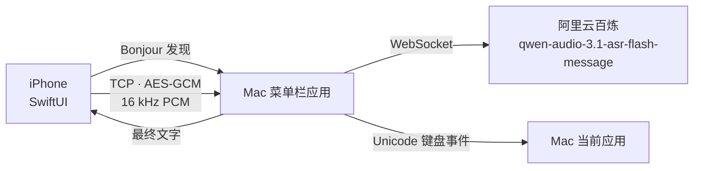

# 架构

## iPhone 端

| 文件 | 职责 |
| --- | --- |
| `LinkClient.swift` | Bonjour/TCP 主链路、BLE 兜底切换、握手、AES-GCM 帧、重连、令牌存取 |
| `BLELinkClient.swift` | iOS BLE 中心端，把 iMic Link 字节流搬到 Mac |
| `SpeechPreview.swift` | Apple Speech 临时转写，正常停录排空尾部、取消时作废代际 |
| `AudioCapture.swift` | 前台热麦、每代输入引擎与 sink 生命周期；请求 10ms IO，playAndRecord 允许触感与短弓弦声同时工作 |
| `IMicAudioInputBridge.h` / `.m` | 原生 sink 回调、预分配 SPSC 槽位、串行重采样与排空；向 Swift 交付有所有权的 16 kHz PCM16 数据 |
| `SessionModel.swift` | 按住 / 松开 / 取消 / 识别超时状态机、60 秒音频日志、触感、结果 |
| `HomeView.swift` | 主界面、线框转轴、波形、结果卡、按住横条手势 |
| `PairingSheet.swift` | Mac 列表、六位配对码输入 |
| `DesignSystem.swift` / `Spectrum.swift` | 44 环频谱弦、共用 CADisplayLink、解析弹簧与持续删除状态机 |
| `WaveformTrace.swift` / `WaveformReplayView.swift` | 有界频谱缓存、原始响度统计与无音频复看 |
| `BowReleaseSound.swift` | 一次合成、缓存复用的 105ms 弓弦与气流释放声，发射前准备资源 |
| `PixelFont.swift` | 5×7 像素字模，避免引入第三方字体 |

麦克风在前台常驻，按下即可采集；未录音时只保留最近 150ms 预录。按下立即发送 `audio.start`，Mac 立刻进入「正在听」；音频仍要过 0.5 秒短按门限。每次录音最多 60 秒，音频按 20ms 切帧，并在 iPhone 本地保留完整会话日志用于补发。

输入不再使用 `installTap`：即使请求较小 buffer，旧真机 tap 仍约每 100ms 批量回调。sink 直接消费硬件格式；IO 侧不创建 Swift 对象或 PCM buffer，不执行 FFT、重采样与日志，只复制到预分配的 64 个有界槽并唤醒串行 worker。worker 按序向 Speech 交付借用的原生 buffer、经复用的转换器输出 PCM。槽满、格式改变或转换失败会明确失败并取消本次录音，不静默跳帧；停止时先停引擎，再排空已接受槽与转换尾部。Swift 交付主线程使用 FIFO 队列和采集代际，旧引擎的迟到回调不能污染新会话。

FFT 使用最近 512 个 16 kHz 样本组成约 32ms 重叠窗，采集 hop 与窗长独立；提高的是新数据到达频率，不是把旧大块音频切小后伪造采样时刻。2026-10-25 的 iPhone 16 Pro 真机日志为 48 kHz、每次 480 个硬件样本，稳定约 100 次 IO 回调/秒，worker 同频、`pending=0`。这是实际输入回调频率，不是屏幕帧率；可视化缓存的 50Hz 上限独立。

界面状态完全由 `LinkClient.Phase` 与 `SessionModel.Phase` 两条轴决定：前者管连接，后者管一次输入。离线时底部横条变成 `LINK TO MAC`，不会误触开始录音。中心弦手势通过加密 `input` 消息交给 Mac 注入回车/删除/方向键；实时预览由 Apple Speech 生成 `preview` 消息，最终百炼结果替换临时文字。

中央弦只在 `TorusView` 局部订阅逐帧状态；拖拽使用连续软阻力，松手继承手指速度，解析阻尼弹簧按真实帧间隔采样，支持回弹中重新抓取。「减少动态效果」关闭纹理漂移，并使用无反复振荡的临界阻尼回位。左右连接点固定在标尺中线，拖拽、声音纹理与回弹均不能移动它们。弦身在受力点两侧用平滑正弦肩部连接至固定端，圆环随局部切线倾斜并轻微拉伸，上下横向轨道沿同一弦形弯曲，不再整体平移。投影额外预留拉伸半径与边界余量，避免极限拉力或回弹越界。

弦张力由 `StringSpring` 共享参数控制：`dragGain=0.80`、阻尼率 `6.0`、角频率 `21`，降低初段顺从度并加快回弹，保持手势门限与既有形变。解析过中线时刻和弹簧推进使用同一组参数，避免调手感后回车与画面错位。

波形保留原始 RMS dBFS，不给录音 PCM 增益：RMS ≤ −60dBFS 不产生语音能量，−48/−36/−24/−12dBFS 分别映射约 0.22/0.48/0.74/0.90。44 个预计算三角频带使用 Hann 窗相干增益校准，组合带内峰值与均值，并以当前最强频段以下 34dB 的相对窗口凸显频峰/频谷；绝对可听度与 RMS 门限防止放大底噪。展示时将相邻两频段按均方强度合为 22 组，低频居中、向两侧对称展开成 44 环；可视化强度平方和保持不变，不硬拉高频或伪造噪声，原始 44 段顺序与缓存不变。频段与亮度采用连续速度的解析临界阻尼包络，起音约 120ms 达九成，停音约 280ms 回落九成；每帧只计算一组共用系数，不降低采集频率。环高保留绝对包络，避免逐帧归一化抵消缓动。RMS 与 FFT 共用一次样本扫描。固定 1.3pt 线宽，保留静止锥形与上下横向轨道，拖拽不绘制光点。

下拉释放只登记 `pendingReturn`。解析弹簧计算首次向上过中线的时刻，显示时钟抵达该点后消费待发动作，再投递回车、播放短发射声与触感；后续振荡不重发。重新触摸、后台、断线、弹窗、关闭功能或离开均作废待发动作。「减少动态效果」在一次有限时间回位后发送，不等待渐近零点。

下拉越过阈值时播放轻短 `bowArmed` 扣点，并预热音效与缓存 Core Haptics player；松手只登记飞行并确认预热。过中线成功投递后，同一主线程内启动短弓声和一次强脆瞬态加 38ms 衰减尾韵。发射点不再创建 PCM、player 或启动触感引擎，音效不修改采集会话配置。两套硬件不保证采样级同步。重抓停止旧短音，后台与取消作废待发动作；不支持 Core Haptics 时保留系统反馈。

`SessionModel` 仅在一次正式录音期间向 `WaveformTraceStore` 写入频段、显示响度、原始 RMS 和相对采样时间；正常松手后异步落盘，取消则丢弃。缓存最多 50Hz、60 秒、最近 3 次，读取/保存时清除超过 24 小时的数据，使用文件保护并排除备份。真实麦克风与合成测试明确区分，静音 `rmsDB = -∞` 成对编码为 `"-Infinity"`。复看使用独立 `SpectrumStore`，不启动录音、链路或文字投递；清除代际阻止迟到的异步写入恢复已删除数据。

停录通过 `stopVisualInput` 结束视觉输入：清空 FFT 窗、作废预览定时器代际，将频谱和响度目标更新为零，让既有惯性自然收回。结果、失败、断链和超时同样释放目标；取消、过短与显式重置保留立即清空语义。非 listening 的迟到分析/合成回调不能重新写入峰值，DEBUG 处理中与结果预览也不固定展示有声尾帧。归零目标不写入波形缓存，不影响 Speech 尾字收尾、音频补发或最终识别。

上拨松手发送一次既有 `input/delete`；超过阈值保持 0.4 秒后，每次发送一字删除，间隔在约 2.2 秒内从 180ms 降至 60ms。方向变化使用 2.5pt 净位移迟滞以过滤手指微抖动；明显下移、退回阈值内或松手即停，进入连续模式后松手不额外删除。后台、弹窗、断线、功能关闭或视图离开均取消手势，不积压补发。

实时预览正常停录时先 flush 待发文字，再对本代在途音频 buffer 排空并 `endAudio()`；Apple Speech 最多继续收尾 3 秒。`audio.end` 不等待 Speech final，百炼并行完成识别。授权、识别回调、音频 buffer 与预览发送均按代际隔离，最终结果、取消、断线或新会话会立即作废旧代。

## Mac 端

| 文件 | 职责 |
| --- | --- |
| `LinkServer.swift` | `NWListener` Bonjour 广播、握手状态机、加密收发、心跳，并暴露回环端口给 BLE 桥 |
| `BLEBridge.swift` | Mac BLE 外设与回环桥；GATT 字节流复用 LinkServer |
| `DeepSeek.swift` / `shared/PolishOptions.swift` | DeepSeek 官方 `deepseek-flash` 润色、三级强度与五种场景组合，失败回退原文；全部组合继续受原意/问句守门保护 |
| `PairingStore.swift` | Mac 身份、配对设备令牌、六位码轮换、0600 持久化 |
| `ASR.swift` | 百炼 message ASR，流式 PCM 上传，最终文本聚合 |
| `Interface.swift` / `main.swift` | 菜单栏、主窗口、设置、权限引导、输入与状态机；润色强度/场景为两行带图标文字的单选按钮，选中即保存 |
| `Permissions.swift` | 辅助功能 / 事件投递权限说明与引导 |
| `Credentials.swift` | 从 `~/.zshrc` 读取或写入 `DASHSCOPE_API_KEY` |

一次输入的时序：

1. `audio.start`：记录 Mac 前台应用（排除 iMic 自身），清空上一轮状态。
2. 音频帧到达：校验 `seq` 连续；发现首帧缺失或中间缺口时发送 `audio.need`，iPhone 从本地日志补发，补齐前不把尾段送进 ASR。`ShortClipGate` 攒够 0.5 秒后才创建百炼会话，之前的数据一次性补发。
3. 百炼返回：音频持续写入 WebSocket；队列允许整段 60 秒，避免长句在握手稍慢时被截断。
4. `audio.end`：补齐节流队列中的实时文字但不清空输入框；立即 `finish-task`，不等待服务端静音检测，继续接受当前会话的 Apple Speech 尾部预览。
5. 完整转写先差量补到输入框，再进行可选 DeepSeek 润色；此后忽略迟到的临时预览。最终文本通过 `TextRevision` 保留共同字素簇前缀，仅删除并重写变化尾部。自动输入仍要求授权有效、前台匹配；无论输入是否成功，都把 `result` 回传 iPhone。
6. 断开：取消识别，绝不把半段文字填进输入框。

调试日志写在 Mac 的 `~/Library/Logs/iMic/iMic.log` 和 iPhone 应用容器的 `Library/Logs/iMic/iMic.log`（`scripts/pull-ios-log.sh` 可拉取）。只记录状态、会话号、帧序号、缺口与补发、ASR 阶段和字数，不记录令牌、音频或正文。

## 延迟来源

| 阶段 | 典型值 |
| --- | --- |
| iPhone 采集到 20ms 帧 | 20–80 ms |
| 本地 TCP | < 5 ms |
| 百炼端到最终文本 | 250–500 ms |
| 文字回传 iPhone | < 10 ms |
| 键盘事件输入 | < 20 ms |

实测试音频 7.16 秒：`end_to_final_ms` 约 244–412 ms，随网络与句子长度波动。

## 安全模型

- 首次配对码 6 位，配合 ECDH 临时密钥；攻击者没有 ECDH 私钥时无法离线枚举，在线尝试限制 3 次。
- 配对成功后只使用 32 字节设备令牌；配对码立刻轮换。
- 每帧 AES-GCM 独立 nonce；帧类型、序号与长度都受完整性保护。
- iPhone 令牌存钥匙串（模拟器未签名构建回退到受数据保护的应用容器文件）；Mac 令牌存 0600 JSON。
- 不落盘录音与识别正文；日志不打印令牌、正文或音频。
- 不注册系统麦克风设备，不修改 TCC。

## 已知限制

- 无可用输入设备时无法验证 `AVAudioEngine` 的真实采集；本项目在 Mac mini（无麦克风）上用系统 TTS 走同一条编码/加密/上传路径完成联调。
- Bonjour 跨网段与 AP 隔离环境不可用。
- 识别依赖百炼云端，需要有效 Key 与网络。
- 自动输入依赖 macOS 辅助功能权限；未授权时文字保留在 Mac 窗口与 iPhone 上。
