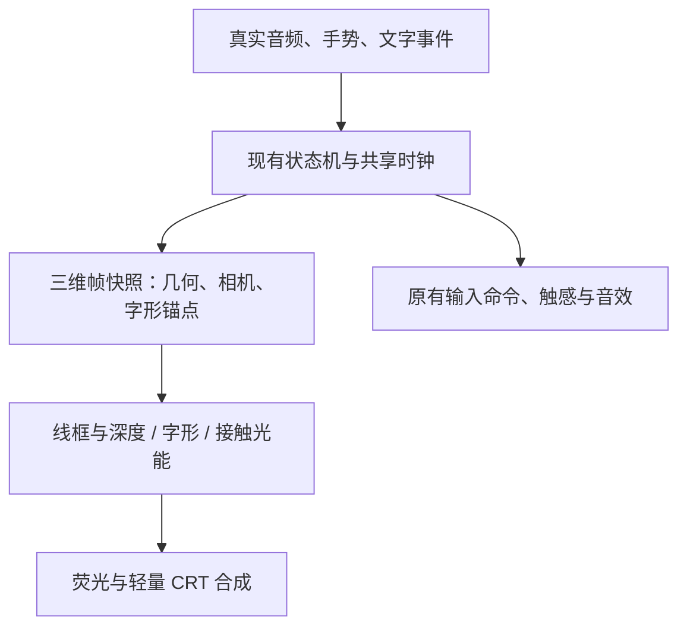

# 恶魔低语：波形真 3D 与完整动效迁移评估

日期：2026-10-27
分支：`codex/ui-phosphor-wireframe`
阶段：原生架构评估；另有独立 WebGL 2 视觉原型，尚未实现或测量新的 iOS 3D 渲染器。

## 结论

推荐采用 **SwiftUI 基础 UI + 自定义 Metal 三维声场渲染器**。将现有频谱、解析弹簧、文字生命周期和事件时序保留为驱动层，升级它们产生的空间几何与显示层。

真 3D 的验收依据是：主体顶点、文字锚点和空间关系具有真实 x/y/z；使用统一的相机与投影；具有可验证的前后深度；从调试侧视角观察时仍然是连续的空间结构。正交相机同样可以渲染真 3D，投影方式可按手机交互需求选择。

「完整保留」以交互行为、触发顺序、动力学参数、动效阶段和视觉预算为基准。新投影带来的大小、透视和遮挡需要校准，不能把视觉像素完全一致作为三维升级的承诺。

## 现有工程中可以保留的部分

| 当前模块 | 已有能力 | 迁移方式 |
| --- | --- | --- |
| `SpectrumAnalyzer` / `SpectrumPresentation` / `SpectrumResponse` | FFT、44 段对称展示、真实音量门限、连续速度的起落响应 | 保留输入与平滑模型，驱动三维截面的半径、形态与亮度 |
| `StringMotionStore` / `StringSpring` | 固定端、非中心受力、跟手锚点、解析回弹、首次过中线触发 | 保留控制状态与解析时间；提供三维中心线形变 |
| `StringClearStretch` / `StringClearFeedback` | 上拉删除、长距离顶部清空、缩径与回位、触感时序 | 保留进度与时序；将拉伸、缩径与透明度映射到三维几何和字形 |
| `ReceiverFlowStore` / `ReceiverFlowSurface` | 增量文字、触点发射源、飞入、附着、释放和逐帧管理 | 保留文字生命周期；三维锚点替换二维 `Ring.point` |
| `WaveformInkStore` | 落点亮弧、短促火花、完整接触位置、蓄力和释放光能 | 使用同一圆环局部坐标生成三维亮弧与接触标记 |
| `ReceiverFlightLayout` / `ReceiverArrowFlight` | 长文本密度预算、整批高初速释放、随机扇形、空气阻力、字形变化 | 保留屏幕观感基准，扩展空间轨迹并校准投影后的速度与字号 |
| `ReceiverShutter` / `WaveTextRenderer` | 字形图集、后台字形生成、批量 Metal 绘制、居中快门曝光 | 保留图集与字形级曝光；每个子采样求三维姿态和投影 |
| `SpectrumStore` | 单一显示时钟、动态刷新率、40 秒保持与 4 秒渐隐、后台暂停 | 新场景继续由同一时钟显式驱动 |

当前 `TorusGeometry.Ring` 由 `CGPoint`、二维半径和旋转描述，主图由 Canvas 画椭圆，文字附着也是二维点。文字已经使用 Metal，但这并不等于主体已经具有三维几何。

## 几何方案：沿可拉伸中心线排列的三维截面

沿现有弦方向设置 44 个截面。每个截面使用真实空间圆环或可调椭圆，半径由当前频谱及已有静态饱满度控制；截面之间可加入少量纵向连线，形成可辨认的声场线框体。

基本表达：

```text
C(s,t) = 弦在三维空间的中心线
P(s,θ,t) = C(s,t) + rN(s,t)·cos(θ)·N(s,t) + rB(s,t)·sin(θ)·B(s,t)
```

- `s` 表示沿弦的位置，`θ` 表示截面上的角度。
- `C` 的受力形变沿用当前固定端函数和实际锚点；渲染器读取同一时刻的拉力、速度与回弹进度。
- `N/B` 是截面局部坐标基。使用连续平行移动的标架，避免弦接近直线或发生反弯时截面突然翻转。
- `rN/rB` 保留频谱峰谷、呼吸、蓄力伸缩、极限上拉缩径等现有形态参数。
- 首版每个截面可先使用 64–96 个角度采样，即约 2,800–4,200 个基础采样点；纵向连线数量单独控制，避免过密。
- 模型由程序生成，拓扑静态缓存，每帧只更新驱动参数和必要的标架/顶点数据。无需离线制作 44 个独立模型。

初版使用稳定的轻斜视相机，比较正交和弱透视。正常操作保持相机稳定；调试模式提供侧视和旋转以核验真实空间结构。两端固定点在屏幕上的位置作为校准约束。

## 手势与三维模型如何对齐

手指仍在屏幕平面操作。通过相机逆投影，将触点映射到稳定的交互平面，再求弦上的锚点与位移。屏幕上的拉伸阈值、回车/删除判定和顶部清空区域继续由当前交互逻辑决定。

需要统一以下转换：

1. 底部录音条触点 → 发射源的屏幕坐标。
2. 屏幕触点 → 交互平面 → 弦锚点与拉伸量。
3. 三维圆环位置 → 投影后的文字落点与局部反馈位置。
4. 顶部清空区域 → 允许延伸的场景视口与最终接触进度。

相机、投影、字形和几何读取同一份帧快照，避免画面更新与文字附着相差一帧。首次过中线仍由解析弹簧判定并消费，网络输入、音效与触感不等待 GPU 完成回调。

## 文字如何完整迁移

### 飞入和附着

- 文字记录 `ringIndex + angle`，位置由新的三维截面采样函数求出。
- 字形继续使用现有高清 CoreText 图集，采用位于三维空间、朝向相机的字片；字形有空间位置和深度，中文字形保持正面可读。
- 飞入终点每帧跟随真实锚点，保留现有轨迹节奏、缩小过程和落点反馈。
- 附着后与模型共用三维形变，不单独估算一条屏幕椭圆。
- 背面与远处文字采用有下限的亮度、字号和遮挡策略；需要原型比较，避免密集中文字变成噪点。

### 拉弦与发射

- 张力驱动所有保留的接触位置，继续保留局部亮弧、蓄力呼吸和释放短闪。
- 实际首次向上过中线时整批释放，继续保留高初速、扇形散射、简化空气阻力和字号变化。
- 将现有屏幕速度、散射范围和投影字号作为约束，校准三维方向、深度变化与相机；透视不能再次造成字形突然变巨大或堆叠。
- 保留现有长文本显示预算：完整正文保留；弹射视觉字形根据文字量和屏宽抽样，当前上限 64。
- 快门仍为 60fps 动效基准下的 180°、居中曝光。每个字形子采样重新计算三维姿态、投影、缩放和透明度，继续沿用字形级批量曝光预算。

## 渲染组织



建议把主体与文字合入同一个 Metal 场景输出，SwiftUI 继续负责外层布局和基础控件。

- **线框**：采用具有真实三维端点与深度的线段，投影后扩展为抗锯齿细带，保持稳定的屏幕线宽。前后线条通过深度/朝向区分亮度，形成可调的透视线框效果。
- **深度**：验证深度壳或线框深度策略；背线可低亮度透出，视觉不依赖大面积实体填充。
- **文字**：复用字形图集与曝光算法，将提交阶段改为可嵌入统一命令缓冲的绘制 pass。现有字体生成代际管理、串行工作队列和预乘透明度需继续保留。
- **发光**：清晰线芯与可控荧光分层；先比较降采样光晕纹理，再决定分辨率和 pass 数。
- **CRT**：在最终材质阶段加入轻扫描纹与低强度颗粒；中文与系统状态栏的处理范围单独控制。
- **时钟**：采用显式提交，继续由 `SpectrumStore` 驱动。MTKView 可配置为手动绘制，也可延用当前 CAMetalLayer 方式；不会再建立独立动画时钟。

MetalKit 提供手动绘制、深度附件和绘制节奏配置。[MTKView 文档](https://developer.apple.com/documentation/metalkit/mtkview)

## 技术路线取舍

| 路线 | 评价 |
| --- | --- |
| 自定义 Metal | 推荐。现有图集、快门曝光和共享时钟可继续使用，便于统一线框、文字、深度、发光与复古后处理；需要自行实现相机、几何和合成管理 |
| RealityKit | 可行。其低层 mesh 可以频繁更新，并可由 Swift/Metal 更新数据；本项目还需额外验证与既有字形曝光、渲染节奏和完整后处理链的衔接成本 |
| SceneKit | 新增此类核心渲染模块不优先考虑。Apple 已宣布弃用并进入维护阶段 |

以上推荐依据本项目已有的 Metal 资产与动效结构，不是对不同引擎作通用性能排名。[RealityKit LowLevelMesh](https://developer.apple.com/documentation/realitykit/lowlevelmesh) · [Apple 对 SceneKit 的说明](https://developer.apple.com/videos/play/wwdc2025/288/)

## 完整动效验收表

| 动效/状态 | 必须保留的标准 |
| --- | --- |
| 待机 | 饱满的静态轮廓、微呼吸、局部 HUD 动效、40 秒保持与 4 秒渐隐 |
| 录音 | 真实频谱峰谷与当前起落响应，保持 44 段映射 |
| 非中心拉弦 | 两端固定、触点跟手、锚点移动、拉力与阻尼连续 |
| 回弹发射 | 首次向上过中线仅触发一次；弹簧、音效、触感和释放保持同一时序 |
| 上拉删除/清空 | 长距离延展、缩径、齿感、顶部接触、断开/消隐与回位 |
| 文字飞入 | 发射源跟随录音触点，末尾异步文字继续使用最后来源，缩小并落到移动的三维锚点 |
| 文字附着 | 拉伸和回弹时位置吻合，落点亮弧与火花在同一表面 |
| 蓄力 | 全部保留的文字和接触位置响应张力，释放后光能衰退 |
| 文字弹射 | 整批高初速、散射、阻力、旋转、字形变化、居中快门与长文本密度预算 |
| 打断 | 重新触摸、弹窗、后台、断线、禁用功能等继续取消待发动作 |
| 可访问性 | 减少动态效果时保留清楚的静态状态和必要操作反馈 |
| 真 3D | 侧视角仍有连续几何，文字锚点与几何一致；正常相机与手势映射吻合 |

## 主要风险与验证顺序

风险集中在投影后的跟手感、极限上拉时的截面标架、透明线框与中文的深度关系、文字曝光与新 bloom 叠加后的清晰度。几何采样数量相对可控；GPU 开销还取决于字形曝光覆盖面积、透明叠加和后处理分辨率，需以真机测量为准。

建议分步落地：

1. 用现有记录/合成频谱驱动纯几何 3D 原型，验证正视、侧视、固定端和完整拉伸范围。
2. 接入同一物理状态和手势映射，逐项对齐回弹、删除、清空和打断行为。
3. 迁移文字锚点与字形曝光，完成整条飞入—附着—蓄力—弹射链。
4. 加入蓝橙荧光与复古显示材质，再测清晰度、GPU 时间和静置行为。

对比模式使用同一不可变输入快照或离线重放。输入命令只由唯一的状态机消费，避免比较两套 renderer 时重复触发实际动作。

在实现前冻结当前动效基准；实现后复用并扩展现有 `test-receiver-flight.sh`、`test-ios-standby.sh` 与协议/手势检查。新增投影/逆投影一致性、锚点误差、截面连续性、深度与裁切测试。先以稳定 60fps 为基础目标，再在支持设备上验证 120Hz；此处为验收目标，尚非性能实测结果。
