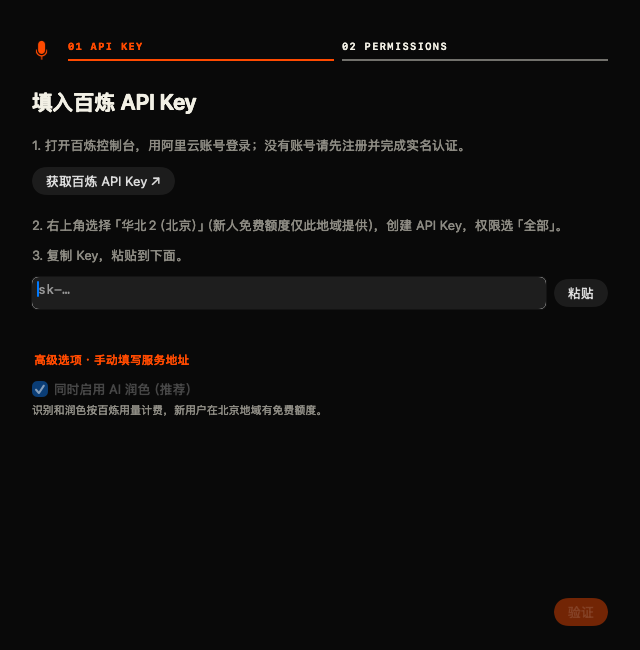
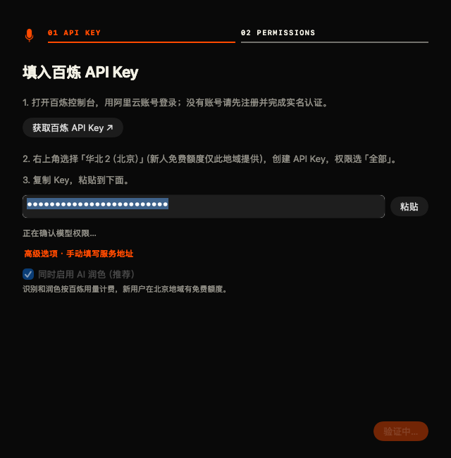
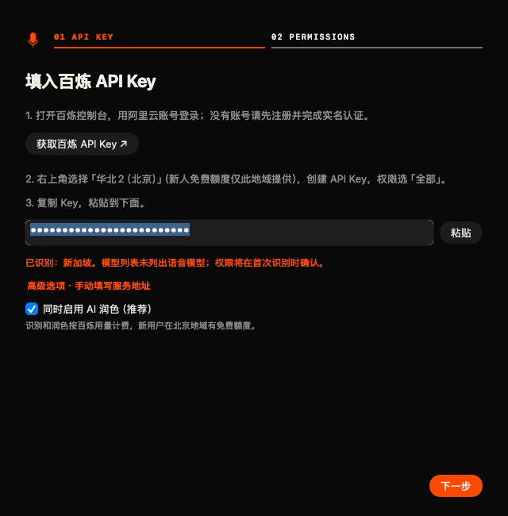
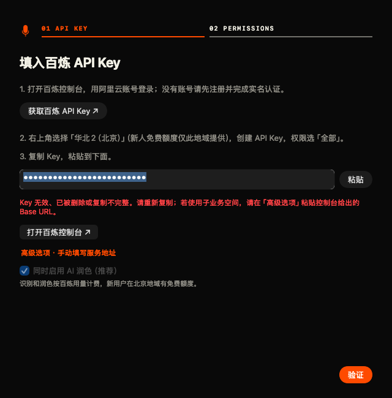
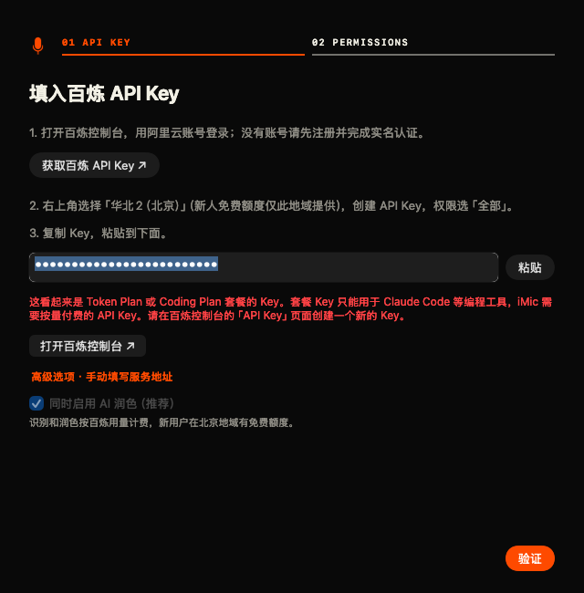
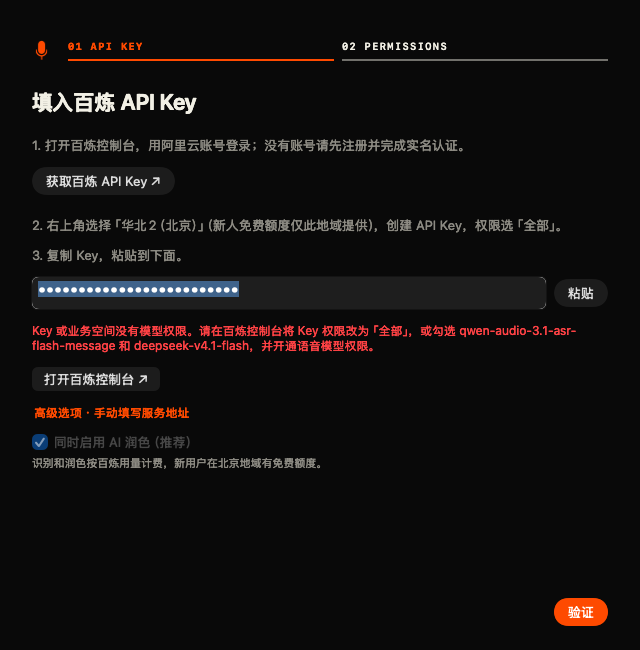
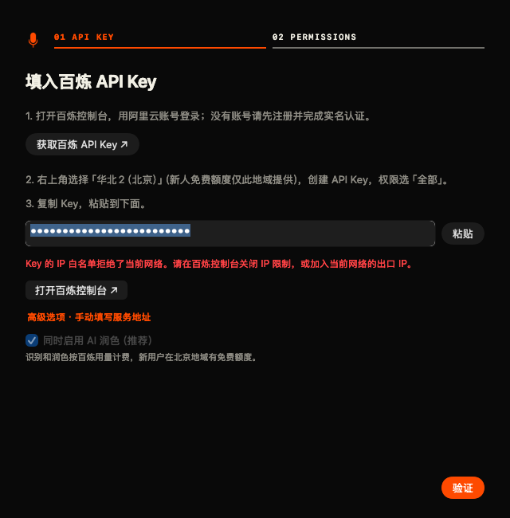
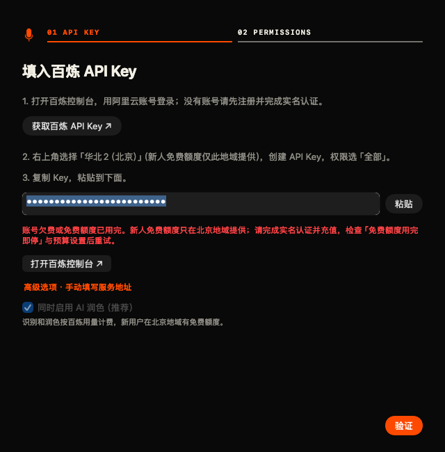
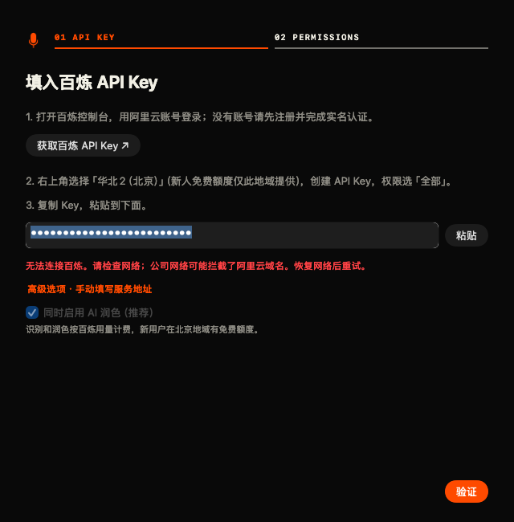
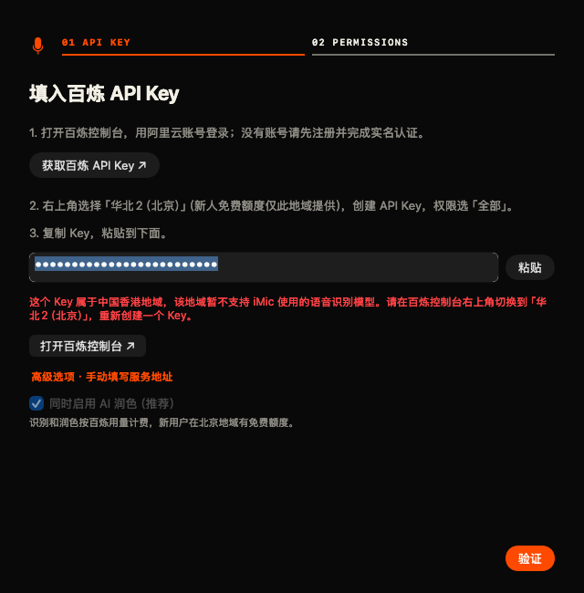

# 百炼新用户接入：调研与验证报告

查阅与测试日期：2026-10-31（Asia/Shanghai）。分支：`codex/bailian-onboarding`；PR base：`codex/ui-phosphor-wireframe`；起点：`815b49a`，已 fetch 核对 base。

## 实现与边界

- 向导和「设置 → 百炼」共用 `BailianDiscovery`：Key 停止编辑 450ms 后自动验证，并发只读查询北京、新加坡、香港、弗吉尼亚的官方 `/models`；7.8 秒墙钟截止并取消尚未完成的请求。禁用所有重定向，不发送音频、文字或付费推理。
- 唯一成功地域同步保存识别和润色地址；多个成功地域不猜测，提示手填 Base URL。香港、弗吉尼亚等未支持语音的地域给出切换北京、重建 Key 的说明。部分地域网络失败时，仍可采用唯一返回 200 的地域。
- Key 仅清理外层空白、CRLF、成对引号与 `DASHSCOPE_API_KEY=` / `export DASHSCOPE_API_KEY=`；保留原有 `sk-`、长度和字符集限制，不执行 shell 表达式。
- 官方共享、业务空间与三地域试用域名共用白名单。HTTPS / WSS、443、固定路径，拒绝用户信息、query、fragment、套餐域名和任意主机。识别真正发起连接前也执行白名单检查。
- 缺少润色模型时保存配置并关闭润色，向导仍可继续；模型列表缺少语音模型时明确标明权限将在首次识别确认，不能把列表查询成功描述成语音权限验证成功。
- 错误分类优先读取顶层或嵌套 `error.code`；IP 拒绝共用 `access_denied` 时只在内存中识别响应 message，绝不展示或记录原文。实际语音 `task-failed`、HTTP 握手错误、润色失败复用提示；需要控制台操作的错误有控制台按钮。
- 不修改协议、版本、菜单、设置「通用」页或 `scripts/build-mac.sh`；不安装、不发布、不覆盖 `/Applications/iMic.app`。Mac 二进制仅位于本 worktree 的 `build/mac.noindex/iMic.app`。

## 调研结论（对应任务书第 3、8 节）

以下仅来自公开官方文档，没有注册账号或登录控制台；文档查不到的内容标为“文档未说明”。

| 议题 | 2026-10-31 核对结论与依据 |
| --- | --- |
| 创建按量付费 Key | 仍需在 API Key 页选地域并按需创建；归属主账号、默认业务空间是默认选项，权限建议「全部」，自定义可以限制 IP / 模型；不能创建时联系超级管理员或业务空间管理员。文档没有明确承诺新账号会自动生成 Key。[获取与配置 API Key](https://help.aliyun.com/zh/model-studio/get-api-key) |
| 地域隔离 | 每地域的 Key、域名和模型列表独立，不能混用；Key / Base URL 还需同一计费方案。[API Key](https://help.aliyun.com/zh/model-studio/get-api-key)、[Base URL](https://help.aliyun.com/zh/model-studio/base-url) |
| 新注册个人账号默认地域 | **文档未说明**，不根据中国站/国际站猜测；也未登录控制台验证。向导仍按任务书明确指导用户选择北京。[API Key](https://help.aliyun.com/zh/model-studio/get-api-key) |
| 新用户默认看到的域名 | **文档未说明**。官方推荐生产使用业务空间专属域名，临时测试可用试用域名，共享域名仍可用；推荐不等于控制台默认显示。[Base URL](https://help.aliyun.com/zh/model-studio/base-url) |
| 三类按量付费域名 | 共享域名仍是北京、新加坡、香港、弗吉尼亚四个；业务空间域名列出六个地域；试用域名仅北京、新加坡、香港。**修正任务书的推测：共享域名文档明确支持跨业务空间 Key，专属域名才限所属业务空间 Key**。业务空间授权错误仍提供手填 Base URL 和匹配 Key 的恢复入口，不把共享域名一概说成不支持子空间。[Base URL](https://help.aliyun.com/zh/model-studio/base-url) |
| 语音模型地域 | 模型价格/限流和 WebSocket 地址均只列**北京、新加坡**。其他地域文档未列出支持；本次产品按这两个地域开放。共享地址可继续使用，官方推荐迁移到业务空间专属地址。[模型信息](https://help.aliyun.com/zh/model-studio/qwen-audio-3-1-asr-flash-message)、[WebSocket 接入指南](https://help.aliyun.com/zh/model-studio/qwen-asr-message-websocket-api) |
| 套餐使用限制 | Base URL 文档仍明确 Token Plan、Coding Plan 仅用于 AI 工具交互式使用，不能用于后端服务；本次全部拒绝，不请求套餐接口。[Base URL](https://help.aliyun.com/zh/model-studio/base-url) |
| 套餐 Key 前缀 | 官方 **Token Plan 团队版**快速开始明确 `sk-sp-`，Coding Plan FAQ 也明确 `sk-sp-`，不能用该前缀区分两个套餐。未找到“Token Plan 一定 `sk-ws-`”的官方依据，不能给出此结论。实现只在所有探测端点均 401 后，对任务书指定的 `sk-sp-` / `sk-ws-` 显示“看起来是套餐”的排查提示；前缀本身不阻止有效地域的成功结果。[Token Plan 快速开始](https://help.aliyun.com/zh/model-studio/token-plan-team-quickstart)、[Coding Plan FAQ](https://help.aliyun.com/zh/model-studio/coding-plan-faq) |
| 新人免费额度 | 北京地域、有效期 90 天仍准确。**更新**：当前额度文档写的是开通前须实名认证、未认证不发放额度；用完自动按量付费，可开启用完即停；ASR 模型还需在业务空间逐一开通权限。[新人免费额度](https://help.aliyun.com/zh/model-studio/new-free-quota) |
| 未实名认证时具体 code | **文档未说明“所有未实名认证请求”的唯一 code**。错误码文档把未开通百炼归为 `AccessDenied.Unpurchased`，并提示开通时可能要求实名认证；不能将其断言为所有未实名请求的固定返回。[错误码](https://help.aliyun.com/zh/model-studio/error-code) |
| 免费额度耗尽时具体 code | `AllocationQuota.FreeTierOnly` 的说明涵盖未认证新用户额度耗尽、或开启用完即停且额度耗尽两种情况；欠费是 `Arrearage`。这与当前额度文档的实名开通要求存在历史口径差异，应分别保留，不推断现行新账号实测结果。`Throttling.AllocationQuota` 也用于 Token 限流，不能仅凭含 quota 就说是欠费。[错误码](https://help.aliyun.com/zh/model-studio/error-code) |
| 控制台链接 | 继续使用任务书的 `https://bailian.console.aliyun.com/?tab=model#/api-key`；没有在未登录条件下确认更可靠的北京专属深链，未替换。 |

### 模型权限与空 WebSocket 任务

没有本机可用 Key，**无法实测 `/models` 是否列出两个模型，也无法实测列表能否反映 Key 自定义权限**。因此实现采用保守降级：缺少语音条目不判定 Key 不可用，提示首次识别时确认；缺少润色条目则默认关闭润色，允许稍后在设置开启。

[模型信息](https://help.aliyun.com/zh/model-studio/qwen-audio-3-1-asr-flash-message)列出输入/输出 Token 计费，[WebSocket 接入指南](https://help.aliyun.com/zh/model-studio/qwen-asr-message-websocket-api)描述 `run-task → task-started → finish-task`，**未找到“空任务必定免费”的明确保证**。按任务书 4.2，未实现、未执行空任务探测，验证阶段仅发 GET；首次真正识别失败复用准确错误提示。

## 真实接口实测（任务书第 7 节）

**未实测**。只检查了允许的本机 `DASHSCOPE_API_KEY` 和 `~/Library/Application Support/iMic/credentials.json` 的 `keys.bailian`，均未发现 Key；没有读取其他凭据来源，没有请求别人提供 Key，也没有发送任何真实认证请求。

| 计划检查 | 结果 |
| --- | --- |
| 北京 `/models` 的 HTTP / code / 两个模型是否在列表 | 未实测：无本机 Key |
| 新加坡 `/models` 的 HTTP / code / 两个模型是否在列表 | 未实测：无本机 Key |
| 香港 `/models` 的 HTTP / code / 两个模型是否在列表 | 未实测：无本机 Key |
| 弗吉尼亚 `/models` 的 HTTP / code / 两个模型是否在列表 | 未实测：无本机 Key |
| 故意写错 Key 的实际 401 响应 | 未实测：无本机 Key；401 和套餐启发提示有 URLProtocol 单元测试 |
| WebSocket 空任务及账单验证 | 未实现、未执行：无法确认必定免计费 |
| `./scripts/test-link.sh` 真实识别 | 跳过：无本机 Key，按任务书允许的降级交付 |

## 自动化测试报告

耗时为命令墙钟耗时（含编译；独立检查可并发运行）。测试日志只含合成凭据、状态和断言，不含真实 API Key。

| 命令 | 结果 | 耗时 | 关键输出 |
| --- | --- | --- | --- |
| `DEVELOPER_DIR=/Applications/Xcode.app/Contents/Developer swift test` | 通过（exit 0） | 19.84s | 69 tests，0 failures |
| `./scripts/test-polish.sh` | 通过（exit 0） | 4.05s | 28 tests，0 failures |
| `./scripts/test-mac-settings.sh --capture-onboarding=docs/reports/bailian-onboarding/screenshots` | 通过（exit 0） | 18.63s | 原生设置/向导交互通过；11 张截图；真实偏好与凭据指纹未变化 |
| `./scripts/test-input.sh` | 通过（exit 0） | 2.46s | 21 tests，0 failures |
| `./scripts/build-mac.sh` | 通过（exit 0） | 30.65s | 构建及 codesign --verify --deep --strict 通过；仅 build/mac.noindex |
| `./scripts/test-asr.sh` | 通过（exit 0） | 3.31s | 11 tests，0 failures |
| `python3 tools/check-site.py` | 通过（exit 0） | 0.07s | PASS: 2 HTML pages, 39 files；资源预算通过 |
| `IMIC_SITE_URL=<本 worktree 独立本地 HTTP 服务> node tools/test-site-browser.mjs` | 通过（exit 0） | 21.46s | 28/28 browser checks passed（含新增 FAQ 断言） |
| `./scripts/test-link.sh` | 跳过 | — | 本机允许来源没有 Key；未启动识别或创建账号 |

新增/补充的测试覆盖：

- 空白、换行、制表符、Windows CRLF、中英文成对引号、两种环境变量赋值的清理；拒绝其他变量赋值、未闭合引号、shell 表达式、内部空白与 header 注入。
- 共享/业务空间/三地域试用地址；拒绝套餐、外域、伪后缀、坏业务空间主机、HTTP、非 443、用户名密码、错误路径、query、fragment；Base URL 推导出两个相同主机的地址；实际 ASR 发起请求前同样拦截。
- URLProtocol 模拟唯一新加坡 200、多个 200、全部 401、其他地域超时、全部网络错误、限额拒绝、香港/弗吉尼亚不支持、错误 JSON、缺语音/润色模型、手填业务空间/试用域名。
- 所有地域挂起时，确认四个请求都已启动，并在注入的 80ms 截止内返回；取消的验证不回调；所有重定向一律拒绝。
- 各类 code 优先于 HTTP 的分类、嵌套错误体、IP message 只用于分类而不回显、运行中识别与向导共用提示。
- 原生 AppKit：粘贴带 export 和 CRLF 的 Key 后，无需点击验证即自动清理、验证、采纳，并启用「下一步」；设置页验证、拒绝草稿、关闭保留/放弃、外部 Key 不拷入文件、预览不改真实偏好/凭据等回归。
- 官网浏览器新增 FAQ 三步骤、北京、实名认证、全部权限和套餐限制断言；在本 worktree 的独立 HTTP 服务上运行。

执行中记录：首次润色/ASR 回归暴露了旧断言和假主机 fixture 与新规则不符，已更新断言、保留注入 transport 的离线测试；最终全部通过。第一次 Mac 构建在源文件被本次编辑改动时中断（36.53 秒，`input file ... was modified during the build`），停止改动源文件后重新构建通过。

## 实际错误提示清单（对应 4.4）

所有内容均为本地固定文案，不回显远端 body、Key 或 error_message。

| 情况 | 实际提示 |
| --- | --- |
| 所有地域 401，普通 Key | Key 无效、已被删除或复制不完整。请重新复制；若使用子业务空间，请在「高级选项」粘贴控制台给出的 Base URL。 |
| 套餐地址，或所有地域 401 且疑似套餐前缀 | 这看起来是 Token Plan 或 Coding Plan 套餐的 Key。套餐 Key 只能用于 Claude Code 等编程工具，iMic 需要按量付费的 API Key。请在百炼控制台的「API Key」页面创建一个新的 Key。 |
| 地域不支持语音（示例：中国香港） | 这个 Key 属于中国香港地域，该地域暂不支持 iMic 使用的语音识别模型。请在百炼控制台右上角切换到「华北2（北京）」，重新创建一个 Key。 |
| 403 / 模型授权不足 | Key 或业务空间没有模型权限。请在百炼控制台将 Key 权限改为「全部」，或勾选 qwen-audio-3.1-asr-flash-message 和 deepseek-v4.1-flash，并开通语音模型权限。 |
| IP 白名单拒绝 | Key 的 IP 白名单拒绝了当前网络。请在百炼控制台关闭 IP 限制，或加入当前网络的出口 IP。 |
| Arrearage / FreeTierOnly / 账单或预算限制 | 账号欠费或免费额度已用完。新人免费额度只在北京地域提供；请完成实名认证并充值，检查「免费额度用完即停」与预算设置后重试。 |
| 未开通百炼服务 | 账号尚未开通百炼服务。请在百炼控制台完成实名认证、同意服务协议，并开通所需语音模型后重试。 |
| 网络错误或探测超时 | 无法连接百炼。请检查网络；公司网络可能拦截了阿里云域名。恢复网络后重试。 |
| 业务空间不存在或拒绝访问 | Key 与业务空间地址不匹配或没有该空间权限。请在「高级选项」粘贴控制台给出的 Base URL，并使用该空间自己的 Key。 |
| 多个地域成功，无法唯一识别 | 多个地域接受了这个 Key，无法唯一识别。请在「高级选项」粘贴百炼控制台给出的 Base URL。 |
| 限流（包括 Token 配额速率限制） | 请求触发百炼限流。请稍后重试，或在控制台检查并发与用量限制。 |
| 内容检查失败 | 百炼内容检查未通过。请调整识别内容后重新录音。 |
| 无效或不受支持的服务地址 | 服务地址不受支持。请粘贴百炼官方按量付费 Base URL（HTTPS、443 端口、/compatible-mode/v1），不要填写套餐地址或其他主机。 |

设置页保留「获取百炼 Key」按钮。向导及实际识别中需要去控制台的错误附「打开百炼控制台」按钮；网络错误提供重试/重新录音说明。运行中的 WebSocket 握手若只提供 HTTP 状态、没有可读取 code，按 401/403 兜底；收到 `task-failed` 后按 code 进一步细分。

## 原生界面截图

截图由 `./scripts/test-mac-settings.sh --capture-onboarding=docs/reports/bailian-onboarding/screenshots` 生成，使用实际 AppKit 视图绘制；`DEBUG` 专属状态注入只使用合成 Key，不触发网络、权限弹窗或真实凭据保存。下列是界面状态预览，**不是实际账号验证截图**。已检查长错误文案完整换行、按钮可见、没有截断或重叠。

| 初始 | 验证地域中 |
| --- | --- |
|  |  |

| 模型确认中 | 成功并显示新加坡地域 |
| --- | --- |
|  |  |

| 无效 Key | 套餐 Key |
| --- | --- |
|  |  |

| 无模型权限 | IP 白名单 |
| --- | --- |
|  |  |

| 欠费或额度用尽 | 网络失败 |
| --- | --- |
|  |  |

## 交付约束核对

- README 只在「开始使用」第一步加指定提醒；官网只改目标 FAQ。
- `shared/iMicLink.swift`、协议测试/文档、版本、Mac/iOS 发布配置、设置「通用」页、菜单、`build-mac.sh` 均未修改。
- 仅构建当前 worktree 内应用；没有运行安装脚本、注册/登录阿里云账号、修改 TCC 或申请权限。
- 只向工作分支提交并推送，PR base 指定 `codex/ui-phosphor-wireframe`；没有合并、开启自动合并、改 GitHub 设置或发布。
- Pages workflow 只监听 base 分支 push；此次工作分支 push 不触发部署。
