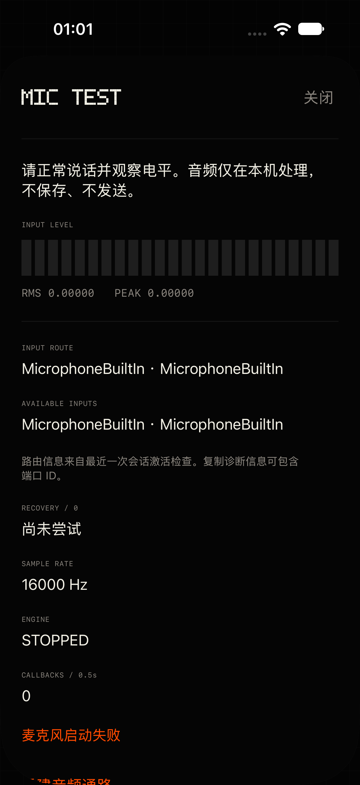
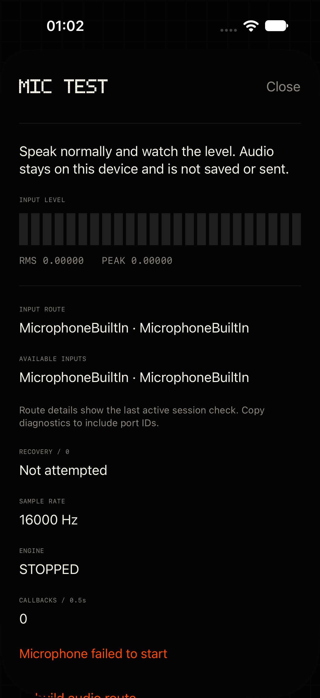
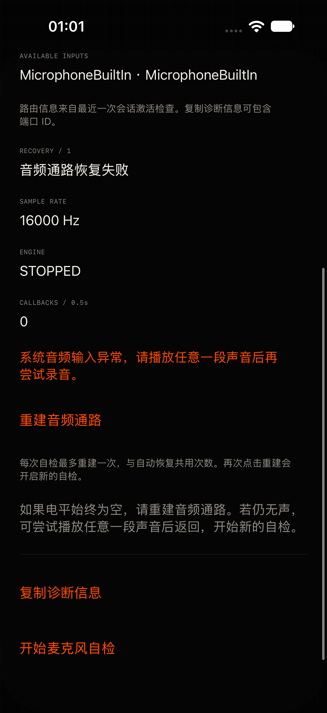
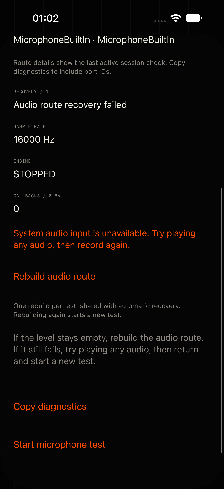

# 失效输入路由的单次恢复

会话激活成功但输入路由为空/悬空，或采集持续数字静音时，iMic 现在最多尝试一次不输出音频的 playback 切换与引擎重建。MIC TEST 增加路由快照、手动恢复及失败后的明确指引。

日期：2026-11-03。基础分支：`codex/ui-phosphor-wireframe`，本次从 `origin` 最新提交 `862436f` 新建 `codex/ios-mic-route-recovery`，没有继续使用已合并的 #23 分支。

## 根因说明与证据边界

**用户真机观察（尚未在本环境复现）**：iOS 27.0.1 故障发生时，微信、钉钉及语音输入法等均无声，相机录像正常；音频会话激活成功且亮橙灯，但输入列表为空或指向已不存在端口，输入样本全零；播放一段声音后相关 App 恢复。以上是本次恢复设计的线索，不是本次模拟器测试得出的系统根因。

**已核实的代码缺口**：#23 在激活后读取输入节点格式，但没有把 `currentRoute.inputs` 与 `availableInputs` 核对。它的静音重试只重新激活原录音类别、新建引擎，没有经过 playback。因此旧实现不能识别“会话激活成功但输入路由无效”，也没有尝试用户所观察到的类别切换路径。

**已核实的 API 行为**：[currentRoute](https://developer.apple.com/documentation/avfaudio/avaudiosession/currentroute) 提供当前输入/输出端口，[availableInputs](https://developer.apple.com/documentation/avfaudio/avaudiosession/availableinputs) 受 category/mode 影响，playback 类别下为空；所以校验仅在 playAndRecord 激活之后执行。[mixWithOthers](https://developer.apple.com/documentation/avfaudio/avaudiosession/categoryoptions-swift.struct/mixwithothers) 支持 playback，允许与其他音频混音；[QA1631](https://developer.apple.com/library/archive/qa/qa1631/_index.html) 建议重新配置期间避免 notify-others 后立即重新抢占。[oldDeviceUnavailable](https://developer.apple.com/documentation/avfaudio/avaudiosession/routechangereason/olddeviceunavailable) 表示旧输出路径不再可用，不意味着当前输入必然失效，因此本实现会重新读取输入路由再判断。

**未确认的部分**：没有找到 Apple 官方资料确认这个特定的 iOS 27.0.1 故障，也不能证明系统相机与其他 App 的内部录音链路差异。跨 App 同时失败、播放后恢复支持“系统输入路由/音频服务状态异常”的推断，但不是底层 audio graph 故障的直接证明。切换 playback 是有界的恢复尝试，Apple API 不保证这会修复系统状态。本次不构建、不安装真机包，实际恢复率和对其他 App 的影响需由用户按下方清单验证。

## 行为与实现

- 普通录音及 MIC TEST 冷启动都在 `setActive(true)` 之后、访问输入节点格式之前检查输入。输入为空，或任一输入的 UID/端口类型不在 `availableInputs` 中，即判失效；`availableInputs == nil` 也按无法核验处理。名称不参与身份校验。引擎启动后再次核验，热启动再次按住时也立即检查。
- 每次按住最多一次恢复。初始失效路由、约一秒无回调/无样本/原生全零、失效路由通知及手动自检共用当前轮预算。首次开启监测不会重置启动阶段已经使用的预算；健康热窗口的下一次按住才重新计次。
- 恢复顺序：停止 IO、断开并丢弃旧 engine/sink/converter、停用会话（中间不 notify-others）→ `.playback / .default / .mixWithOthers` 激活后立即停用 → 恢复 `.playAndRecord / .measurement / .defaultToSpeaker`、16 kHz 偏好与 10 ms 缓冲偏好 → 激活、新建引擎、重新核验实际输入路由/格式。不配置播放节点或播放器，不创建音频文件、不投递音频缓冲，也不添加定时等待；恢复本身不播放提示音。
- “路由通过校验”只进入“路由已重建，请说话检查电平”，直到非零原生 RMS/峰值到达才显示“已检测到输入信号”。重建清除旧电平，不能用上一代电平证明成功。第二次静音、路由仍失效或恢复抛错立即终止，不自动循环。
- 恢复失败中英文提示：**“系统音频输入异常，请播放任意一段声音后再尝试录音。” / “System audio input is unavailable. Try playing any audio, then record again.”** 主屏继续使用 #23 的“打开麦克风自检”入口。已有识别文字沿用现有取消保留逻辑。
- `.oldDeviceUnavailable` 重新读取当前输入与可用端口；按住/自检期间路由确实失效则恢复。当前输入仍健康且身份/格式未变化时不额外切换；健康输入已换为另一设备则沿用安全结束本轮的行为。空闲热窗口只释放，避免无用户请求时激活 playback。
- MIC TEST 显示端口类型/名称、无输入路由、可用输入列表、恢复次数/结果、采样率、引擎状态和电平。失败停用后保留最近一次激活时的路由快照，并明确标注“最近一次会话激活检查”，不把停用后的空列表当成故障证据。复制包含原始 UID、端口类型/名称、availableInputs、当前轮恢复次数、结果和电平元数据，不含音频。
- “重建音频通路”在本次预算未使用时直接执行同一路径；若本次预算已用，**再次点击明确开启新的自检**，新一轮在创建普通采集引擎之前就执行一次重建，仍不允许随后静音再重建一次。只有用户的显式点击能开启这轮，没有后台重试循环。按钮在启动、权限等待或重建期间禁用，关闭/离开前台后不接受迟到手动请求。
- 录音、恢复、停用仍共用 #23 的串行 lifecycle 队列与代际过滤；旧配置/失败/电平回调不作用于新引擎。正常模式保留 measurement、实际原生格式和 16 kHz 转换链路，不修改协议、配对、加密或引导。

### SessionModel.swift 改动点

仅 `startAudioEngine()` 的启动完成处理：对 `CaptureRouteError` 保留明确的中英文系统输入异常提示，避免统一替换成“麦克风启动失败”；同时使用 `if let error` 解包。没有改动引导、练习模式、权限准备或其他状态机逻辑，便于 #25 合并。

其他改动集中在 `AudioCapture.swift`、`AudioCaptureController.swift`、`MicrophoneTestView.swift`；两份 Mac 字符串文件为统一词条生成器的同步产物。

## MIC TEST 截图

本任务专用 iPhone 18 Pro / iOS 27.0 模拟器，真实界面截图。模拟器不提供可靠麦克风输入，截图中的无电平/格式失败不能证明真机系统路由故障，也不能作为自动恢复成功的证据。实际日志显示 currentRoute 与 availableInputs 的内置麦克风 UID 匹配，手动点击确实完成 playback 激活/停用及 capture 配置恢复，随后因原生输入格式不可用而终止；没有将这种格式失败误报为输入 UID 失效。

| | 简体中文 | English |
| --- | --- | --- |
| 路由与可用输入 |  |  |
| 手动恢复与诊断 |  |  |

## 测试结果

仅使用本任务新建的专用模拟器 `iMic Route Recovery QA`：`3F70BA68-8144-40E9-A9BB-F7C4D32314FF`。iOS 构建均使用 `iphonesimulator` 和 `CODE_SIGNING_ALLOWED=NO`，无真机构建、安装或 Personal Team 签名发布 ID；验证结束后已关闭并删除专用模拟器。

| 命令 | 结果 |
| --- | --- |
| `DEVELOPER_DIR=/Applications/Xcode.app/Contents/Developer swift test` | PASS，74 tests，0 failures |
| `./scripts/test-ios-audio.sh` | PASS，94 项生产控制器断言（含 #23 原有覆盖） |
| `./scripts/build-ios.sh` | PASS，`IMIC_SIM_DESTINATION=platform=iOS Simulator,id=3F70BA68-8144-40E9-A9BB-F7C4D32314FF`，禁止签名 |
| `./scripts/test-ios-standby.sh` | PASS，指定上述专用模拟器；40 秒保持、淡出/恢复、闲置零回调、Reduce Motion、手势、文字与可见性检查 |
| `python3 tools/check-l10n.py` | PASS，中英文、占位符、生成资源与中文常量检查 |
| `xcodebuild … -only-testing:iMicUITests/MicrophoneTestUITests … test` | PASS，中英文最终 2 tests，覆盖两次显式手动重建、复制诊断、关闭与设置入口 |

新增断言覆盖空路由、孤立 UID、同 UID 不同端口类型、名称变化、nil/空 availableInputs、失效路由启动时恢复、旧引擎停止/停用与 playback/新启动顺序、恢复后等待非零电平、清除旧电平、重新核验仍失效、playback 操作抛错、与静音共用预算、首次监测不重置预算、MIC TEST 手动恢复及显式新自检、格式启动失败后手动恢复、关闭后拒绝迟到手动请求、oldDeviceUnavailable 的健康/失效输入、空闲窗口不自动恢复、热按住立即核验、复制信息字段。保留 #23 的中断/媒体重置/配置变化/无回调/精确零/极弱非零/旧代回调/阻塞启动与 stop-start 竞争测试。

## 用户真机验证清单（本任务未执行）

由用户运行 `./scripts/install-ios-device.sh` 安装开发版，确认 ID 为 `art.malette.imic.dev`。发布 ID 仅允许团队 `5H39F98ND4`，脚本保护不绕过。每步保存 MIC TEST 复制信息与 `./scripts/pull-ios-log.sh` 日志（多设备用 `IMIC_DEVICE_UDID` 选择）。重点查看 `activated input-route`、`invalid-input-route`、`route-recovery`、`silent-capture` 及恢复后的 UID/电平；日志没有录音内容。

1. **正常基线**：在 iOS 27.0.1 正常按住说话三次，包含五秒热窗口内再次按住。路由应非空且 UID 在 availableInputs 中，波形与识别正常，没有无故进入 playback；每次关闭自检/热窗口到期后停止采集。
2. **用户故障再次出现时先看 MIC TEST**：不要先播放声音或重启手机。记录当前路由与 availableInputs；如为空或 UID 已不存在，先复制故障快照，再点“重建音频通路”（若本轮自动恢复已用，按钮会开启明确的新自检）。核对日志只有本轮一次恢复，输入路由重新出现且属于可用端口；正常说话确认 RMS/峰值变化和“已检测到输入信号”。随后回主屏按住，确认识别恢复。
3. **普通录音自动恢复**：故障时直接按住，检查 initial invalid-route 或约一秒数字零/无回调后发生一次 playback 切换，恢复后有电平与文字。若初始路由重建已用一次，但仍然全零，应直接提示失败，不能再次自动切换。
4. **恢复仍失败**：确认出现明确系统音频输入异常提示及 MIC TEST 入口；复制恢复结果和次数。用户再手动播放任意一段声音，回 iMic 开始新的自检并说话，对比路由、电平与其他受影响 App。记录是否只有真实播放有效、仅类别切换不足；不要把提示理解为一定能恢复。
5. **耳机/设备移除**：录音过程中拔出有线耳机或断开 AirPods。oldDeviceUnavailable 后若系统已给出健康内置输入，不应误判空路由；输入确实悬空/为空时应只尝试一次重建。新路由有效后再次按住能录；若只更换输出且输入未变，不应无故重建。
6. **静音与预算**：若能自然复现数字零，保持按住至少三秒，核对最多一条 attempt=1；不把安静房间的微弱底噪当作数字零。在 MIC TEST 手动恢复后继续观察，仍无输入不得追加自动恢复；再次点击按钮必须是新的用户自检轮次。
7. **其他 App 与声音**：另一 App 播放音乐时启动一次自检/恢复，确认恢复本身没有提示音、噪声或实际音频输出，playback 过渡使用混音且没有不必要的反复暂停/恢复。正常录音类别恢复对音乐的系统行为单独记录，不能保证其他 App 都自动继续播放。
8. **中断、后台及竞争**：恢复/录音期间来电、Siri，关闭自检、切后台、快速松开再按住。不能自动复活已取消录音或在后台继续重建；下一次用户操作可重新采集；中断/路由变化后已识别文字保留，旧一代停用不会打断新一代。
9. **双语与诊断**：中文及英文（含美国地区）检查“无输入路由”、端口名称/类型、恢复状态、按钮、失败指引和复制内容；长端口名可完整换行。复制应含 UID、availableInputs、恢复次数/结果，截图/日志不含音频。关闭后再次打开仍能诊断。

验收重点是“路由有效 + 原生非零电平 + 实际录音/识别恢复”，会话激活成功、橙灯亮或仅创建新 engine 都不足以证明故障消失。
