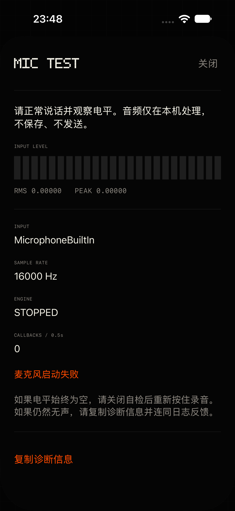
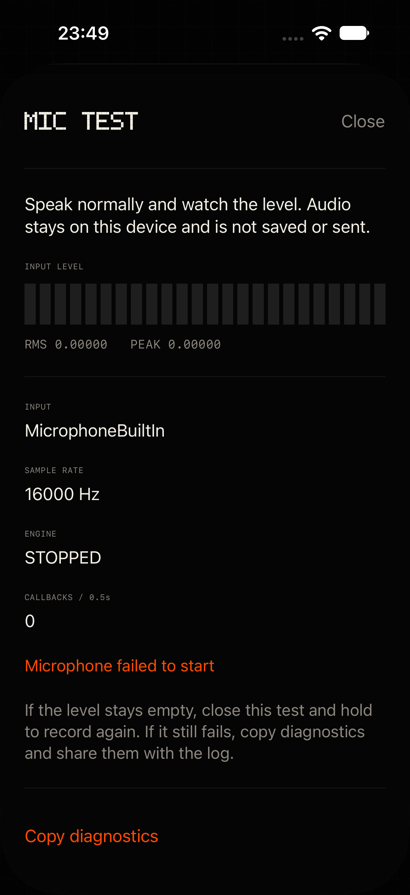

# iPhone 麦克风无声排查与修复

日期：2026-11-02。基线：`269ad67`（`codex/ui-phosphor-wireframe`）。工作分支：`codex/ios-mic-silence`。

## 根因结论与五项假设

**确认了采集生命周期的缺陷，尚不能确认用户手机上具体是哪一个系统事件触发了无声。** 原代码把 `AudioCapture.requested` 当作可复用引擎的依据；这个值不代表引擎仍有输入。热启动窗口会把已被系统中断、停止或改过配置的对象保留至下次按住。没有输入电平与无回调诊断，界面只能显示请求录音的状态。此次没有操作真机，模拟器启动失败或静音不能证明真机根因。

按任务书先在原生 bridge 工作线程加入电平统计，再检查五项假设，最后接入生命周期修复；统计不在实时 IO 回调中执行，不写入任何音频内容。

| 假设 | 验证及结论 |
| --- | --- |
| 1. 中断后会话失活、热启动仍复用 | **代码缺陷确认，真机触发待验证。** 基线只维护 `requested`，没有中断观察者；`SessionModel.startAudioEngine()` 在这个布尔值为真时直接复用。Apple 明确说明中断 began 时会话已经不再 active。注入中断开始/结束测试验证：当前轮结束、热引擎释放、结束通知不会自动恢复；下一次用户操作重建。 |
| 2. 输入路由/配置变化停止引擎 | **代码缺陷确认，真机触发待验证。** 基线没有路由及引擎配置观察者。Apple 说明硬件通道数/采样率变化会让引擎停止并解除初始化，旧连接仍保留原格式。测试覆盖输入身份/实际速率变化、当前引擎配置通知、旧引擎迟到通知、热窗口及 active capture；同输入且仍健康的自身激活路由通知不会误取消。 |
| 3. 偏好 16 kHz / 激活前读格式 | **激活顺序错误已排除；没有证据表明偏好值本身导致无声。** 基线已在 `setActive(true)` 后读取 `inputNode.outputFormat`，sink 使用实际原生格式，`AVAudioConverter` 在工作线程转 16 kHz 单声道 PCM16。保持这个顺序与转换路径，新增会话速率、原生速率、通道数诊断。Apple QA1631 说明偏好是提示，必须激活后查询实际值。假硬件用 48 kHz 验证控制器不假定会话等于 16 kHz；真实硬件转换仍列入真机验证。 |
| 4. 旧 stop 的停用影响新 start | **未复现基线所假设的硬件停用乱序。** 基线本来已有串行 lifecycle 队列，正常 start/stop 的硬件操作按 FIFO 执行。问题是状态/完成回调与新增恢复路径需要共同隔离。现在激活、启动、重试、停止、停用共用同一个队列，主线程请求代数过滤迟到完成，控制器 epoch 过滤旧 meter/failure/config 通知。测试强制阻塞旧启动，同时排入 stop/start，验证最后一次新启动之后没有旧停用；也覆盖旧失败回调和重试启动失败。不能把未复现的竞争写成已确认根因。 |
| 5. measurement 处理/增益偏小 | **没有完全无声的证据，不更换模式。** Apple 说明它减少系统信号处理并关闭部分 dynamics processing，并非说明会把输入置零。保留 `.measurement`。静音检测在原生浮点/整数 PCM 上判断精确零，测试 `1e-12` 非零电平不触发静音；PCM16 量化后的零不会被误当作数字静音。实际说话电平与识别效果需要用户真机核对。 |

Apple 依据（2026-11-02 核对）：[音频中断](https://developer.apple.com/documentation/avfaudio/avaudiosession/interruptionnotification)、[引擎配置变化](https://developer.apple.com/documentation/avfaudio/avaudioengineconfigurationchangenotification)、[实际采样率与偏好 QA1631](https://developer.apple.com/library/archive/qa/qa1631/_index.html)、[媒体服务重置 QA1749](https://developer.apple.com/library/archive/qa/qa1749/_index.html)、[measurement 模式](https://developer.apple.com/documentation/avfaudio/avaudiosession/mode-swift.struct/measurement)。

## 改动

- `IMicAudioInputBridge` 在非实时 worker 上统计原生 RMS、峰值、是否全零、样本是否存在，每 0.5 秒报告。IO 线程仍只有原有有界队列、拷贝和原子操作。原有回调/帧数/最大间隔日志保留。
- `AudioCaptureController.swift` 为实际生产使用的控制器，可注入 NotificationCenter、硬件包装和单调时钟。中断开始、当前引擎配置变化、实际输入身份/速率变化、媒体服务重置都丢弃当前引擎，取消本轮并释放热窗口。中断结束不自动录音；回前台丢弃未核验的热窗口或不健康引擎。前台允许下一次用户请求，避免 App 被挂起时漏收 interruption ended 后永久锁住。
- 录音/自检期间连续约一秒无输入回调、无样本或原生全零，记录 `iphone.audio silent-capture`，新建 engine/sink/converter 并重新激活会话，最多一次。第二次静音或重试启动失败安全终止，提示“没有收到声音 / No audio received”；已有本地识别文字沿用现有取消保留逻辑。新一轮按住重置预算，热待机不自动重试；跨热窗口的报告只累计本次按住时间。
- 旧对象先停止 IO、断开 sink、同步排空 worker，再释放 converter/内存和停用会话；所有后续启动等待该串行操作结束。旧代完成/失败/电平/引擎通知不能终止新代；取消时同步关闭非实时 PCM 投递门，旧 worker 排空不能喂给新一轮 SpeechPreview。
- `MicrophoneTestView.swift`：设置顶部增加 `MIC TEST`，错误状态也能直接打开；打开自检时暂停被遮住的主屏动画。实时电平、输入名称、采样率、引擎状态、回调数及一键复制诊断；音频既不保存也不发送，不启动 Speech/识别/波形留档。与正式录音共用一个采集 owner/队列，避免自检和旧热窗口互相停用；关闭或离开活跃状态即停麦，返回后需手动再次开始。
- 启动失败、通知、路由比较、失效、静音、重试、停用错误均记录日志。bridge 内部详细错误保留日志，用户错误提供中英文。协议、配对、加密、引导逻辑、版本号未修改。Mac 两份字符串是统一词条生成器的同步产物。

### SessionModel.swift 改动点（供引导任务合并）

仅修改 `// MARK: - Permissions / first press` 的录音生命周期部分：

1. `startAudioEngine()`：冷启动和复用热引擎时开启本轮静音监测。
2. 新增 `microphoneTestCapture()`：取消正在录音的一轮、调用现有 `deactivateAudio()` 清理热窗口，再把同一采集 owner 交给自检。
3. `updateAudioStandby()`：按住时开启监测，热待机关闭监测。保留原五秒 lease 与 150ms 预录策略。

未改权限准备、练习模式、引导状态或文字/网络处理。现有 `handleAudioFailure`/`endListening(cancelled: true)` 负责保留本地文字和取消远端本轮。

## 自检截图

专用模拟器 iPhone 18 Pro / iOS 27.0，中文 `zh-Hans / zh_CN`、英文 `en / en_US`，中文为 DEBUG 直达、英文为实际设置入口实拍界面（不是生成的假电平）。该环境的会话可报告 16 kHz，但 `inputNode.outputFormat` 不可用（日志为 `Microphone format unavailable`），截图显示安全失败状态；不能据此判断 iPhone 的麦克风故障。另：该模拟器在 DEBUG 直达和设置入口截图中均曾偶发部分图层未绘制，控件语义/操作仍通过；重新打开后取得了中英文完整截图。尚不能确认此绘制现象是否仅限模拟器，已在真机清单加入完整显示复核，不能把语义测试通过等同于每一帧绘制都正常。

| 简体中文 | English |
| --- | --- |
|  |  |

## 测试报告

仅使用本任务创建的 `iMic Mic Silence QA`（`54E6FFF1-FC16-43D6-8D7D-C1A63BBE0D46`）。所有 iOS 构建均为 `iphonesimulator`、`CODE_SIGNING_ALLOWED=NO`；未构建、安装或签名任何真机包。验证完毕已关闭并删除此模拟器；为排查截图兼容性另外创建但未启动的专用 iOS 27.1 模拟器也已删除。

| 命令 | 结果 |
| --- | --- |
| `DEVELOPER_DIR=/Applications/Xcode.app/Contents/Developer swift test` | PASS，74 tests，0 failures |
| `./scripts/build-ios.sh`（`IMIC_SIM_DESTINATION=platform=iOS Simulator,id=54E6FFF1-FC16-43D6-8D7D-C1A63BBE0D46`） | PASS，模拟器 Debug，禁止签名 |
| `IMIC_SIM_NAME=54E6FFF1-FC16-43D6-8D7D-C1A63BBE0D46 ./scripts/test-ios-standby.sh` | PASS，40 秒保持、淡出/恢复、空闲零回调、Reduce Motion、手势/文字/飞行/可见性 |
| `./scripts/test-ios-reconnect.sh` | 默认端口首次在前台绕过退避超时，第二次在初始加密配对超时；保留失败记录。`IMIC_RESUME_TEST_PORT=47954 ./scripts/test-ios-reconnect.sh` 独立端口复测 PASS：健康复用 22ms、失效重连 871ms、保留新缓冲录音、前台绕过退避 179ms。没有修改重连/协议代码。默认端口失败的确切环境原因未确认。 |
| `./scripts/test-polish-link.sh` | PASS，真实加密链路的设置确认、终端保留、Mac 更改同步、旧 Mac 兼容 |
| `python3 tools/check-l10n.py` | PASS，中英文词条、占位符、生成资源一致，无新增未审查中文常量 |
| `./scripts/test-ios-audio.sh`（新增） | PASS，48 项断言；注入通知、假硬件、假时钟，运行生产控制器 |
| `xcodebuild … -only-testing:iMicUITests/MicrophoneTestUITests … test`（新增） | PASS，中英文 2 tests，检查复制、关闭、设置入口；模拟器没有声音不判为真机回归 |

新增控制器断言覆盖：active/warm 两种状态下四类通知；中断后不自动启动；前台释放无效热窗口；忽略旧 engine 配置/失败/电平；原生全零、没有回调、极弱非零、连续性重置；一次重试上限、第二次失败提示、重试启动失败；新按住重置重试预算；跨热窗口计时；阻塞启动期间 stop/start FIFO，旧停用不落到新激活之后。

## 用户真机验证清单（本任务未执行）

先由用户运行 `./scripts/install-ios-device.sh` 安装开发版，确认 Bundle ID 为 `art.malette.imic.dev`；发布 ID 只能由团队 `5H39F98ND4` 签名，脚本保护不绕过。每个场景同时查看波形、识别结果与 `MIC TEST` 的 RMS/峰值/设备/速率/引擎状态。异常时点“复制诊断信息”，并执行 `./scripts/pull-ios-log.sh`（默认开发 ID，多设备时设置 `IMIC_DEVICE_UDID`），保留包含 `iphone.audio` 的日志。

| 步骤 | 修复前风险/预期 | 修复后应验收 |
| --- | --- | --- |
| 1. 正常按住说话三次，每次 2–3 秒；包含松手五秒内再按住 | 通常正常；如果之前留有失效引擎，会显示录音却无波形/空结果 | 三次都有随声音变化的电平、波形与文字；热启动可复用健康采集，五秒后停止输入 |
| 2. 打开语音备忘录录三秒，回 iMic 立即按住 | 原代码可能复用被中断或失效的状态 | 下一次按住新建并激活；如系统仍占用音频，明确失败，不能一直假录音；再按住应恢复 |
| 3. 松手五秒内切到另一语音输入 App 录音，再回 iMic 按住 | 热窗口可能扩大旧引擎失效的影响 | 旧热窗口释放，返回不会自动录音，按住重新建立会话；日志可见通知/失效/新启动 |
| 4. 正在录音时接入/断开 AirPods 或有线耳机；再按住 | 无处理时可能继续显示录音、格式过期或无回调 | 输入路由改变时取消本轮，保留已有本地识别文字，停止旧引擎；下一轮用可用输入与实际格式重建。若 AirPods 只改变输出且当前模式仍用内置麦，输入身份不变时可继续；自检应准确显示实际输入 |
| 5. 录音过程中来电或 FaceTime 音频，挂断后再按住 | 会话失活却未取消/恢复 | 中断开始取消本轮、释放热窗口；挂断不自动开麦，用户按住后重新激活并有电平 |
| 6. 若开发者设置可用，用户手动执行 Reset Media Services，再回 iMic 按住 | orphaned engine/converter 没有采集侧重建路径 | 所有采集对象丢弃；不自动录音，下次按住完整设置 category/mode/preferences/active 并新建对象 |
| 7. 快速按下/松开再按住，重复十次；交替普通录音和 MIC TEST | 旧状态/完成可能迟到，缺少统一恢复代隔离 | 没有崩溃/卡死/迟到终止；松手五秒后或关闭自检停止开麦，最新一轮不会被旧停用打断；自检关闭后正式录音正常 |
| 8. 如果再次出现橙灯亮、无电平，保持按住至少三秒并复制诊断 | 原来会一直等空识别/没听清，没有原始输入证据 | 约一秒记录 silent-capture，最多一条 retry=1；仍无输入则结束并显示“没有收到声音”，可直接打开自检。不要用正常低声/安静房间代替数字零复现；环境底噪通常非零，不应触发重试 |
| 9. 每一步后打开设置的 MIC TEST，正常说话再关闭；切后台后回来；也检查英文/美国地区显示 | 原来没有独立自检，难区分输入与识别问题 | 中文及英文（包含美国地区）的所有标签、电平条和数字都应完整显示；电平随声音变化，输入/采样率/引擎真实可读，复制不包含音频；切后台停止自检，返回需手动重新开始；自检不会发送到 Mac 或保存录音 |

未在真机验收前，不承诺已消除所有设备特有静音问题。新增诊断可以区分数字零、没有回调、引擎停止、输入格式/路由与非零低电平，下一份真机日志可据此确定具体触发条件。
