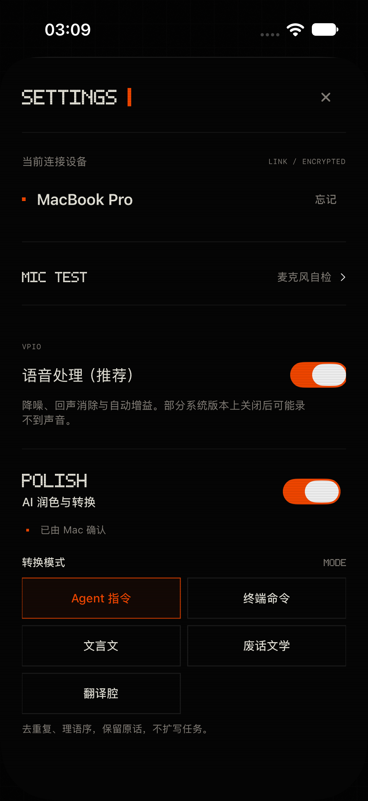
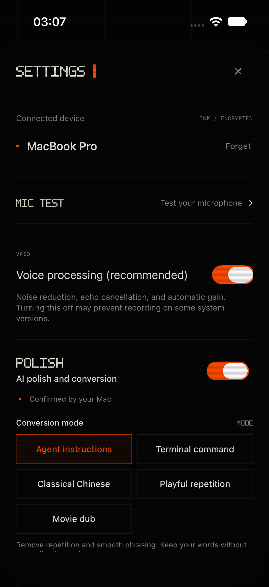
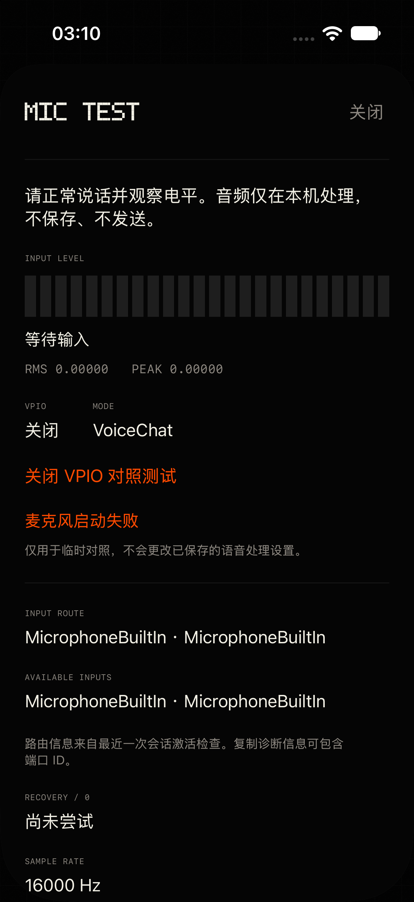
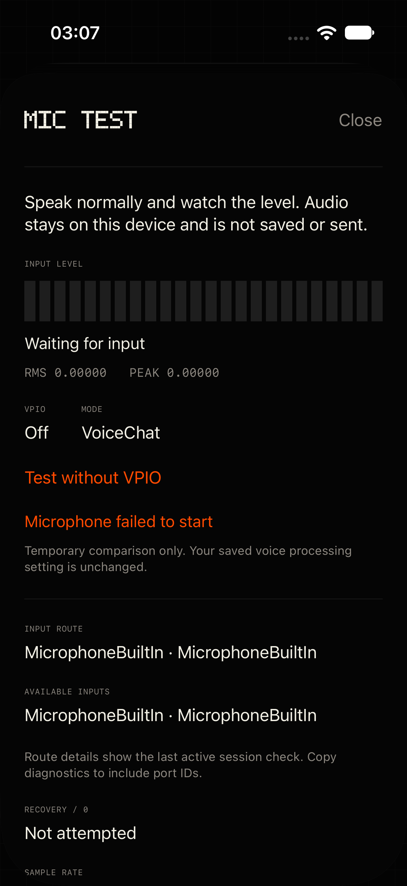

# iPhone 默认 VPIO 与低电平兜底

基础提交 `8fe74a5`；分支 `codex/ios-vpio-default`；仅在本任务指定的新 worktree 工作。参考现场分支 `claude/mic-quick-test` 的 `6ae69b0`，没有合并该分支。

## 根因与证据边界

任务书记录的用户真机结果：iPhone 16 Pro / iOS 27.0.1 在 measurement、default、voiceChat 三种会话模式及各内置麦克风数据源上均只有 RMS 约 0.0002、峰值约 0.0008，输入路由有效、样本非零；真正启用 VPIO 后恢复，关闭又复现。这些是用户现场观察，本环境没有复现该设备的原始通路故障，不能据此宣称已确认 iOS 内部实现或硬件根因。此前“输入路由失效”的猜测不能解释这组有效路由、非零底噪的结果。

本次已核实的代码问题：正式版只设置 measurement，没有调用 `setVoiceProcessingEnabled(true)`；#27 把任何峰值大于零的恢复数据都判为 `signalDetected`，会将上述底噪误报为成功。现在默认真正启用 VPIO，且只有达到正常阈值才确认恢复。

## 配置、生命周期与兜底

- 默认 `.playAndRecord / .voiceChat / .defaultToSpeaker`；关闭设置仍为原有 `.playAndRecord / .measurement / .defaultToSpeaker`。不显式增加 `.allowBluetoothHFP`，沿用已有路由选项，避免本次另行扩大蓝牙选择策略；voiceChat/VPIO 自身造成的系统路由差异仍需真机核对。
- 顺序：配置会话 → 激活并核验输入路由 → 检查 VPIO 所需硬件输入/输出可用性 → 访问 main mixer → `setVoiceProcessingEnabled(true)` → 保持 AGC 开、bypass 关 → 配置最小闪避 → **重新读取 inputNode.outputFormat** → 用实际格式连接现有 sink/converter → 启动。VPIO 失败向上返回，不悄悄退回失效的原始通路。
- VPIO 可能改变采样率、声道；仍由已有 `IMicAudioInputBridge` 按实际格式转为 16 kHz 单声道 PCM16。main mixer 只满足 VPIO 输出侧依赖，不连接任何播放器/音源，不投递播放缓冲；恢复本身没有可听声音。
- iOS 17+ 设置 `enableAdvancedDucking=false`、`duckingLevel=.min`，读取并记录实际配置及 `minApplied`；AGC 明确开启，回声处理不 bypass。[Apple ducking 文档](https://developer.apple.com/documentation/avfaudio/avaudioinputnode/voiceprocessingotheraudioduckingconfiguration)、[AGC 文档](https://developer.apple.com/documentation/avfaudio/avaudioinputnode/isvoiceprocessingagcenabled)。日志/复制诊断包含实际 VPIO、mode、格式、闪避和电平判定。
- 新偏好键 `imic.audio.voiceProcessing.enabled`，默认 true，完全忽略诊断版旧键 `micDebug.voiceProcessing`。设置变更在下一次按住时应用，旧配置的热窗口不会被继续复用。
- 只在正式录音按住期间：RMS < 0.001 **且** peak < 0.003，整次按住一直低于阈值并持续约 1.5 秒，判几乎无声。只累计属于本次按住的时间；一旦出现正常电平，后续停顿不触发该兜底。全零/无回调仍保留约 1 秒原有看门狗。
- 原始通路低电平/数字静音时，停止并丢弃引擎，直接切到 VPIO、新建引擎，不依赖 playback“踢醒”。与路由重建、全零重试和手动恢复共用每次按住一次预算；先被其他恢复消耗后不能追加 VPIO 尝试。中断、路由变化、媒体服务重置、停止/开始代际过滤继续沿用原控制器；重建保持当前处理配置。
- 选择任务书允许的“成功后直接保存开启并说明”：**只有本次仍按住、VPIO 重建后的电平达到正常阈值才保存**，并提示“已自动开启语音处理以恢复录音”。底噪、启动失败、松手后才到达的正常样本均不触发保存。这样下一次不会重新进入已确认失效的原始通路，用户仍可在设置关闭。
- `lowLevel` 与 `signalDetected` 分离。VPIO 仍几乎无声或恢复预算已用完则结束并提示“没有收到声音，请打开 MIC TEST 检查麦克风”，主屏沿用已有 MIC TEST 入口。

## MIC TEST 与音效

- 默认读取保存设置；显示实际 VPIO、当前 mode、正常/几乎无声/全零/等待输入。临时按钮只改变本次自检状态，不写 UserDefaults；关闭再打开重新读取设置。为了对照，MIC TEST 不因微弱非零输入自动切 VPIO或终止；原有失效路由/数字静音恢复保留。没有 MODE / MIC 数据源诊断行。
- 复制包含原有输入端口 UID、类型、availableInputs、恢复次数/结果，以及 VPIO、mode、实际格式、闪避、RMS/峰值/分类。自检不启动 SpeechPreview/ASR，PCM 只做电平处理并丢弃，不保存、不发送。
- 首次授权弹窗会使自检进入停止状态；临时 VPIO 按钮现在能从该状态显式重新取得采集实例启动，不再静默无效。离开前台仍停止，不自动恢复旧请求。
- 已核对 `SoundDesign` 使用 AudioServices 系统声音，不改 AVAudioSession、不共用采集 AVAudioEngine；保留录音前后 `setAllowHapticsAndSystemSoundsDuringRecording(true)`。**代码核对通过不代表已验证音效听感、音乐音量或回声消除效果**：模拟器不能证明这些行为，真机需核对音效音量、首播延迟、是否压掉，以及是否进入识别结果。本次没有改 SoundDesign/触感。

### SessionModel.swift 改动范围

仅 `startAudioEngine()` 录音生命周期：下一次按住检查热引擎配置是否与保存设置相符；不符则停止旧引擎并清理 pre-roll；增加经代际校验的兜底成功提示。没有改动引导、练习或其他业务流程。

## 验证

只运行用户指定的精简检查，没有运行 standby、polish、link 联调或全量 UI 回归。全部 iOS 构建均指定 iphonesimulator / `CODE_SIGNING_ALLOWED=NO`，无真机构建、安装或 Personal Team 签名。

| 检查 | 结果 |
| --- | --- |
| `DEVELOPER_DIR=/Applications/Xcode.app/Contents/Developer swift test` | PASS，74 tests，0 failures |
| `./scripts/test-ios-audio.sh` | PASS，141 项注入断言；包含原有生命周期/路由/竞争覆盖及 VPIO 开关配置、启动顺序、格式、重建保持、阈值/时间/停顿、兜底、共享预算、失败、默认/迁移、临时设置隔离 |
| `./scripts/build-ios.sh` | PASS，指定本任务专用模拟器，unsigned iOS Simulator |
| `python3 tools/check-l10n.py` | PASS，中英文、格式、生成资源与中文常量检查；新增词条标记 ios-only，Mac 资源没有改动 |
| `xcodebuild … -only-testing:iMicUITests/VoiceProcessingUITests … test` | PASS，1 个定向 UI 用例覆盖中英文两轮，0 failures；验证默认值、开关、复制、重启持久化、退出自检恢复保存值（96 秒） |

专用模拟器：`iMic VPIO QA 20261103` / iPhone 16 Pro / iOS 27.0，UDID `47E7966F-065F-463F-BD6F-358C5E392CA2`。验证结束后已关闭并删除（仅此 UDID）。

模拟器日志显示：会话 `inputChannels=1`、`sessionRate=16000`、路由有效，但输入节点硬件侧格式为 **0 ch / 0 Hz**。直接调用 VPIO API 会在内部连接图时抛出 Objective-C 异常；现在先检查输入节点硬件侧 `inputFormat` 与输出侧格式，不可用则安全返回格式失败。用于 sink 的 **outputFormat 仍只在 VPIO 启用之后读取**。截图因此显示实际 VPIO 关、VoiceChat 模式、启动失败（请求 VPIO 开并不等于实际启用成功）；复制还包含 `requestedVPIO`。没有伪造正常电平或 VPIO 成功；这些截图不能当成真机恢复证据。中文截图在界面布局完成后用 simctl 重新截取，避免首帧未绘制的 Canvas。

| | 简体中文 | English |
| --- | --- | --- |
| 设置 |  |  |
| MIC TEST |  |  |

## 给用户的真机验证清单（由 Claude 使用 .dev Bundle ID 安装）

1. 新安装及升级后确认“语音处理（推荐）”默认开，旧诊断版曾关闭也应开。正常按住说话三次，Mac 识别与本地预览正常；MIC TEST 显示实际 VPIO 开、voiceChat、电平正常，复制诊断确认真实格式与 `minApplied=true`。
2. 播放音乐再按住录音：核对音量变化/是否暂停可以接受；开始/结束音效正常、不被压掉或明显延迟；识别中没有音乐和音效，触感不变。如系统路由导致播放变化，记录输出路由与诊断。
3. 在故障手机关闭 VPIO 后按住正常说话：约 1.5 秒后应仅切换一次 VPIO；正常电平确认后提示并保存开。再录一遍直接走 VPIO；若仍低，提示没有收到声音并可打开 MIC TEST。正常手机关闭后能正常录音，已说话后的停顿不触发兜底。
4. MIC TEST 临时关闭 VPIO，对照原始 measurement 的电平，再临时开启比较；复制两种诊断。退出后设置必须保持原值；重新进入自检恢复保存设置。自检不发送、保存或识别音频。
5. 嘈杂环境与轻声说话对比 VPIO 开/关的识别效果、电平与误触发情况，重点验证阈值没有误伤轻声/较晚开口。
6. 插拔耳机、蓝牙切换、来电/中断、锁屏/返回和连续快速按住/松手：不自动恢复旧录音，下一次新请求按当前 VPIO 设置启动；单次恢复预算不循环。记录故障前后 MIC TEST 路由、恢复次数、结果和电平。
