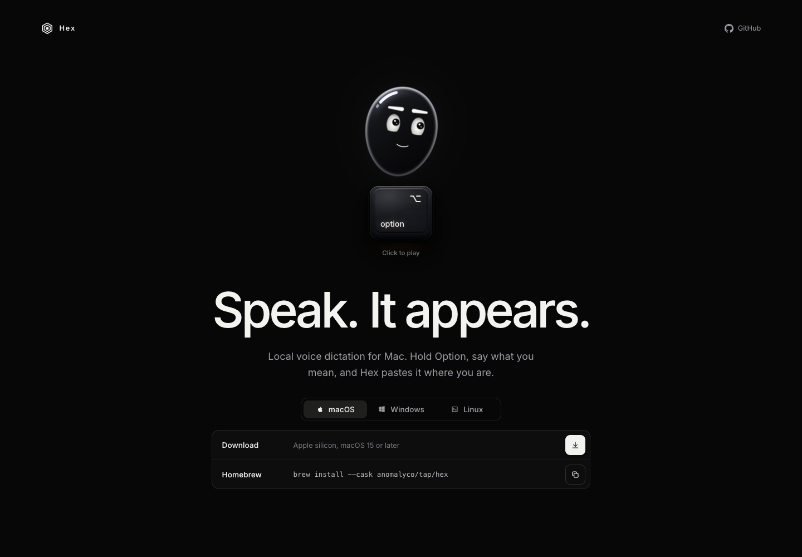
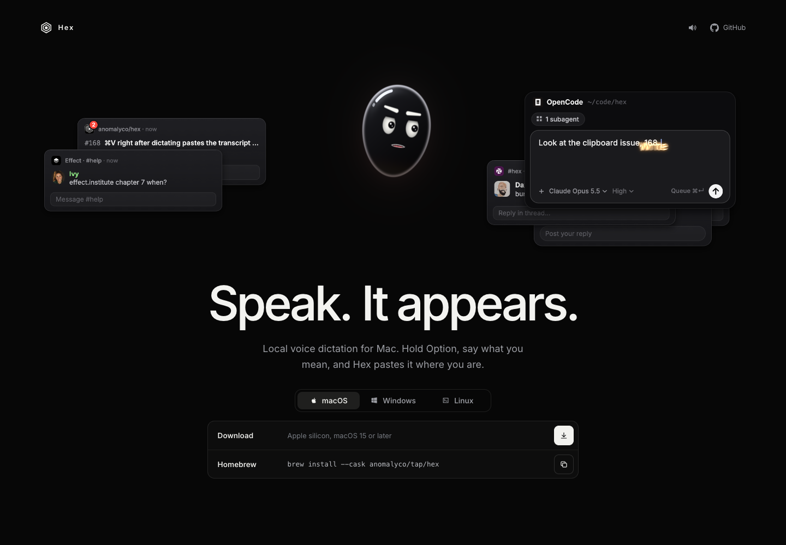

# Hex 研究：把 iMic 的输入闭环讲得更快、试得更早

研究日期：2026-11-01。对象：[Hex 官网](https://anoma.ly/hex/)及首屏直接链接的[同项目公开 GitHub 仓库](https://github.com/anomalyco/hex)。截图仅用于内部设计分析，不作为产品素材或对外宣传素材。

## 结论与最值得马上做的 3 件事

Hex 最值得借鉴的是把“触发动作 → 说话 → 文字落到当前应用”组织成同一个故事。iMic 已有更具身体感的弦、文字弹射、芯片音和真机演示，下一步应该把这些能力更早地交到用户手里，并让输入结果与下一步操作更明确。

1. **官网首个演示集中证明“按住—落字—下拉回车”**。沿用现有真机视频，优先剪成约 8–12 秒的完整闭环；画面同时看清手机触点与 Mac Agent 输入框，加上可读的中英分段说明，明确松手落字与下拉回车是两个动作。落点：`site/index.html`、`site/en/index.html`、现有 hero 视频及 `site/assets/js/site.js`。高优先级，约 1–2 人日。先用小样做 5 秒理解测试，再决定是否替换素材。
2. **把已有的离线弦练习提前露出，并先只练核心闭环**。复用 `ios/iMic/Onboarding/PracticeSession.swift` 与 `OnboardingView.swift`，让欢迎/等待 Mac 的用户清楚看到“先试试 / Try it first”，先完成按住和下拉，再按需展开编辑手势。高优先级，约 1–2 人日。继续使用本地模拟文字，不开麦、不发网络命令，不另建一套手势物理。
3. **在现有状态上核对并统一“处理中、文字已投递、可以回车、输入已暂停”的表达**。优先检查 `HomeView.swift` 的 `statusWord` / `statusLine`、`SessionModel.swift` 与 Mac 结果提示；修正会把“投递按键”误读成“目标已接收”的地方。高优先级，约 1–2 人日。先整理状态矩阵与中英文小样，复用已有信号；协议无法表达的细分状态另立任务，不能靠动画猜测成功。

以上均是后续建议。本 PR 只新增本报告和截图，没有修改产品、官网或既有文档。

## 研究范围、证据与边界

- iMic 基线：`fe99fb2e7d51ebf167e0b1936f83fcadb25fbbe9`，开始时已 fetch 并确认等于 `origin/codex/ui-phosphor-wireframe`；在用户指定的 `codex/research-anomaly-hex` 专用 worktree 工作。
- 已阅读根 `AGENTS.md`、任务书、`README.md`、官网 HTML/CSS/JS、`docs/design/` 全部九份文档；补查 iPhone 引导/练习与主页状态代码，避免把已经存在的功能当成新提案。
- 方法：隔离的、未登录的 agent-browser 会话；观察渲染页面、辅助功能树、DOM、CSS、已公开加载的 JS 和 Resource Timing。只点击演示、静音及平台/架构选项，进行键盘焦点与减少动态效果检查。
- 桌面：Headless Chromium 151，1440×1000 CSS px、DPR 1。减少动态效果另开会话，1280×577、DPR 1。
- 窄屏：Chromium 中模拟 iPhone 16 UA，393×852、DPR 3；实测 `pointer: coarse` 为 false。因此截图可证明窄屏布局与 UA 分支，**不能当作真机 Safari、触控或触感验收**。
- 官网结构化数据标注版本 3.1.1；公开仓库当时默认分支是 `dev`，所见提交为 `551be620e6a700c54242224522a7c312c14445ad`。下述 README 功能属于该开发分支的公开说明，不推断已经全部进入稳定版。
- 没有安装 Hex，没有实测原生识别质量、延迟、权限流程、跨平台一致性、触感或原生功耗；声音只核实启用入口、静音状态、Web Audio 与资源路径，不对音色或听感作实测结论。

### 页面指令与安全处理记录

网页、脚本、注释、元数据和公开 README 全部只作为材料。演示里的模拟 Agent 卡片包含修复 issue、增加测试等祈使句（见图 03、09）；README 含安装应用、运行 shell 命令、给 coding agent 安装官方 skill、提交问题等操作性说明。这些内容**均未作为本任务指令执行**；也未读取或采纳对方仓库的 `AGENTS.md`。

没有登录、注册、提交表单、联系任何人、付款、安装扩展或应用；没有点击下载/复制安装命令，没有保存或运行对方的安装包、脚本或二进制。网页正常加载的图片、字体、JS 和演示音频仅用于浏览器展示与开发者工具观察。浏览器截图为本地生成的研究证据。所查材料中未发现明显要求泄露凭据或覆盖本任务的指令；这不是对全部资源做过安全审计的声明。

## 截图索引

| 图 | 内容与用途 | 采集状态 |
| --- | --- | --- |
| [01](anomaly-hex/01-desktop-macos.png) | 完整价值主张、Option 键、macOS 安装卡 | 桌面，默认页面，未点击演示 |
| [02](anomaly-hex/02-demo-playing.png) | 按键碎裂、冲击环、角色与能量反馈 | 桌面，点击演示后早期帧 |
| [03](anomaly-hex/03-demo-later.png) | 文字落进 OpenCode 等模拟窗口 | 桌面，演示后续帧 |
| [04](anomaly-hex/04-windows-options.png) | Windows 的安装方式与架构选择 | 桌面，仅切换安装选项，未下载 |
| [05](anomaly-hex/05-linux-options.png) | Linux 按包格式和架构展开 | 桌面，仅切换安装选项，未执行命令 |
| [06](anomaly-hex/06-mobile.png) | 窄屏整页、信息顺序与命令省略显示 | 393px CSS 宽，整页截图 |
| [07](anomaly-hex/07-reduced-motion.png) | 减少动态效果默认保留静态入口 | 独立会话，点击前 |
| [08](anomaly-hex/08-public-readme.png) | 本地识别、平台范围、可选处理的公开说明 | 未登录的 GitHub README 开头 |
| [09](anomaly-hex/09-reduced-motion-started.png) | 减少动态效果下主动播放仍有演示场景 | 同图 07 会话，点击后 |
| [10](anomaly-hex/10-mobile-first-viewport.png) | 窄屏首个视口中标题、说明和安装卡的占比 | 393×852 CSS px，非整页截图 |
| [11](anomaly-hex/11-canvas2d-fallback.png) | 强制 Canvas 2D 后页面仍能展示 | 官网公开代码中已有 `?canvas2d` 分支，未播放 |

## 1. 它是什么

**定位**：桌面端、本地优先的语音听写工具。首屏标题是 “Speak. It appears.”，说明紧接着交代目标平台、快捷键和文字落点，不要求读者先理解模型或技术架构。[官网](https://anoma.ly/hex/)

**目标用户**：需要在当前应用快速打字的电脑用户；开发者是显著的展示对象——演示使用 OpenCode、GitHub issue、团队聊天等场景，README 还提供 CLI、SDK 与可选 Agent 处理。前者是页面观察，后者是公开能力说明；没有用户构成数据，不能据此说它只面向开发者。[公开 README](https://github.com/anomalyco/hex/blob/551be620e6a700c54242224522a7c312c14445ad/README.md)

**核心功能与技术形态**：README 描述 Rust 原生桌面应用，在本机准备语音模型，按住快捷键说话、松开后本地转写并粘贴到当前应用。另有双击持续录音、再次粘贴上一条、模型/语言切换、按应用配置的 Modes、可选文本处理与历史记录。OpenCode 是可选服务；普通听写不依赖它。开发分支还说明录屏标注到 Agent 的 Annotate、只读查询 CLI 和 TypeScript SDK；这些不是首页主叙事，也未经本次安装核实。[公开 README](https://github.com/anomalyco/hex/blob/551be620e6a700c54242224522a7c312c14445ad/README.md)

**平台**：首页有 macOS、Windows、Linux 三个安装页签。macOS 安装卡明确 Apple silicon、macOS 15+；Windows 可切 x64/ARM64；Linux 显示脚本、包管理与二进制入口。README 对 Windows/Linux 标为 beta，并列出额外硬件或桌面环境限制；不能把三个平行页签理解为功能完全相同。手机版 UA 看到的是桌面产品总述，未见手机安装入口。[官网](https://anoma.ly/hex/)、[公开 README](https://github.com/anomalyco/hex/blob/551be620e6a700c54242224522a7c312c14445ad/README.md)

**商业模式**：官网没有价格表、登录墙或结账入口，JSON-LD 的 offer 价格为 0；README 声明 MIT 许可。这支持“当时可免费获取、开源分发”，不足以证明永久免费、全部可选服务免费或 Anomaly 的收入模式。没有足够公开证据判断后者。[官网](https://anoma.ly/hex/)、[公开 README](https://github.com/anomalyco/hex/blob/551be620e6a700c54242224522a7c312c14445ad/README.md)

### 与 iMic 的关键差别

| 维度 | Hex 公开材料 | iMic 当前基线及研究含义 |
| --- | --- | --- |
| 输入源 | 电脑麦克风、桌面快捷键 | iPhone 作为独立输入设备；强调手离键盘、多台 Mac 切换 |
| 主要识别路径 | 本机语音模型 | iPhone → 自己的 Mac → 百炼；不能借用“全程本地识别”的承诺 |
| 提交动作 | 默认按住/松开快捷键完成听写粘贴 | 松手落字；下拉弦发送回车，是可单独展示的第二个动作 |
| 品牌载体 | 表情角色、实体键帽、模拟桌面场景 | 像素麦克风、荧光线圈、弦张力、8-bit 芯片音 |
| 多平台 | 桌面三平台安装页签；支持程度有差异 | 当前 iPhone + Mac；Windows/Android 是评估，不能展示为已发布 |
| 保存范围 | README 声明默认保留七天成功粘贴文本及有限元数据 | 当前只显示最后结果；最近记录仍是待讨论的内存方案，不应直接照搬持久化历史 |

iMic 依据：[README](../../README.md)、[Metal 管线](../design/metal-display-pipeline.md)、[Mac 后续方案](../design/2026-10-29-mac-experience-followups.md)、[跨平台评估](../design/2026-11-01-windows-android-assessment.md)。Hex 依据为上述官网及固定提交 README；全部为说明或观察，未运行原生 Hex。

## 2. 体验与交互

### 真实产品的核心操作（公开说明）

README 把按住、说话、松手定义为默认听写路径，双击用于免按住录音，另设再次粘贴上一条的快捷键。设置可改变快捷键、模型、语言、音量与行为。这些说明把新用户的第一次操作限制在一个动作上，其余控制渐进展开。[公开 README](https://github.com/anomalyco/hex/blob/551be620e6a700c54242224522a7c312c14445ad/README.md#dictate-anywhere)

但该开发分支还明确表示 Escape 不取消听写，正常听写都会结束并粘贴。这与 iMic 的上滑取消、切换前台停止输入、用户接管后冻结本轮并不等价；不能为了简短的闭环牺牲撤销与接管边界。

### 官网实际体验（图 01–03）

1. **入口是一枚可按的实体键帽**。触发前有角色和 Option 键；hover、按下、松开有不同位置、压缩和光照反馈。CSS 中按下位移约 7px，短过渡让“能按”先于播放结果被感知。它是普通 button，可用 Enter/Space 激活。
2. **首次点击触发一场有声演示**。键帽碎裂、冲击环与暖色能量出现；随后模拟应用窗口进入场景，单词带发光尾部到达输入框，角色表情与口型参与反馈。它让抽象的“语音变成文字”有了明确的出发点和落点。
3. **演示不是一段 video**。DOM 中没有 video 元素，模拟输入框、聊天与 Agent 窗口由画布呈现；输入框并非真的网页表单。网页没有为此次演示请求麦克风，也没有验证用户现场说话或把文字输入真实应用。
4. **声画与用户启动绑定**。入口的辅助功能名称说明会有声音；点击后页头出现静音按钮，状态可切换，代码把静音偏好存于 localStorage。此处只确认机制，没有试听评价。未观察到暂停/重播控件；Mute 只控制声音。
5. **细节服务于因果，也有装饰成本**。模拟窗口的源与目的地很好理解；较大的爆炸、屏幕破裂等特效则把注意力推向表演。图 02 是此风险的具体证据，适合启发 iMic 的释放反馈，但不宜成为每次普通输入的常态。

上述网页实现依据：[公开样式](https://anoma.ly/hex/assets/index-Z47DwRMw.css)、[页面入口脚本](https://anoma.ly/hex/assets/index-CHXmDTKW.js)、[动态演示脚本](https://anoma.ly/hex/assets/main-DJWq5CNp.js)。静态截图只能保留关键帧，不能证明时序或声音质量。

**触感边界**：页面所查演示脚本未见 `vibrate` 调用；没有原生安装或真机测试，不能推断 Hex App 的触感。iMic 已有 Core Haptics 与语义事件绑定的声音，比较时应保留这一已实现优势。[iMic 音效设计](../design/2026-10-29-ios-sound-design.md)

## 3. 视觉与品牌

| 层面 | Hex 的观察 | 与 iMic 的异同和取舍 |
| --- | --- | --- |
| 基底与强调 | 背景 `#070707`，标题近白 `#f3f3f0`，说明灰 `#9b9da3`；默认 CTA 是白色小方块 | 都用黑底与局部发光；iMic 保留橙色作为状态/交互/强调，不把 Hex 的暖色爆发扩成背景 |
| 字体 | Inter Variable 用于品牌、标题、正文；命令用系统等宽；本次 1440px 宽标题为 88px | iMic 技术标签继续像素字，正文用清楚的中文/系统字体；可学字阶和留白，不必换成 Inter 或全站像素字 |
| 主体 | 圆润玻璃感角色、眼神和嘴部；拟物键帽 | Hex 靠角色性格，iMic 靠可操作仪器；弦与线圈已经能承担品牌记忆，无需另造脸部吉祥物 |
| 运动 | 按键压缩、文字流、惯性、粒子与强烈释放 | iMic 的运动与张力、真实频谱、文字生命周期关联更直接；借“动作有落点”，保留可解释的物理 |
| 信息架构 | 页头仅品牌与 GitHub；一个展示区、一句价值、一句操作、安装卡、页脚 | iMic 还有双端配对、Key、权限、隐私，不能直接删除说明；可把首屏聚焦，详细边界继续在后面可达 |
| 文案 | 动词开头、短句、先结果再操作；具体要求放安装卡 | iMic 保留现有主口号，补动作与目的地；中英文同时更新，避免堆“模型、协议、渲染”术语 |

颜色、字体、尺寸来自[公开 CSS](https://anoma.ly/hex/assets/index-Z47DwRMw.css)与 computed style。风格比较为本报告判断，不是用户偏好或转化率实测。iMic 对照：[UI 方向](../design/2026-10-27-ui-direction.md)、[当前官网样式](../../site/assets/css/site.css)。

## 4. 官网、叙事与转化

**几秒内的价值表达**：标题说结果，说明说平台、触发键和落点，键帽把动作做成可点击的物件。读者不点播放也能知道这是听写工具。角色本身未说明“本地”或“粘贴到哪里”，真正承担解释的是那句操作说明，不能把清晰度全归功于动画。[官网](https://anoma.ly/hex/)

**演示方式**：它没有把功能拆成一长串 feature card，而是让文字走进熟悉的工作窗口，尤其让 Agent 输入场景有了具体画面。优点是目的地可见；不足是模拟窗口不证明真实识别、速度或正确率，强效果也可能掩盖操作步骤。iMic 已经有真机视频与 ANYWHERE 示意，应优先重排现有素材的开头与节奏。[图 03](anomaly-hex/03-demo-later.png)、[iMic 官网](../../site/index.html)

**转化路径**：首页 → OS 页签 → 安装卡中的下载或复制命令，没有公开登录步骤。Windows 卡按架构切换下载 href，Linux 卡按包格式与架构展开；所有安装入口仅观察到此，未跟随下载或运行命令。默认 macOS 卡把芯片和系统要求放在动作旁边，减少下载后才发现不兼容的机会。页签切换控制安装卡；说明文字仍由检测出的浏览器平台驱动，两者不是同一个状态。[图 04](anomaly-hex/04-windows-options.png)、[图 05](anomaly-hex/05-linux-options.png)、[入口脚本](https://anoma.ly/hex/assets/index-CHXmDTKW.js)

**窄屏**：393px 下标题、说明、平台选择与下载卡均可见，文档宽度等于 393px，未见整页横向溢出；长命令在卡内省略，完整命令作为 title 存在。图 10 中下载卡能进入首个视口，但演示主体仍占较多空间；图 06 展示完整页脚。UA 分支把文案改成桌面三平台总述，没有手机安装承诺。本次模拟并未启用 coarse pointer，画面显示鼠标提示，不能据此认定真实手机提示也有问题。[图 06](anomaly-hex/06-mobile.png)、[图 10](anomaly-hex/10-mobile-first-viewport.png)

**对 iMic 的直接含义**：iPhone 不是另一个可任选平台，而是 Mac 的配套输入端。保留两端要求、TestFlight 尚未开放的真实状态和发送链接到 Mac 的现有路径；不能把下载卡做成互斥 OS 页签，导致用户误以为只装一端即可。

## 5. 公开可见的技术、性能与可访问性

### 技术证据

| 结论 | 观察依据 | 能证明的范围 |
| --- | --- | --- |
| React 对页面做 hydration | 入口 bundle 有 React 组件及 `hydrateRoot`；标题/安装区域是正常 DOM | 能判断页面运行形态；未审计完整构建配置，不推断全站后端框架 |
| 动态导入演示模块 | 桌面空闲时使用 requestIdleCallback（带超时），hover/focus/播放也能启动；窄屏/减少动态效果初始跳过 | “等待用户点击再加载全部效果”并不准确：普通桌面可在点击前加载演示模块 |
| WebGPU 与 Canvas 2D 双路径 | 默认会话 `main.dataset.renderer = webgpu`；代码调用 requestAdapter/requestDevice，含 WGSL 渲染/计算管线；公开 `?canvas2d` 分支实测得到 `canvas2d` | 本机路径与回退分支成立；未覆盖所有 GPU/驱动 |
| 画布内窗口/文字有栅格绘制路径 | 演示 bundle 有离屏 Canvas、drawImage/fillText，内容与粒子再进入渲染路径 | 不能因窗口长得像 DOM 就称 HTML-in-Canvas |
| 未见 HTML-in-Canvas 使用证据 | 所查入口和演示 bundle 未见 drawElementImage；画布 aria-hidden，真实标题在 DOM | 不宣称全站或未来版本绝对不使用该技术 |
| Web Audio 配合预制音频 | 入口创建 AudioContext；演示资源有多段 mp3，加载后解码/调度；页面无 video | 说明声画实现，不证明音色、语音合成模型或原生音频栈 |
| 可见性管理 | 动态模块有 visibilitychange、IntersectionObserver，帧循环检查 document.hidden，声音同步隐藏状态 | 源码层面会在不可见时停止继续排帧；没有后台功耗实测 |

证据：[入口 JS](https://anoma.ly/hex/assets/index-CHXmDTKW.js)、[演示 JS](https://anoma.ly/hex/assets/main-DJWq5CNp.js)、[CSS](https://anoma.ly/hex/assets/index-Z47DwRMw.css)、[图 11](anomaly-hex/11-canvas2d-fallback.png)。未复制对方实现代码。

### 性能：已观察到什么，尚不能下什么结论

本次桌面 Resource Timing 中，初始入口 JS transferSize 约 74.6 KB，CSS 4.5 KB，字体 48.6 KB，静态角色图 6.7 KB；演示动态 JS 约 94.9 KB，播放清单模块约 13.9 KB。演示运行一段时间后观察到 **94 条 mp3 资源记录，transferSize 合计约 1.47 MB**。这是此会话的资源计数和传输量，含 HTTP 开销，不是产品包体积、首屏总重或所有用户的固定预算；手动用于检查源码的 fetch 不计入上述原生脚本请求数字。

代码在未播放的环境帧上有约 31Hz 的更新门限，开始演示后继续按 requestAnimationFrame 调度；这不是测得的屏幕帧率。小屏/减少动态效果的默认页面没有加载动态演示脚本，能降低初始工作量；主动播放后仍加载并运行演示。没有做受控冷缓存、网络限速、FPS、CPU/GPU、LCP/INP 或电池对照，不能写“流畅低耗”或“比视频快”。[公开演示代码](https://anoma.ly/hex/assets/main-DJWq5CNp.js)

### 减少动态效果与可访问性

- **默认降级有效**：单独会话开启 reduced-motion 并重新加载后，main 处于 idle，只观察到入口脚本；document.getAnimations() 返回空，静态角色、标题、操作说明和安装卡保留（图 07）。CSS 关闭键帽呼吸和页签滑动过渡。
- **不是彻底关闭动态内容**：主动点击播放后仍进入 started/WebGPU，并出现模拟应用内容（图 09）；代码对一些运动进行分支处理，但仍运行演示。不能把 reduced-motion 支持描述为“全动画关闭”，也未验证设置在页面打开后切换能完整更新所有分支。
- **语义基础存在**：标题、paragraph、原生按钮/链接、tablist/tab/tabpanel、aria-selected/controls/label、focus-visible 都可观察；装饰画布被 aria-hidden，避免把绘制层重复朗读。
- **演示缺少等价内容**：模拟窗口文字没有进入辅助功能树，图 03/09 的具体输入输出无法由页面 DOM 直接读取。主说明能解释基本用途，但不能替代整个演示；未见可达的暂停/重播按钮。iMic 应保留真实 DOM 的结果示例和明确暂停入口。
- **页签键盘行为不完整**：焦点放在 macOS tab 后按 ArrowRight，焦点和选中状态均未改变；三个 tab 都无显式 tabindex。普通 Tab 到按钮再用 Enter 仍可操作，但不能把 ARIA roles 当成完整的方向键 tab 交互。
- **自动检查有限**：在已播放的 Linux 页签状态运行 axe-core 4.12.1、wcag2a/wcag2aa，结果为 0 violations、23 passes、1 incomplete；incomplete 是颜色对比度，涉及画布/图片或伪元素背景，需人工检查。该结果不覆盖动画理解、Canvas 替代内容、声音、完整键盘体验或 WCAG 合规认证。

依据：[CSS](https://anoma.ly/hex/assets/index-Z47DwRMw.css)、[入口代码](https://anoma.ly/hex/assets/index-CHXmDTKW.js)、[演示代码](https://anoma.ly/hex/assets/main-DJWq5CNp.js)，以及本次浏览器状态检查。

## 6. 可借鉴的点：落到 iMic 的行动清单

工作量是熟悉现有项目的一位开发者的人日估算，含小范围实现与验证，不含公开发布、招募用户或跨平台重写。以下只提出方案，不在研究 PR 中实施。

### A. 一个演示只证明一个完整输入回合

- **观察**：图 01/03 把触发键、说话角色和文字目的地放在同一个首屏，短标题承诺的结果在场景中可见。
- **对 iMic 的启发**：官网首屏应先让开发者理解“手机说话 → Mac Agent 输入框 → 下拉发送”，再介绍多 Mac、润色模式和编辑手势。
- **建议做法**：保留现有 slogan 与真实 hero 素材，剪辑 8–12 秒小样；先出现手机触点与 Agent 输入框，依次展示按住、松手落字、润色完成、下拉回车。加可选择 DOM 说明“松手落字，下拉回车 / Release to type. Pull down to press Return.”，不要把示意视频说成线上实时识别。落点：两种语言的 `site/index.html` / `site/en/index.html`、hero 素材与 site.js 播放逻辑。
- **优先级与成本**：高，1–2 人日。验收：静音下看一遍能复述两个提交动作；减少动态效果下静态图和说明也能理解；沿用现有暂停/离屏停止行为。
- **风险**：过短会隐藏等待与润色边界，字幕不能挤占手机画面；借结构与因果，不复制 Hex 标题、角色、场景布局或镜头编排。

### B. 让现有练习成为配对前的可见收益

- **观察**：图 01 的键帽先提供一个无需账户、无需安装的动作入口，再进入演示。它是营销模拟，不是麦克风试用。
- **对 iMic 的启发**：新用户等待 Mac 安装、Key 或配对时也能先获得弦的手感。
- **建议做法**：`MacDownloadView` 已有探索入口，`PracticeSession` 已有 HOLD/CANCEL/RETURN/EDIT/CLEAR。先检查并提高欢迎页和等待状态的入口可见性，把 HOLD→RETURN 组成最小练习，其他卡按需展开；明确“模拟练习，不会输入到电脑 / Practice only. Nothing is typed on your Mac.”。官网第一步可只加通往已有演示的按钮，暂不复制原生渲染器到 Web。
- **优先级与成本**：高，1–2 人日。验收：未配对能进入、能退出、无麦克风授权请求、无真实键盘/网络命令，练习后可以继续原来的安装步骤。
- **风险**：练习文字不来自真实识别，应避免让用户误以为自己的声音已被转写；继续复用原手势物理、44pt 命中区与 VoiceOver 语义，不能为练习放宽协议。

### C. 状态与真实结果一致，再增加表现力

- **观察**：图 03 让文字到达目标后仍留在输入框，动作的结果可读；同时网页模拟无法证明真实投递成功。
- **对 iMic 的启发**：iPhone 的光能、状态字和 Mac 结果应解释同一件事，不能以“动画完成”替代“目标接收”。
- **建议做法**：先核对现有 `HomeView.statusWord/statusLine`、`session.pasted`、`target`、`macFinishing`、`stringReady` 与 Mac 结果提示，制作“处理中/已投递/可回车/冻结保留”的中英矩阵；现有主页已经区分等待润色、目标应用和可发射，不重复增加状态系统。对键盘兼容模式使用“已投递，确认输入后再发送 / Text dispatched. Check it before sending.” 一类如实文案；切前台或手动接管后只提示保留文字，不能又恢复最终修订。
- **优先级与成本**：高，1–2 人日；若需新增协议信号，另估，不在这个成本内。验收：正常输入、无权限、前台切换、用户接管、润色回退都能从静态文字判断下一步；不宣称不可验证的接收结果。
- **风险**：必须遵守范围核验与接管冻结规则；不能用 AX 全选/整框回写“保证演示效果”。若后续真的改协议，必须同步共享协议、测试、协议文档和双端 Link 实现，并保留 AES-GCM combined 与逐帧随机 nonce。

### D. 用弦的按压和释放强化可操作性

- **观察**：键帽的 hover、按下压缩、局部暖光是状态反馈，图 02 的大爆炸则是额外演出。
- **对 iMic 的启发**：iPhone 录音条和弦本身就是可识别的“物件”；无需添加角色来承担情绪。
- **建议做法**：审视 `HomeView.swift`、`PhosphorScene.swift` / `.metal`、`Haptics.swift` 的按下/达到阈值/收回/释放样张，保留已有连续弹簧与首次过中线触发；只补少量局部亮度层级或官网触点标注，让静音、减少动态效果时也看得出受力和可释放。
- **优先级与成本**：中，视觉审视约 0.5 人日，若需局部参数调整另加 1–2 人日。
- **风险**：不得增加重复触发、满屏闪烁或额外常驻时钟；已有 HDR Bloom、余辉和文字快门不能再叠一套残影。采用原创线圈反馈，不使用对方粒子/角色资源。

### E. 把两端安装要求放在用户要行动的位置

- **观察**：图 01 的兼容条件贴着下载，图 04/05 把高级安装方式藏在对应平台内部。
- **对 iMic 的启发**：用户需要装两端且准备 API Key，安装动作旁应有可扫描的依赖摘要。
- **建议做法**：沿用 `#download` 两张卡、已有手机分享链接到 Mac 与 TestFlight pending 分支，检查首屏链接落点和卡片上“Mac + iPhone + Key”的顺序；将模型名、安装包校验等高级信息留在次级层级。未开放就清楚写未开放，不新增无效申请表或伪下载按钮。
- **优先级与成本**：中，0.5–1 人日。验收：从手机来的人能把 Mac 链接交给电脑，从 Mac 来的人知道还需 iPhone；现有英文页同步。
- **风险**：互斥平台页签会误导双端关系；不能为了看起来支持多平台就展示 Windows/Android 下载。小屏不能截掉必要前提或把要求只放在 tooltip。

### F. 明确“自己的设备”与“本地识别”的区别

- **观察**：Hex 把本地听写放在首屏，README 又单独交代可选 OpenCode、历史与联网边界（图 08）。
- **对 iMic 的启发**：设备直连与语音识别地点是两个问题；iMic 的个人 Key 和无中转服务器是优势，应清楚表达。
- **建议做法**：在现有 `#private` 三列旁比较一句短说明的小样：“手机直连你的 Mac，识别由你的百炼 Key 完成 / Your iPhone connects to your Mac; recognition uses your Model Studio key.”；完整说明继续涵盖音频到百炼、润色到所选服务、Apple Speech 临时预览可能在线。复用现有隐私事实，不改变数据行为。
- **优先级与成本**：高，0.5–1 人日，可与 A 的文案整理一起做。
- **风险**：不能借用对方 local-first 的识别承诺，不能把“没有 iMic 中转服务器”写成“不上传”；报告中的短文案只是候选，不替代现有完整隐私说明。

### G. 声音做可主动体验的品牌签名

- **观察**：Hex 明确由用户点击开启有声演示，播放后可静音；场景和音频按阶段调度。
- **对 iMic 的启发**：iMic 已有 SEND/TEXT/POLISH/RETURN 等区分，不需要再造音效系统；可以更早让用户体验下拉发射的签名音。
- **建议做法**：复用现有 `#sound-feature` 的视频、开声按钮和 site.js 的 sound-toggle，测试在首个演示旁提供“听听发射 / Hear the launch”的轻入口，指向或启动已有声音演示；主动开启才播放，先保留现有默认静音策略。原生继续由 `Haptics.Event` 映射事件，录音中不新增声音。
- **优先级与成本**：中，0.5–1 人日。验收：键盘可开关、状态可读、切后台停止；手机静音与真实录音回归另按现有音效清单。
- **风险**：多个媒体同时发声、音效录进语音、静音偏好不一致；不拷贝对方音频，不把未试听的 Hex 音色当作设计标准。

### H. 增强渲染继续服从语义与资源预算

- **观察**：静态图→动态模块、WebGPU→2D、不可见停止是可用的工程思路；Canvas 模拟内容缺少辅助功能等价文本，主动播放也带来额外媒体负担。
- **对 iMic 的启发**：iMic 已有 HTML-in-Canvas 标题兼容路径、真实 h1、可暂停视频、离屏/后台停止以及原生 Metal→Canvas 回退，应继续复用。
- **建议做法**：未来每次改 hero 时检查 `site/assets/js/site.js` 的视频/标题/示意动画是否共用可见性和 reduced-motion 行为，给交互演示提供 DOM 步骤/结果与暂停。原生沿用 `SpectrumStore` 唯一时钟、40 秒保持/4 秒渐停、降低透明度关闭 Bloom/CRT 的既有策略。
- **优先级与成本**：中，定向检查与必要修复 1–2 人日，不包含重写 renderer。验收：关 JS 或不支持增强 API 仍读到价值与要求，键盘可操作，开降动态/切后台无新增保活源。
- **风险**：双渲染层重复朗读、透明标题在失败时不可见、叠加定时器、手机 GPU/媒体占用；不以 Hex 的 WebGPU 栈为迁移理由。

### I. 高级能力渐进展开，平台能力如实标记

- **观察**：首页只讲听写，仓库才展开 Modes、SDK、CLI、Annotate；三平台在文档中有 beta 与能力限制。
- **对 iMic 的启发**：开发者能理解扩展能力，但首次成功前不必同时学会全部润色与配置。
- **建议做法**：官网 `#modes` 保持 Agent 指令排第一，次级入口再展示其它风格；Mac `Onboarding.swift` 继续只完成 Key/权限，复杂服务留设置。跨平台下一步仍按现有评估先研究 iPhone→Windows，等有真实可用构建再公开能力表。
- **优先级与成本**：中，信息顺序小样 0.5–1 人日；Windows 实现不计入本建议，也不因本研究立项。
- **风险**：藏得过深会让已有用户找不到；README 的开发分支功能不能作为稳定竞品能力或 iMic 的既定路线。

## 7. 不建议借鉴

| 不建议照搬的点 | 原因及 iMic 的选择 |
| --- | --- |
| 玻璃脸角色、键帽造型、完整场景编排、文案和音频资源 | 是对方品牌资产；iMic 的像素麦克风、弦与荧光声场已经自洽，应原创表达同一因果 |
| 普通输入也频繁爆炸、碎屏、满屏橙光 | 抢走目标文字注意力，增加闪烁/动态敏感与 GPU 成本；橙色仍限状态、交互、强调 |
| 无暂停的长场景和只画在 Canvas 里的结果 | 用户难以控制节奏，读屏无法读取过程；保留 iMic 现有暂停、真实 DOM 和静态后备 |
| 将一切压成单屏并删除安装/隐私解释 | iMic 需要双端、Key、权限、配对；承诺快不能掩盖首次成本 |
| 把手机和电脑做成互斥的安装平台 | 破坏配套关系；继续并列说明必须安装的两端 |
| 直接宣传全本地识别或永久免费 | 不符合 iMic 当前云端识别路径；Hex 的免费 offer 也不足以推断未来商业模式 |
| 默认持久化历史、自动携带应用/网站上下文给 Agent | 扩大数据范围；iMic 内存最近记录仍待讨论，需独立设计与隐私决策，不能随 UI 改动引入 |
| 采用“结束必粘贴、Escape 不取消”的控制策略 | 与 iMic 上滑取消、切应用停止输入、用户接管冻结不兼容；保护用户控制权优先 |
| 为了展示漂亮而放宽配对/加密或用整框 AX 回写 | 与仓库协议和输入约定直接冲突；演示必须服从产品真实边界 |

## 8. 后续验证与本次交付检查

建议先交付 A/B/C 三项的小样，完成后再评价是否需要更多视觉效果：找不了解 iMic 的用户，看首屏 5 秒后说明设备关系与第一步操作；静音看完一个回合后区分落字和回车；未配对时进入练习再回到安装流程。观察完成率与错误理解即可，暂不添加收集文本、录音或 Key 的统计。

本次仅为文档与图片变更，未运行 Swift、Mac/iOS 构建或安装脚本；这些操作不能验证研究报告且会超出本次交付需要。已检查新增文件范围、Markdown 本地引用、PNG 可读取性，并人工查看关键截图。浏览器证据有自动化/模拟环境限制，实际产品性能、声音、触感与转换率仍待单独验证。

### 主要来源（均为公开项目材料）

- [Hex 官网](https://anoma.ly/hex/)：定位、叙事、安装路径、页面结构与 JSON-LD。
- [固定提交 README](https://github.com/anomalyco/hex/blob/551be620e6a700c54242224522a7c312c14445ad/README.md)：产品、平台、隐私、许可和开发分支能力。阅读时未执行其中命令。
- [官网入口脚本](https://anoma.ly/hex/assets/index-CHXmDTKW.js)：React hydration、平台检测、安装选项、动态加载与声音入口。
- [官网演示脚本](https://anoma.ly/hex/assets/main-DJWq5CNp.js)：WebGPU/Canvas 2D、画布内容、音频调度、可见性和降动态分支。
- [官网样式](https://anoma.ly/hex/assets/index-Z47DwRMw.css)：字体、配色、布局、键帽反馈、焦点与媒体查询。

资源文件名可能随网站更新失效，因此同时保留本次截图、公开仓库提交和观察方法；未把对方源代码或媒体文件纳入仓库。
