# 官网信息架构改版：验收记录

日期：2026-10-31。分支：`codex/landing-ia`；起点 `314ec77`（最新 `codex/ui-phosphor-wireframe`）。

仅修改 `site/`、站点相关 `tools/` 和文档。未修改 App、协议、版本、仓库设置或下载/TestFlight 逻辑；未发布、未合并。

## 信息框架与排版

- HERO：桌面 5:7 两列，平板 1:1；手机上下排列。1440×900 时视频底部约 728px，标题、按钮、视频完整可见；H1 67.68px。删除 hero-foot。
- FEEL：只保留 STRING / POLISH / SOUND，编号 01 / 03 到 03 / 03。视频约占可用列宽 60%，左右交替；手势改成四项短图例，重复视频说明删除，录制来源统一在节标题下说明。
- MODES：替换重复 POLISH 标签和锚点，5 个紧凑示例在桌面一行，平板 3+2，手机原文与结果并列；保留终端不自动执行及服务设置说明。
- ANYWHERE：应用列表与两条说明并排，1440px 时约 327px 高。PRIVATE 的事实性内容完整保留。
- DOWNLOAD：三步上手与两张下载卡片合并，旧 `#start` 锚点留在标题上。所有指定 id、data 属性、iPhone 直达和分享分支保留。提示条改为 sticky，滚到下载后仍可见。
- FAQ：新增实时预览风险与 IPA 自签名条目，说明新安装默认开启（可关闭）、兼容模式重复/误删、手动接管后停止、无监视且无法核验时只投递最终结果；清空限制合入支持应用条目。
- 最大内容宽度从 1120px 增到 1360px；统一流式字级、间距、焦点样式。保持静态 HTML/CSS/原生 JS，无第三方字体、框架、追踪或 Cookie。

## 页面高度

在线基线：<https://drafffffff.github.io/iMic/>；改后：`http://127.0.0.1:8000/`。等待下载元数据完成后读取 `document.body.scrollHeight`，不使用截图文件高度代替 DOM 测量。390px 使用 iPhone 12 设备配置，DPR 1，截图均为实际 CSS 视口尺寸。

| 宽度 | 改前 | 改后 | 减少 |
|---|---:|---:|---:|
| 1440px | 8,796px | 5,693px | 35.28% |
| 390px | 9,543px | 7,307px | 23.43% |

1440px 达到至少 35% 的目标。所有检查宽度（390 / 820 / 1440 / 1920）均无横向溢出。

## 视频与首屏可读性

只重新合成现有真机素材，原始目录 `~/.codex/worktrees/landing-demo-videos/iMic/build/site-demo/device/` 只读；工作目录 `build/site-demo/work/`。没有重新录制。

```bash
python3 tools/site-demo-compose.py <raw-dir> build/site-demo/work site hero hero-mobile
./scripts/site-demo-review.sh
```

桌面改为 1400×1120 的紧凑构图，手机另有 720×900 竖版，仍保留同一条事件时间线、真实 UI、扫光、镜头缓动及循环。默认合成流程也会产出竖版，不再重新生成被删除的两个亮点成片。手机仅下载匹配断点的片源。

**1440px 的保守字号换算**：原生 Mac 字号 24pt，录屏倍率 2，原片宽 1656px；Mac 在合成的 2×画布中宽 1880px，输出视频宽 1400px，页面视频宽 737.34375 CSS px。不计镜头推近：

`24 × 2 × (1880 ÷ 1656) ÷ 2 × (737.34375 ÷ 1400) = 14.35 CSS px`，高于 13px。手机横版字太小，竖版把两设备上下排并保留 Mac 推近；新增成片 683,352 字节（0.683MB），低于 1.5MB，故采用。

`check-site.py` 的素材与预算输出：

```text
HTML + CSS + JS: 43,687 bytes / 150,000 bytes
Hero poster WebP: 22,756 bytes / 200,000 bytes
First-screen envelope (no video): 638,713 bytes / 1,000,000 bytes
site total: 5,242,434 bytes / 15,000,000 bytes
Video hero-mobile.mp4: 9.63s · 60fps · 683,352 bytes / 1,500,000 bytes · H.264 · faststart · silent
Video hero.mp4: 9.63s · 60fps · 930,238 bytes / 3,000,000 bytes · H.264 · faststart · silent
Video polish.mp4: 8.70s · 60fps · 602,863 bytes / 2,500,000 bytes · H.264 · faststart · silent
Video sound.mp4: 11.07s · 60fps · 722,837 bytes / 2,500,000 bytes · H.264 · faststart · AAC audio
Video string.mp4: 12.48s · 60fps · 1,108,116 bytes / 2,500,000 bytes · H.264 · faststart · silent
```

审阅材料：[桌面联系表](../landing-demo-videos/hero-contact.jpg)、[手机联系表](../landing-demo-videos/hero-mobile-contact.jpg)，各有 3 张关键帧（`hero-beat*.jpg` / `hero-mobile-beat*.jpg`），均已更新。两条首屏片都是 60fps / 9.63s / H.264 / yuv420p / faststart / 无音轨。原有 SOUND 音轨及开关保留。

## 首屏实际传输量

`tools/measure-site.mjs` 使用独立空白标签页，禁用缓存，不滚动、不点击，保持普通动态效果，导航后观测 8 秒；累加 `Network.loadingFinished.encodedDataLength`，包含视频和 GitHub Release API 响应。线上 HTTPS 和本地 HTTP 的响应头开销有差异，实际 payload 明细一并保存于 [metrics.json](metrics.json)。

```bash
node tools/measure-site.mjs <owned-cdp-url> https://drafffffff.github.io/iMic/ build/landing-ia/before-transfer.json
node tools/measure-site.mjs <owned-cdp-url> http://127.0.0.1:8000/ build/landing-ia/after-transfer.json
```

| 首屏 | 改前 | 改后 | 减少 |
|---|---:|---:|---:|
| 1440px | 1,325,787 B | 1,089,761 B | 17.80% |
| 390px | 1,325,773 B | 855,087 B | 35.50% |

两种首屏传输量均下降；桌面新片 930,238B，原片 1,178,588B。静态检查的保守 envelope 同时计算了桌面/手机两套海报和 OG，实际浏览器不会请求所有这些资源。

## 品牌核对

- `tools/site-pixel.swift` 读取 App 的 `Wordmark.imageset/wordmark@3x.png`，从编码 RGB 样本提取像素轮廓并合并为 24 个矩形，生成大小写正确的 iMic。轮廓蒙版差异 0 像素；前景统一为任务指定的 `#f2f0e6` / `#ff4a00`，黑底转透明，保留 `crispEdges`。
- 页头 24px / 手机 23px，页脚 22px；404 同步使用新字标，额外橙点已删除。OG 按新字标比例与首屏截图重新生成。
- 重新运行 `tools/icon.swift site` 到临时目录，对 favicon / touch / 512 图标逐像素比较一致；180px touch 图也与当前 iOS AppIcon 完全一致，无需重写图标。
- [Logo 并排放大图](logo-comparison.png) 与 [App idle 原截图](app-idle.jpg)。App 截图来自专用 iOS 27.0 模拟器，运行现有 DEBUG App 的 `--ui-preview=idle`；没有录制视频，也没有操作用户的模拟器。专用模拟器已删除。

## 测试报告

| 命令 | 结果 | 耗时 | 关键输出 |
|---|---|---:|---|
| `python3 tools/check-site.py` | PASS | 0.04s | 2 个 HTML 页面，39 个文件；引用/锚点/无障碍属性/预算全部通过 |
| `node tools/test-site-browser.mjs` | PASS | 18.22s | 27 / 27；实际 latest API、API 失败分支、无 JS、分享、深链接、声音、懒加载与减弱动态效果 |
| `python3 -m http.server -d site 8000` | PASS | 持续服务 | 按第 7 节核对桌面、宽屏、平板、手机、下载直达截图 |
| `swift tools/site-pixel.swift` | PASS | — | 49 个源字形；iMic 270×73，24 个合并矩形 |
| `swift tools/site-og.swift docs/reviews/landing-ia/after-1440-hero.jpg` | PASS | — | 1200×630，使用新字标比例 |
| `./scripts/site-demo-review.sh` | PASS | — | 更新 hero 联系表和 3 个关键帧；其余已有素材未改变 |
| Python / Node 语法检查、`git diff --check` | PASS | — | 无语法或空白错误 |

浏览器逐项结果：[browser-results.json](browser-results.json)。首轮新用例遇到的元数据读取竞态、非真实点击导致的音频拦截，以及 hash-only 导航不触发 load 事件，均在测试夹具中修正；最终命令全部通过。没有修改下载业务逻辑来迎合测试。

删除资源：`assets/video/{hold,live}.mp4`、`assets/img/{hold,live}.{png,webp}`、`assets/pixel/{hold,live}.svg`，共 8 个文件。下面命令无输出（退出码 1 表示未匹配）：

```bash
rg -n 'hold\.mp4|live\.mp4|hold\.svg|live\.svg' site tools
```

旧 `tools/site-capture.py` 仍包含已移除素材的 30fps 拼接路径，现替换为明确提示使用当前 60fps 工具的兼容入口，防止误生成旧素材。合成器默认输出也同步到当前页面需要的场景。

## 前后截图

静态对比使用系统减弱动态效果显示海报；视频实际加载/播放另由浏览器测试与传输实测覆盖。长截图仅将懒加载海报提前解码，没有改页面排版。

| 视口 / 内容 | 改前（线上） | 改后（本地） |
|---|---|---|
| 1440×900 首屏 | 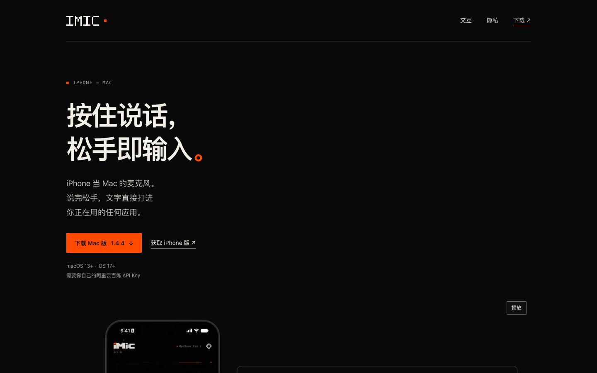 | 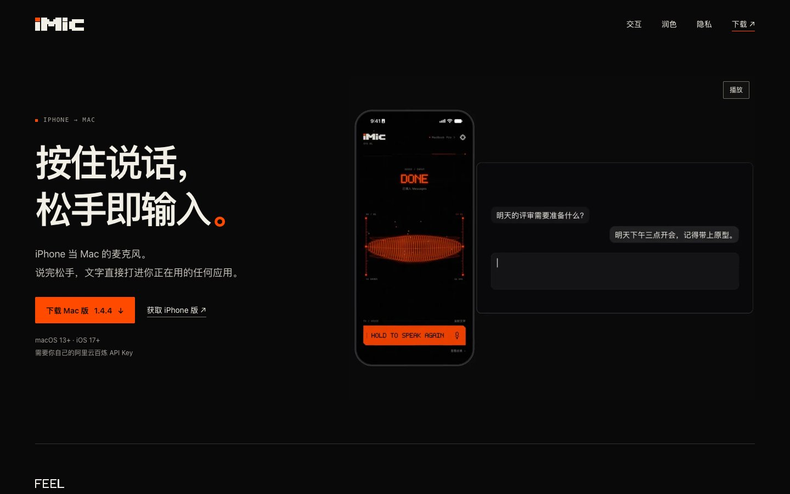 |
| 1440 整页 | 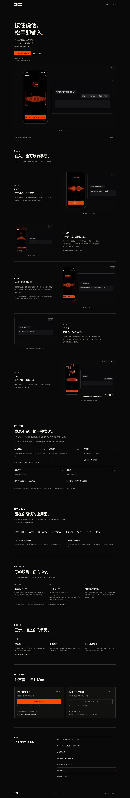 | 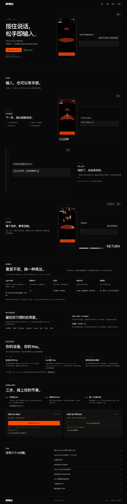 |
| 1920×1080 首屏 | 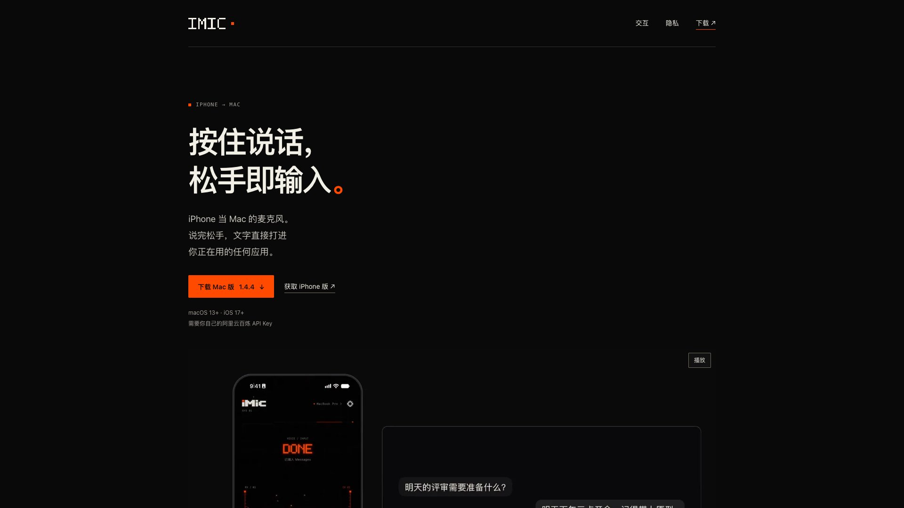 | 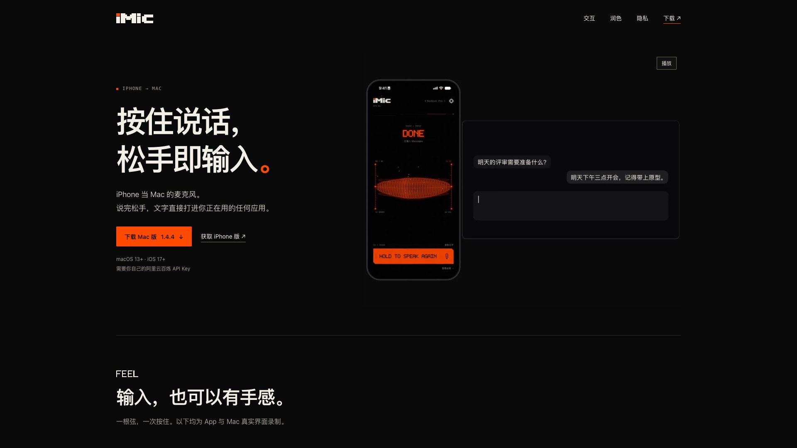 |
| 820×1180 平板首屏 | 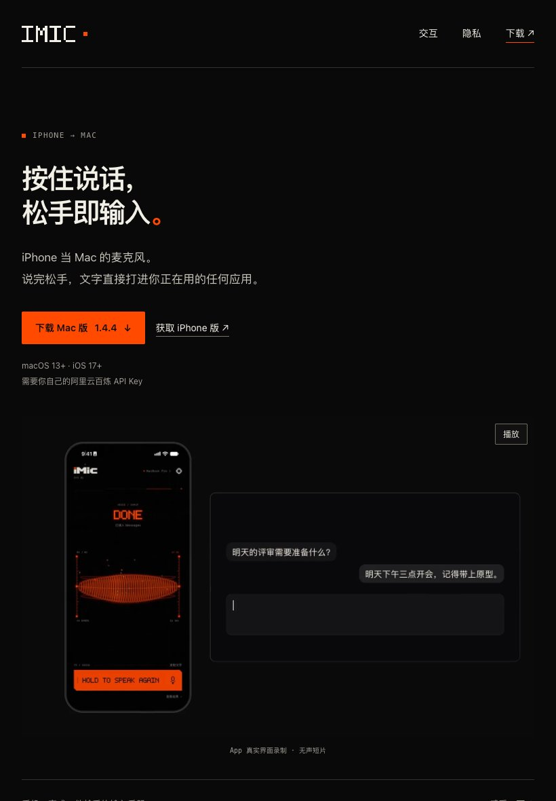 | 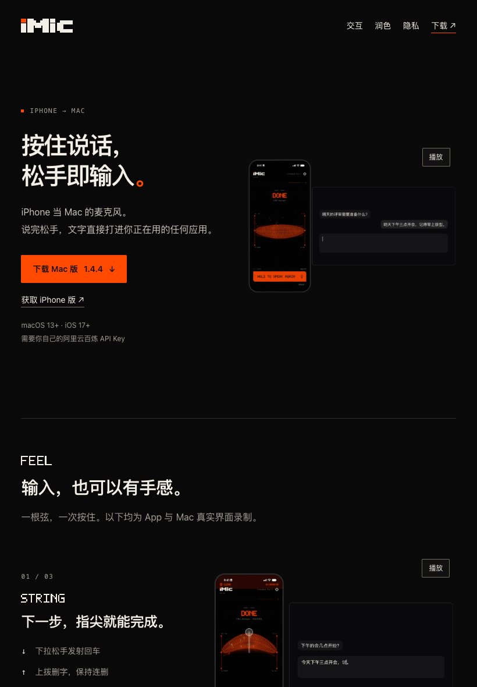 |
| 390×844 手机首屏 | 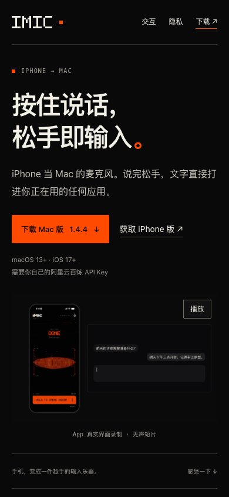 | 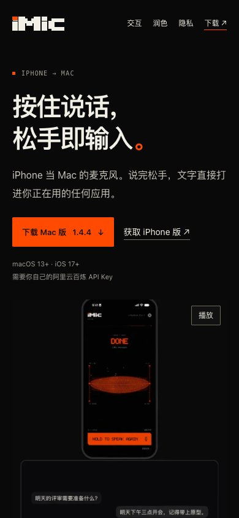 |
| 390 整页 | 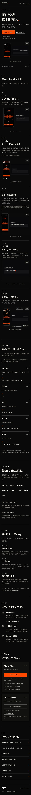 | 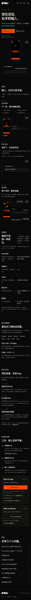 |
| 390 / ?from=ios#download | 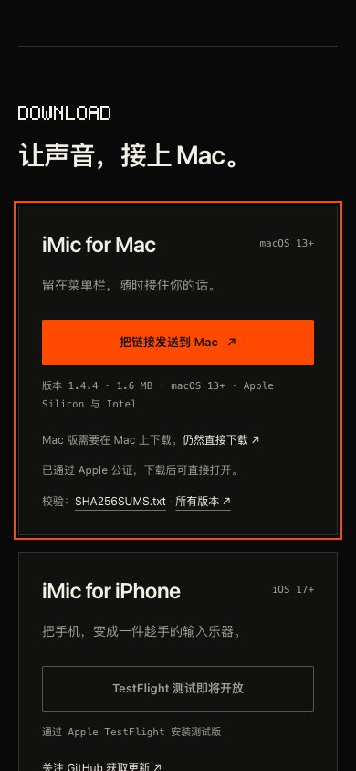 | 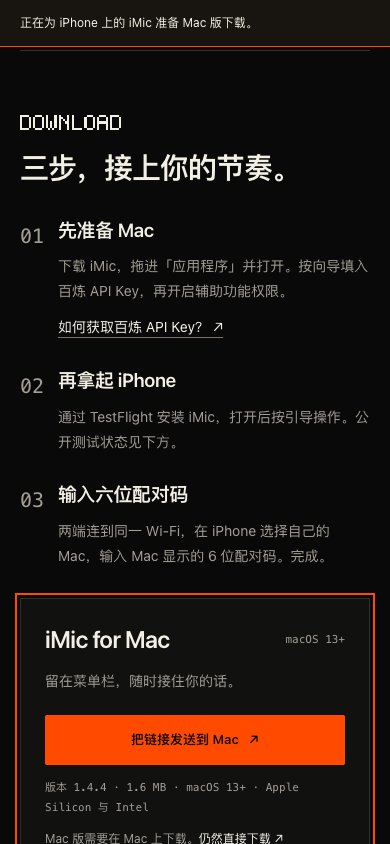 |

平板采用 1:1 左右布局，标题/下载与视频保持同一视觉组；手机采用上下布局和竖版片源。iPhone 直达截图中可直接看到三步、Mac 分享按钮及固定提示条。

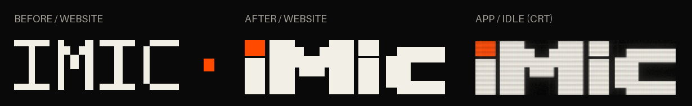

## 验收

- [x] 1440×900 首屏完整左右布局，Mac 文字 ≥13 CSS px。
- [x] 删除两个亮点与资源，FEEL 三项编号正确；风险说明移入 FAQ。
- [x] MODES 导航与锚点正确；START / DOWNLOAD 合并，旧链接有效。
- [x] 宽屏内容最大 1360px；1440px 页面高度减少至少 35%。
- [x] App / 网站 / 404 字标统一；图标与 OG 核对。
- [x] 静态检查与 27 项浏览器检查通过；NEXT 已记录。
- [x] 未改 App、版本或仓库设置，不合并、不自动合并、不发布。
