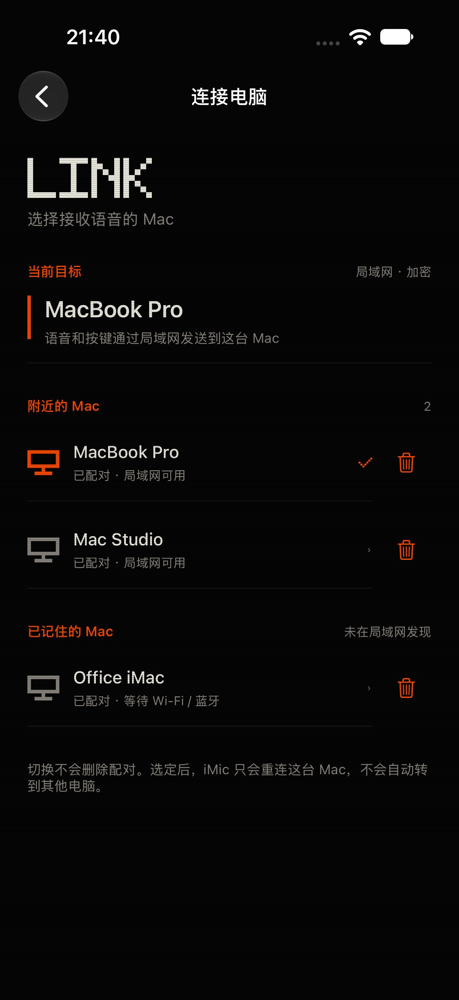
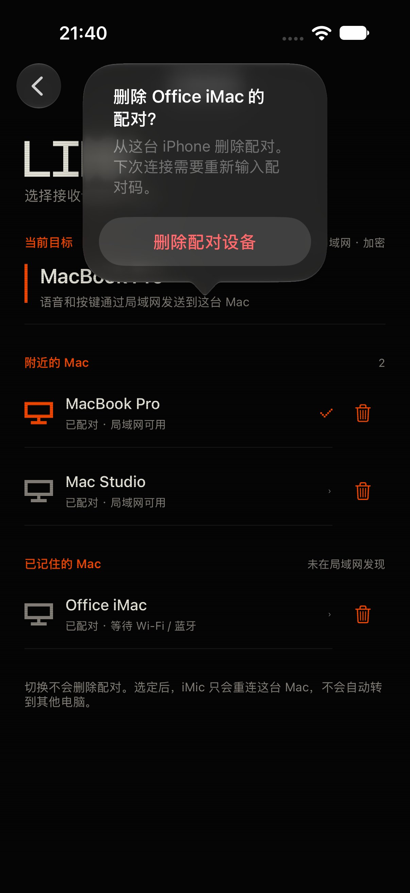
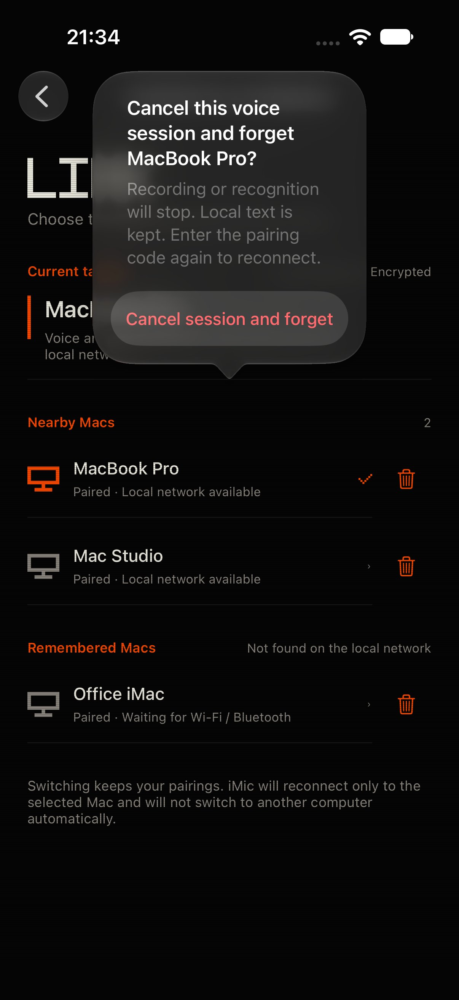
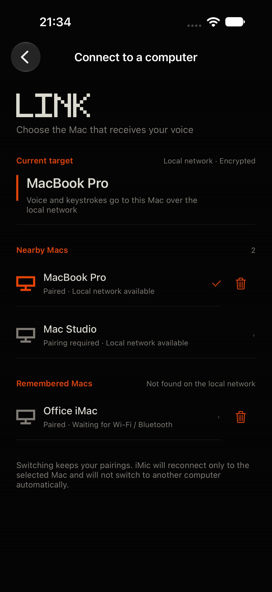
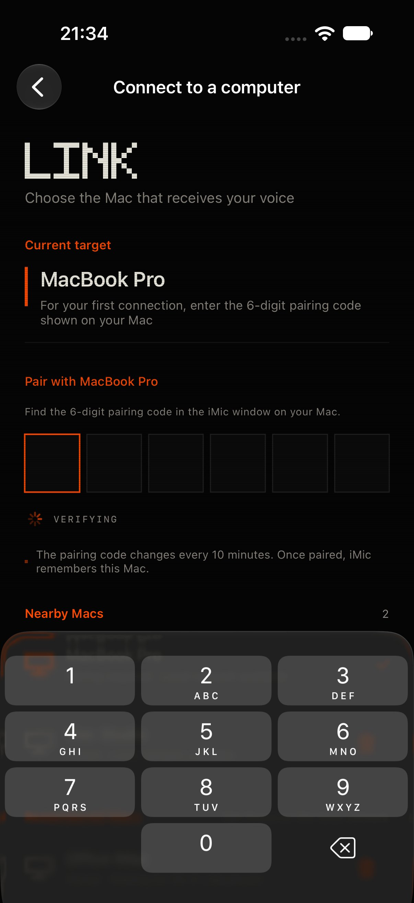

# iPhone 固定上次设备与删除配对：实现和验证

日期：2026-11-03。分支 `codex/ios-sticky-mac-and-forget`，基线 `86a7fbd`（`codex/ui-phosphor-wireframe`）。不修改 Mac 代码、协议、版本或签名配置；不合并、不发布、不安装覆盖用户 App。

## 根因与目标

当前选择策略沿用 10 月 29 日的“选择当前可用已配对 Mac”要求：上次设备未发现时只等 1.5 秒，随后按最近成功时间自动回退；蓝牙 allowlist 也接受其他已配对电脑。新要求改为始终等待上次使用的设备。用户现有手机日志中也确认了返回前台后 `reason=recent`，随后另一台 Mac `ready` 的顺序；未把私人设备名、ID 或原始日志提交进仓库。

另一个问题是手动点选就持久化 `preferredMacID`，即使那次并未认证成功，也会被当作下次启动的默认设备。原删除入口只处理当前目标，而且删完立即重新发现/自动选择，设备列表不能删除其他已配对电脑。

代码并未证明同一个 `LinkClient` 同时有多条 ready 的 TCP 链路；确认的问题是自动策略会改变目标。回归特别断言旧连接取消、最多一台服务进入 ready，防止出现用户感受到的多机抢连。

## 最终行为

- LAN 和 BLE 都只接受当前选择/上次成功设备的同一身份，离线、失败、发现结果陆续到达或旧令牌被拒绝，都不会自动跳到其他 Mac。
- 新 `imic.lastConnectedMacID` 只在收到加密 `ready` 后写入；临时点选在内存里生效，失败后重启仍恢复成功目标。旧数据优先按认证成功时间迁移，没有时间记录才用旧首选，仍有歧义则要求用户选择。
- 首次安装、没有配对且只有一台发现时仍可以进入显式配对；仍必须输入有效配对码。已配对用户不会自动对陌生设备弹码。
- 被 Mac 撤销/拒绝的令牌不触发自动配对；用户可点当前但未 ready 的设备行重新配对，不会因为它已被选中而无响应。
- 设备页每台已配对 Mac 都有 44×44pt 删除按钮，含离线设备；提供明确中英文辅助功能名称、删除确认与取消。
- 删除非当前设备只清理该设备的本机令牌、名称和成功时间，不改变当前 epoch、录音会话或传输。
- 删除当前目标前沿用 `SessionModel.cancelForDeviceSwitch()`，覆盖 listening / transcribing（含补传及等待结果），保留本地文字；清空连接、编辑能力、待处理 clear 和本机配对记录。旧 socket/BLE 回调被身份与 epoch 检查丢弃，迟到的 paired/ready 不能恢复令牌。
- 当前目标删除后持久暂停自动选择。仅点一个仍离线的设备不会提前解除磁盘暂停；新目标真正 ready 后才解除。附近广播仍可看到已忘记的电脑，但它显示“需要配对”，只能由用户明确重新配对。
- 删除仅移除此 iPhone 的配对记录，不远程改动 Mac 端的其他设备授权。

## 改动边界

- `shared/MacSelection.swift`：唯一目标选择、成功目标恢复、单一 BLE 候选策略。
- `ios/iMic/LinkClient.swift`：成功记录迁移、选择与忘记、BLE 身份限制、独立 DEBUG 设备管理预览。未修改 activate / 前台 probe / restartForegroundLocked，前后台恢复由另一独立 PR 处理。
- `DeviceSelectionView` / `PairingSheet`：设备删除入口、当前语音确认与明确重配入口。
- `HomeView` / `SessionModel`：仅 DEBUG 预览入口和忙碌状态夹具；预览不读写真实配对或发送网络内容。
- `Localizable.xcstrings`：新文案同时有简体中文与英文。
- 单测和真实回环集成：覆盖恢复、身份、安全和删除；选择脚本产物随机命名，让并行测试的 UserDefaults 域也隔离，只有端口隔离不够。

## 验证

| 命令 | 结果 | 耗时 | 关键输出 |
|---|---|---:|---|
| `DEVELOPER_DIR=/Applications/Xcode.app/Contents/Developer swift test` | PASS | 2.35s | 77 / 77；14项选择/恢复/BLE策略单测 |
| `IMIC_SELECTION_TEST_PORT=48064 ./scripts/test-ios-mac-selection.sh` | PASS | 23.71s | 三台真实加密服务 + 延迟回复代理；所有断言通过 |
| `IMIC_RESUME_TEST_PORT=48024 ./scripts/test-ios-reconnect.sh` | PASS | 20.31s | 健康恢复、黑洞连接、缓冲语音、绕过退避全部通过 |
| `./scripts/build-ios.sh` | PASS | 9.27s | Simulator Debug BUILD SUCCEEDED；未覆盖用户安装 |
| `xcodebuild test … -only-testing:iMicUITests/DeviceManagementUITests` | PASS | 73.21s session | 英文5 / 5，native点击、确认/取消、重配入口 |
| `xcodebuild test …/testChineseOfflineDeletionIsLocalizedAndRequiresConfirmation` | PASS | 14.62s test | 中文1 / 1；文案与44pt入口 |
| `IMIC_TESTFLIGHT_DIR=build/testflight-sticky-final.noindex ./scripts/testflight.sh archive-unsigned` | PASS | 34.40s | 未签名 Release；调试入口 absent，隐私清单 passed |
| `IMIC_TESTFLIGHT_DIR=build/testflight-sticky-final.noindex ./scripts/testflight.sh check` | PASS | 0.08s | 未签名 Release；调试入口 absent，隐私清单 passed |

Release 归档仅用于校验，没有签名分发或上传。Swift 5 构建仍有既有并发 Sendable 警告，未作为本任务顺手清理。

选择集成使用生产 `LinkClient` 和三台真实 `LinkServer`，在随机临时配对目录与随机测试 ID 下完成真实加密认证，端口 48064–48072：

1. 上次 A 离线，B/C 在线且超过宽限窗口，仍不连 B/C；A 稍后出现只连 A。
2. 已有活跃会话、其他发现晚到，不切换；最多一台服务 ready。
3. 上次设备失败或发现身份与服务端身份不符，不回退也不接受错误电脑。
4. hello/auth 的令牌拒绝不自动弹码或改目标；随后用户明确选择同一设备可以成功重新配对。
5. 旧数据迁移、未成功点选、冷启动成功目标记录；离线点选使用从未广播的随机 UUID，避免异步服务关闭竞态。
6. 删除离线其他设备时保留当前活跃链路；删除当前后跨重启暂停自动选择。
7. 删除后点从未上线目标仍不解除磁盘暂停；显式选择可用目标并认证成功才解除。
8. 通过真实字节代理暂存加密 paired/ready 回复，忘记期间再释放，令牌/ready/gesture 不会复活。
9. 首次配对继续要求有效配对码，已配对用户不会自动连未配对设备。

模拟器 UI：专用 iPhone 18 Pro / iOS 27.0，5 项英文 + 1 项中文全部通过。英文用例覆盖离线删除/取消、附近删除后需配对、当前删除不换机、进行中语音的明确确认、当前失效配对可重试。中文用例确认本地化名称与删除确认。原生 iOS 27 弹出式确认用点空白取消；测试同时断言配对仍保留。

- 英文 xcresult：`build/device-uitest.noindex/devices-v2.xcresult`（5 / 5，测试执行 62.67s，Xcode session 73.21s）。
- 中文 xcresult：`build/device-uitest.noindex/devices-chinese.xcresult`（1 / 1）。
- 静态/集成日志：`build/sticky-validation/`。初轮测试夹具的无日期样例、并行偏好域污染及原生弹出菜单的取消定位已修正，最终用例全部通过。
- 干净基线：父代理在 `86a7fbd` 验证 74 个单测、原选择与重连集成全部通过（15.99 / 25.23 / 20.15s）。基线记录位于父任务 `build/ios-connection-review/baseline-results.json`。

## 两个 PR 的组合验证

父代理将本分支生产改动 `daec88e` 与前后台恢复分支 `257ec8c` / `4aad7ad` 放到临时副本组合，三处 LinkClient 改动无冲突，完整验证通过：77 单测 4.57s、选择集成 30.48s、旧重连 21.48s、6 项前后台生命周期 13.31s、Simulator 构建 9.05s。结果位于父任务 `build/ios-connection-review/combined-results.json`，没有合并任何远端 PR。

## 截图

均为独立 DEBUG 夹具，无真实设备记录或录音；预览删除只改内存。专用模拟器已删除。

## 物理设备补验

本次回环覆盖真实握手/加密/连接取消与删除；BLE 的严格 allowlist 由纯函数测试覆盖。真实 iPhone 与多台物理 Mac 的 Wi-Fi/BLE 发现时序仍需现场补验：A/B 同时在线且上次 A 时只连 A；A 离线时不跳到 B；删除在线/离线设备后保持未配对，重新输入配对码才能恢复。前后台网络挂起恢复的根因和测试另见独立 PR。
