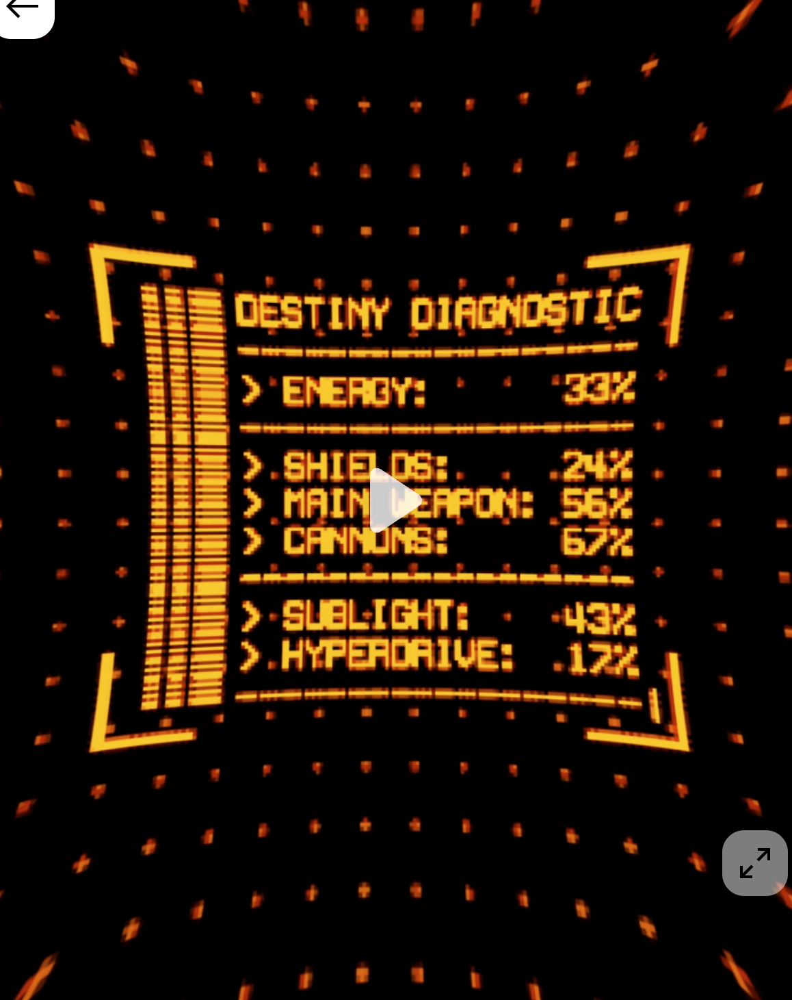

# iOS 录音「时空坍缩」视觉效果

日期：2026-11-11。以下为真机体验后确认的最终行为与参数。

## 目标与范围

按住说话时，用缓慢累积的周边形变提醒用户已经说了多久。接收线圈附近保持原大小与清晰度，标题、状态、线圈、计时、按住条、底部说明和背景一起参与同一个形变场。四周逐渐柔化并带少量色散，彩边融入模糊，不形成几份独立残影。



仅修改 iOS 主页 unified Metal 合成路径。协议、Mac、音频采集和识别时序、手势及命中区域、触感、声音均沿用原行为。unified 不可用时保留原 SwiftUI 回退界面。

## 形变与时间曲线

坐标使用 point。焦点 `c` 为接收线圈中心，`d = p-c`，各轴按 `extent = max(c, viewport-c)` 归一化。

```text
q = d / extent
periphery = smoothstep(0.30, 0.95, length(q)/sqrt(2))^1.5
samplePoint = c + d * (1 + 0.10 * (a/0.08) * periphery)

geometry(t) = 0.20*(1-exp(-(t/1.5)^2)) + 0.80*(1-exp(-t/45))
a_time(t) = 0.08 * geometry(t)
optics(t) = 0.25*(1-exp(-(t/1.2)^2)) + 0.75*(1-exp(-t/28))
```

- `a_max = 0.08`；最外围最大采样拉伸系数 1.10，没有均匀缩放。中心焦点区域的采样保持恒等。
- 几何在前几秒显现少量提示，其余变化按 45 秒时间常数累积；约 10/30/60 秒达到几何范围的 36%/59%/79%。
- 光学进度独立起步，短录音也能看到柔化和彩边，其余部分按 28 秒时间常数累积。
- 使用现有 `SpectrumStore.frame.level`，再以 0.12 秒一阶低通平滑；几何量乘 `1+0.12*(level-0.5)`，脉动为 ±6%，总量不超过上限。不新增采集或 FFT。
- `t` 从真实采集就绪后开始。冷启动仅观察音频引擎完成回调并记录视觉偏移；权限等待、链路未就绪时形变量为零，不更改原录音计时和提交路径。

## 统一合成与光学质感

`PhosphorArtwork` 为透明前景纹理。Metal 按原 26pt 间距、6.5% 白色强度绘制背景网格；背景、前景、core 和三层 bloom 共用一个全屏 UV。seed/history/bloom 继续在源坐标计算，最终合成只施加一次形变，避免光晕错位。保留原按住条局部按压缩放。

先把完成发光合成的整页写入现有 RGBA16F emission，再进行径向 Gaussian 软化与 RGB 偏移：

- 模糊范围最大 7pt，RGB 通道相对绿色的径向偏移为红色 +2.0pt、蓝色 −2.0pt；均乘 `optics(t)*periphery`。
- 三个通道共用同一 Gaussian 核；五个双线性配对采样位置近似九点核，不叠加清晰副本。
- 偏移从上一体验版的 1.8pt 轻微提高到 2.0pt，模糊范围、几何和时间曲线保持不变。
- 中心直接通过原像素，不模糊、不分色；超出纹理范围输出线性 `Theme.ink`，不拉伸边缘像素。正常动态效果的附加周边暗角最多 12%。不保留红移。

emission 在 history 和 bloom 读完后复用，不新增纹理或历史反馈。录音光学效果启用时多一个最终镜头 pass；无光学效果时仍直接单次最终合成。坍缩状态不加入 artwork 缓存键，不额外整页栅格化。

`PhosphorUniforms` Swift/Metal 两侧为五个 float4、80 字节：`collapse` 保存 amount、centerX、centerY、optics，`interaction.z` 保存减少动态效果的暗角。

## 结束与无障碍

- 发送：解析欠阻尼弹簧，ζ = 0.55、自然周期 0.32s；到第一次负向极值后以 ω = 32 的临界阻尼收尾，只有一次轻微过冲。
- 取消、录音失败、断链：ω = 40 的临界阻尼，无过冲。发送回弹期间发生失败也切换为取消恢复。
- `|a| < 0.0005` 且速度小于 0.003 后精确归零并释放显示时钟。长掉帧使用解析曲线，不做逐帧数值积分。
- 原 `releaseWave` 仍属于后续拉弦发射，不在录音松手时提前触发。
- 开启“减少动态效果”：几何和镜头软化/色散为零，改为最多 25% 的周边暗角，结束时 0.2s 线性恢复。
- clean/glow/crt 均有录音镜头效果，各自 bloom/CRT 规则照常生效。“减少透明度”关闭 CRT 材质强度，但保留录音形变与光学反馈。

## 预览与录屏

DEBUG 构建支持 `--debug-collapse=<0…1>` 固定归一化强度，以及 `--debug-collapse-time=<seconds>` 固定真实时间曲线；Release 不读取这两个参数。

```bash
IMIC_SIM_NAME=<专用模拟器UDID> ./scripts/capture-recording-collapse.sh static
IMIC_SIM_NAME=<专用模拟器UDID> ./scripts/capture-recording-collapse.sh timeline
```

static 覆盖 0/.25/.6/1 与 clean/glow，timeline 覆盖 0/2/5/10/30/60 秒与 clean。截图须使用最终 shader。

发送/取消录屏使用真实加密 TTS 链路和原生长按手势：先 build-for-testing，并运行无界面 Mac 测试实例（`--headless --no-input --port=47856 --pair-code=864209`），再运行：

```bash
IMIC_SIM_NAME=<专用模拟器UDID> ./scripts/capture-recording-collapse.sh send
IMIC_SIM_NAME=<专用模拟器UDID> ./scripts/capture-recording-collapse.sh cancel
```

仅记录测试合成语音，不自动向其他应用输入。实际 compositor 每两秒记录一次提交 GPU 的 amount、optics、vignette、material，并记录开始/结束/归零事件；不记录音频、识别文字或凭据。

## 验收与测试

```bash
./scripts/test-phosphor.sh
./scripts/build-ios.sh
IMIC_SIM_NAME=<专用模拟器UDID> ./scripts/test-ios-standby.sh
./scripts/test-receiver-flight.sh
./scripts/test-ios-audio.sh
python3 tools/check-l10n.py
DEVELOPER_DIR=/Applications/Xcode.app/Contents/Developer swift test
```

GPU 回归覆盖 390×844 point 的五秒/三十秒彩边可见性、柔化扩散、单条细线每通道只有一团连续特征、中心不缩小不模糊、上下区域温和弯曲、core/UI/bloom 对齐、越界底色、idle 直接/两阶段合成一致。状态测试覆盖有界时间曲线、电平平滑、一次发送过冲、取消单调恢复、减少动态效果、失败中断、长掉帧、归零后无帧请求。待机诊断通过真实 renderer 验证无额外 artwork 栅格化和结束后零回调。

生成图标不随本任务提交。PR 附最终截图和发送/取消录屏；验收记录见 [REPORT.md](../test-reports/ios-recording-collapse/REPORT.md)。

## 交付

独立 worktree 分支 `codex/ios-recording-collapse`，基于 `codex/ui-phosphor-wireframe` 的 `01aa0ab`。用户已真机体验并授权微增色散后提 PR；目标分支为 `codex/ui-phosphor-wireframe`。在 `docs/releases/NEXT.md` 记录 iPhone 用户可见变化。只提交 PR，不合并。
