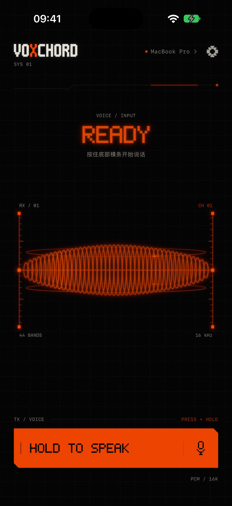
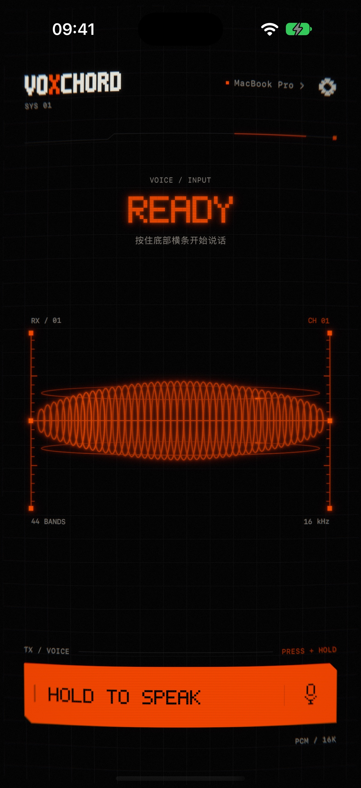
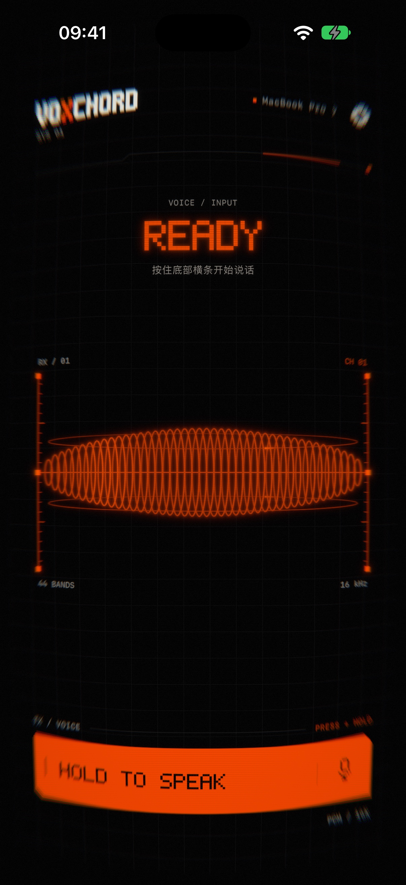
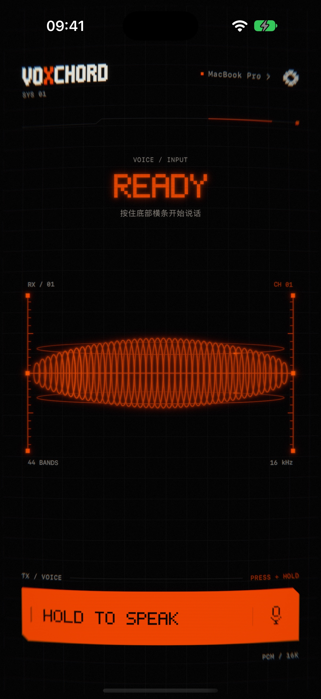
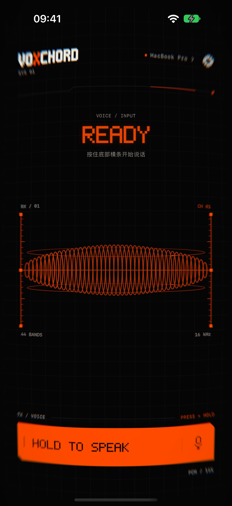

# iOS 录音坍缩验收记录

日期：2026-11-11。基线 `01aa0ab`，目标分支 `codex/ui-phosphor-wireframe`。本目录截图和录屏均来自最终 2.0pt 色散 shader。

## 最终参数

| 项目 | 参数 |
| --- | --- |
| 几何主量 | `a_max=0.08` |
| 几何进度 | `0.20*(1-exp(-(t/1.5)^2))+0.80*(1-exp(-t/45))` |
| 周边采样拉伸 | `1+0.10*(a/0.08)*periphery`；焦点保持原位与大小 |
| 光学进度 | `0.25*(1-exp(-(t/1.2)^2))+0.75*(1-exp(-t/28))` |
| 径向 Gaussian | 最大范围 7pt，RGB 共用同一核 |
| RGB 偏移 | 红/蓝相对绿色为 ±2.0pt，再乘光学进度与周边权重 |
| 发送恢复 | ζ=0.55，自然周期 0.32s，一次过冲后 ω=32 临界恢复 |
| 取消恢复 | ω=40 临界阻尼，无过冲 |
| 减少动态效果 | 无几何或镜头效果，暗角最多 25%，0.2s 线性恢复 |
| 正常动态暗角 | 附加周边暗角最多 12%，无红移 |

最后一次调整仅将 RGB 偏移从 1.8pt 提高到 2.0pt（约 11%），不改 Gaussian 范围、空间映射或时间曲线。三通道共用软化核，避免独立清晰副本造成残影。

## 截图

模拟器：专用 iPhone 18 Pro，iOS 27.0。截图为原生 1206×2622 分辨率，JPEG 质量 94；原始 PNG 保留于本地 `build/recording-collapse-final/`。

固定调试强度（独立观察几何与光学的归一化范围，并非实际录音时间）：

| 0 | 0.25 | 0.6 | 1.0 |
| --- | --- | --- | --- |
|  |  |  |  |

实际时长曲线（中性电平），以及无 bloom 的 clean 材质：

| 5 秒 CRT | 30 秒 CRT | 30 秒 clean |
| --- | --- | --- |
|  |  |  |

检查：中心没有整体后退，标题、底部条及网格一起缓慢弯曲；四周色边融合在柔化内。GPU 另以 390×844 point 夹具检查真实手机尺寸的短录音可见性、中心恒等和单条细线每通道仅一个连续软化特征。

## 原生手势与真实链路录屏

- [发送](send.mp4)：系统 TTS → 原有加密帧 → 无界面 Mac 识别，原生长按 11s 后松手；观察渐入、发送回弹和恢复。
- [取消](cancel.mp4)：相同 TTS/加密路径，长按后上滑 100pt 取消；观察无过冲恢复。

录屏转换为 720px 宽、30fps H.264 MP4，原始 MOV 保留在本地 build 目录。只使用测试语音，无自动向其他应用输入。

[发送渲染元数据](send-visual.txt) 确认结束时 `amount=0.03308, optics=0.529`，随后 `collapse settled`；[取消渲染元数据](cancel-visual.txt) 为 `amount=0.03237, optics=0.540`，随后归零。日志仅包含视觉状态，不含识别正文或凭据。

## 验证

| 检查 | 结果 |
| --- | --- |
| `./scripts/test-phosphor.sh` | PASS：生命周期、过冲、ABI、GPU 空间/模糊/RGB、五秒可见性、中心与单软峰 |
| `./scripts/build-ios.sh` | PASS：模拟器 Debug 构建 |
| `xcodebuild build-for-testing` | PASS |
| `./scripts/capture-recording-collapse.sh static/timeline` | PASS：最终 shader 全组截图 |
| `./scripts/capture-recording-collapse.sh send/cancel` | PASS：两次原生手势 UI 测试及归零证据 |
| `./scripts/test-ios-standby.sh` | PASS：40 秒待机、恢复后零回调、无额外 artwork 栅格化、减少动态效果 |
| `./scripts/test-receiver-flight.sh` | PASS：文字飞行、快门、密度与 GPU 积分 |
| `./scripts/test-ios-audio.sh` | PASS：277 项断言 |
| `python3 tools/check-l10n.py` | PASS |
| `DEVELOPER_DIR=/Applications/Xcode.app/Contents/Developer swift test` | PASS：79 个测试，0 失败 |
| CI 其余检查：`check-site.py` / Updater unittest | PASS：4 页网站检查 / 8 个更新器测试 |
| 真机 Release 构建、签名核验与安装 | PASS：iPhone 16 Pro，iOS 27.2.1，`art.malette.imic.dev` |
| `git diff --check` | PASS |

待机诊断覆盖发送/取消及减少动态效果，要求精确归零、恢复后零显示回调、artwork 栅格化次数不增加。光学启用时复用已有 emission 纹理增加一次镜头 pass；空闲保留单次最终合成。不新增常驻渲染、纹理分配或音频路径。

[最终需求与实现说明](../../tasks/2026-11-11-ios-recording-collapse.md)。仅提 PR，等待审核，不合并。
