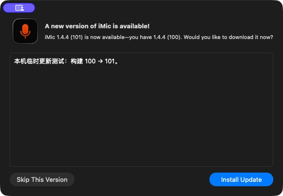
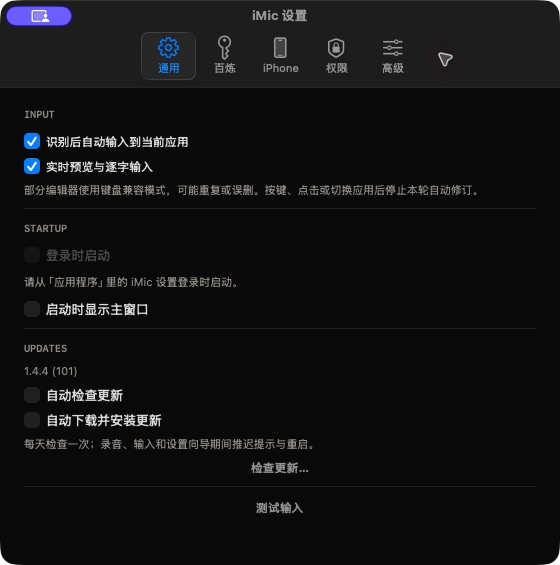
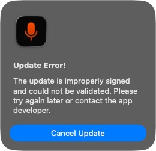
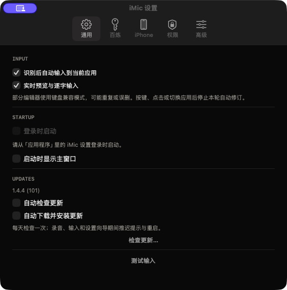

# Mac 自动更新测试报告

日期：2026-10-31；环境：Apple Silicon、macOS 26.6.2、Xcode `/Applications/Xcode.app/Contents/Developer`。开发分支 `codex/mac-auto-update`，目标 `codex/ui-phosphor-wireframe`，已同步到 `c550838`（含百炼与官网任意输入框任务；Mac 源码与已测的 `8f3bf4a` 相同）。百炼实现文件相对目标分支没有修改，设置改动仅增加通用页更新区域及刷新逻辑。

**路径差异**：任务书的根目录 `BUILD` 与现有 `build/` 在本机不区分大小写的文件系统上是同一个路径（`os.path.samefile('build', 'BUILD') == True`）。使用根目录 `MAC_BUILD`，初始值为 `1`；每次发布严格递增、原地覆盖也递增，其他语义一致。`VERSION` 和 iOS 构建号未修改。

## 第 9 节命令回归

下表为最终有效结果；同步 base 后重跑了受百炼提交影响的 Mac、设置、润色和官网检查。协议、输入和 iOS 实现没有变化，保留此前真实执行的结果。耗时为命令实际墙钟时间。

| 命令 | 结果 | 耗时 | 关键输出 / 验证 |
|---|---|---:|---|
| `DEVELOPER_DIR=/Applications/Xcode.app/Contents/Developer swift test` | PASS | 12.32s | `Executed 69 tests, with 0 failures` |
| `./scripts/fetch-sparkle.sh` | PASS | 0.92s | 官方 `Sparkle-2.10.1.tar.xz: OK`；SHA-256 `1a856d2a9edb8e628de88121d7be04cf0e2167f8641650b78fca00b14244cf27`；校验后解压 |
| `./scripts/build-mac.sh` | PASS | 34.48s | `已构建 .../build/mac.noindex/iMic.app`；存在 `Contents/Frameworks/Sparkle.framework`；占位公钥明确关闭自动检查 |
| `codesign --verify --deep --strict build/mac.noindex/iMic.app` | PASS | 0.05s | exit 0，无错误 |
| `./scripts/test-mac-settings.sh` | PASS | 16.66s | 原设置测试与新增两个开关、版本、菜单、录音/输入/清除/未完成向导的更新门全部通过 |
| `./scripts/test-polish.sh` | PASS | 3.34s | `Executed 28 tests, with 0 failures`，含最新百炼回归 |
| `./scripts/test-input.sh` | PASS | 1.22s | `Executed 21 tests, with 0 failures` |
| `python3 tools/check-site.py` | PASS | 0.07s | 2 HTML pages、40 files；合法空 appcast；链接、预算与资源检查通过 |
| `node tools/test-site-browser.mjs` | PASS | 32.58s | `32/32 browser checks passed`，含 FAQ、响应式、键盘操作与下载回退 |
| `./scripts/build-ios.sh` | PASS | 20.91s | `** BUILD SUCCEEDED **`；构建生成的图标副作用已恢复，没有提交 iOS 资源变化 |

附加验证：

| 命令 / 检查 | 结果 | 耗时 | 关键输出 |
|---|---|---:|---|
| `python3 -m unittest discover -s tests/Updater -v` | PASS | 1.30s | 8 项：空 feed、占位公钥阻止打包、dry-run、构建号未增、同版本替换、倒退保护、缺少签名/长度/版本/错误 URL、非法 XML |
| `IMIC_ARCH=universal IMIC_BUILD_DIR="$PWD/build/mac-universal.noindex" IMIC_SIGNING_IDENTITY=- ./scripts/build-mac.sh` | PASS | 53.05s | arm64 + x86_64 编译、lipo 和嵌套签名校验通过；在同步最新 base 前执行，更新器源码相同 |
| `bash -n scripts/fetch-sparkle.sh scripts/sign-mac.sh scripts/build-mac.sh scripts/package-release.sh` | PASS | <1s | exit 0 |
| `plutil` / Python plist 检查及 `strings` 检查发布二进制 | PASS | <2s | `CFBundleVersion=1`、`CFBundleShortVersionString=1.4.4`、检查间隔 86400、自动安装 false、profiling false；没有测试标志或 `--debug-update-*` 字符串 |
| 干净目标分支基线构建（`git archive 8f3bf4a` 后运行其 `build-mac.sh`） | PASS | 25.22s | 同架构、同 Apple Development 身份，用于体积比较 |

同步 base 后首次设置复测为 FAIL（17.45s，`Idle permits update UI`）：新合入的百炼原生向导测试关闭窗口后保留未完成进度，更新门正确阻止弹窗。已修正本任务测试的隔离：先断言该未完成向导会阻塞，再清理该测试进度，继续验证其他空闲状态；最终复测 PASS。不修改百炼产品逻辑。

## 第 8 节本地真实更新

测试始终位于仓库忽略的 `build/update-e2e/`，没有覆盖 `/Applications/iMic.app`。临时 seed 用 CryptoKit 生成并以 0600 写入文件；未运行 `generate_keys`，未导出、导入、替换或删除发布者的钥匙串更新密钥。Developer ID 仅用于 `codesign` 签测试 App。

### 1. 准备 A / B：PASS（人工构建、签名和制盘约 2 分钟）

实际使用以下 DEBUG 构建命令生成模板，再复制为 A/B，通过 `PlistBuddy` 分别写入 `CFBundleVersion=100/101`；保持 `VERSION=1.4.4`，重新显式签名每个 App。测试版关闭定时检查，避免重启后访问生产 feed；正常有效公钥构建的默认值仍为每天检查、自动安装关闭。

```bash
swift build/update-e2e/keygen.swift "$PWD/build/update-e2e"
IMIC_CONFIGURATION=debug IMIC_UPDATE_TEST=1 \
IMIC_TEST_PUBLIC_KEY_FILE="$PWD/build/update-e2e/public.txt" \
IMIC_BUILD_DIR="$PWD/build/update-e2e/template" IMIC_SIGNING_IDENTITY=- ./scripts/build-mac.sh
/usr/libexec/PlistBuddy -c 'Set :CFBundleVersion 100' A/iMic.app/Contents/Info.plist
/usr/libexec/PlistBuddy -c 'Set :CFBundleVersion 101' B/iMic.app/Contents/Info.plist
./scripts/sign-mac.sh A/iMic.app -
./scripts/sign-mac.sh B/iMic.app -
hdiutil create -srcfolder B -format UDZO -fs HFS+ update.dmg
build/vendor/Sparkle/bin/sign_update --ed-key-file build/update-e2e/temporary.key -p update.dmg
swift tools/verify-update.swift build/update-e2e/public.txt '<生成的签名>' update.dmg
```

A/B 为上文临时目录中 installed/payload 的简写。最后一条输出 `PASS: 最终 DMG 的 Ed25519 签名与 App 公钥一致。`。Developer ID 一轮使用相同源码的后续 DEBUG 模板，同样构造 100/101 并用 `scripts/sign-mac.sh <app> 'Developer ID Application: KE CHENG (5H39F98ND4)' release` 逐层签名。第一次 A 的时间戳服务暂不可用，重试签名成功；B 及最终 A 均通过严格签名验证。

### 2. 本地服务与 DEBUG feed：PASS（各 <1 秒启动）

```bash
python3 -m http.server 8765 --bind 127.0.0.1 --directory build/update-e2e/adhoc/server
python3 -m http.server 8766 --bind 127.0.0.1 --directory build/update-e2e/developer/server
build/update-e2e/adhoc/installed/iMic.app/Contents/MacOS/iMic \
  --debug-update-feed=http://127.0.0.1:8765/appcast.xml
```

两个服务只监听回环地址，实际收到 feed 与 DMG 的 HTTP 200 请求。运行时 feed 覆盖仅编译于 DEBUG，并且仅允许 HTTP 的 `127.0.0.1`；发布构建固定 HTTPS feed，忽略 defaults feed 覆盖。

### 3. 下载、校验、替换、重启：PASS

- ad-hoc：22:09:26 请求 feed，22:09:32 下载 DMG，22:09:48 B 重启，约 22 秒（含人工点击）。通过真实设置按钮点击「检查更新…」→ Sparkle 发现 101 →「Install Update」。日志为 `OK: EdDSA signature is correct for update`；新进程与设置页均显示 `1.4.4 (101)`。
- Developer ID：22:15:53 检查，22:16:06 下载，22:16:39 B 重启，约 46 秒，包含下文 32 秒人为忙碌等待。设置显示 101，严格签名校验通过。

[发现窗口](discovered.png) · [ad-hoc 完成后的版本](updated.png) · [Developer ID 完成后的版本](developer-updated.png)

### 4. 篡改拒绝：PASS（约 6 秒）

用 Python 将原 DMG 的第 2048 字节异或 1，保留原签名与长度，重新运行 A 并点击安装。22:11:31 下载，22:11:36 收到拒绝：

```text
Update Error!
The update is improperly signed and could not be validated.
Please try again later or contact the app developer.
```

Sparkle 日志明确为 `EdDSA signature does not match` / `validation before unarchiving failed`；仍为 A（100），没有替换或重启。参见[拒绝提示截图](rejected.png)。

### 5. 忙碌期间检查与重启：PASS

```bash
A/iMic.app/Contents/MacOS/iMic \
  --debug-update-feed=http://127.0.0.1:8765/appcast.xml --debug-update-check \
  --debug-update-busy-file="$PWD/build/update-e2e/busy"
```

- 检查门：22:11:01 启动时 marker 存在，18 秒内只有设置窗口，没有更新窗口、请求或重启；22:11:19 删除 marker 后才请求 feed 并显示更新。
- 重启门：Developer ID 一轮在发现更新后创建 busy marker，再点安装；下载完成后停在 Ready to Install，点击 Install and Relaunch 仍不退出，版本保持 100。22:16:38 移除 marker，下一次空闲轮询后于 22:16:39 重启为 101，等待约 32 秒。
- 设置测试还直接验证真实会话、输入、清除、已关闭但未完成的向导状态均阻止更新 UI；清理进度后恢复。扫光沿用产品的 `blocksGestures` 全阶段判断。
- 测试没有连接真实 iPhone；产品重启路径执行 `disconnect`、`stop`，并通过 LinkServer 串行队列屏障确认断链完成后再交给 Sparkle 退出。协议未改动。

### 6. 发布保护：PASS（0.06 秒及 1.30 秒测试套件）

```bash
./scripts/package-release.sh --check-only
# exit 1（预期）：更新公钥是占位值或格式无效，请先配置发布者的 Ed25519 公钥。
python3 -m unittest discover -s tests/Updater -v
```

在 build 下隔离复制发布脚本与公开测试公钥，验证相等/倒退的构建号被拒绝，提示「请先将构建号加 1（原地覆盖也必须递增）」；正常 dry-run exit 0。未调用实际打包、notarytool、Release 上传或 Pages 部署。XML 工具验证同营销版本的旧签名、长度、构建号被整体替换，只保留一个条目。

### 7. 清理：PASS（<1 秒，另做复核）

退出自有测试进程，停止 8000/8765/8766 自有 HTTP 服务，删除 `build/update-e2e/`（包括临时 App、私钥、本地 appcast、DMG），移除 Sparkle 测试下载缓存；逐项删除新增的 `SUHasLaunchedBefore`、`SULastCheckTime`、`SUSendProfileInfo`、`SUUpdateGroupIdentifier` 和 `NSWindow Frame SUUpdateAlert2`，保留原有识别/润色等应用偏好。复核没有遗留的测试目录或 Sparkle defaults；仓库 `site/appcast.xml` 是零条目的空 channel。构建缓存和测试日志不含私钥。

## Developer ID 与辅助功能授权

**已验证保留**。实际 `AXIsProcessTrusted()` 日志（未请求/自动批准新授权、未修改 TCC）：

```text
22:15:30 version=1.4.4 (100) accessibility=true
22:16:39 version=1.4.4 (101) accessibility=true
```

ad-hoc 对照组为 `100: true → 101: false`，符合 ad-hoc 更新可能失去权限的预期。原始时间戳见 [accessibility.txt](accessibility.txt)。Developer ID 前后 designated requirement 相同：

```text
identifier "com.drafffffff.imic" and anchor apple generic
and certificate 1[field.1.2.840.113635.100.6.2.6] /* exists */
and certificate leaf[field.1.2.840.113635.100.6.1.13] /* exists */
and certificate leaf[subject.OU] = "5H39F98ND4"
```

`codesign --verify --deep --strict` 为 PASS。额外执行的 `spctl -a -vv <Developer ID 测试 App>` 为**预期拒绝**：`rejected / source=Unnotarized Developer ID`。此轮为本地未公证测试包，不代表正式发行通过 Gatekeeper；没有发起公证或发布。正式发布脚本要求公证配置，并在公证/staple 后运行 Gatekeeper 检查，不通过就停止。

## 加载路径与体积

`otool -L build/mac.noindex/iMic.app/Contents/MacOS/iMic` 完整输出附后；Sparkle 项为：

```text
@rpath/Sparkle.framework/Versions/B/Sparkle (compatibility version 1.6.0, current version 2.10.1)
```

`otool -l ... | grep -A2 LC_RPATH`：

```text
          cmd LC_RPATH
      cmdsize 32
         path /usr/lib/swift (offset 12)
--
          cmd LC_RPATH
      cmdsize 48
         path @executable_path/../Frameworks (offset 12)
```

`du -sh iMic.app`：同一最新 base、arm64、同一 Apple Development 身份，更新前 **2.0M**，更新后 **4.6M**，约增加 **2.6M**。可选 Installer/Downloader XPC 已移除；framework 与工具二进制均未入仓库。

<details><summary>完整 otool -L 输出</summary>

```text
build/mac.noindex/iMic.app/Contents/MacOS/iMic:
	@rpath/Sparkle.framework/Versions/B/Sparkle (compatibility version 1.6.0, current version 2.10.1)
	/System/Library/Frameworks/AppKit.framework/Versions/C/AppKit (compatibility version 45.0.0, current version 2775.10.103)
	/System/Library/Frameworks/CryptoKit.framework/Versions/A/CryptoKit (compatibility version 1.0.0, current version 1.0.0)
	/System/Library/Frameworks/ApplicationServices.framework/Versions/A/ApplicationServices (compatibility version 1.0.0, current version 66.0.0)
	/System/Library/Frameworks/Vision.framework/Versions/A/Vision (compatibility version 1.0.0, current version 10.0.44)
	/System/Library/Frameworks/ScreenCaptureKit.framework/Versions/A/ScreenCaptureKit (compatibility version 1.0.0, current version 1.0.0)
	/System/Library/Frameworks/ServiceManagement.framework/Versions/A/ServiceManagement (compatibility version 1.0.0, current version 3298.1.1)
	/usr/lib/libSystem.B.dylib (compatibility version 1.0.0, current version 1359.0.0)
	/System/Library/Frameworks/CFNetwork.framework/Versions/A/CFNetwork (compatibility version 1.0.0, current version 3896.100.1)
	/System/Library/Frameworks/CoreBluetooth.framework/Versions/A/CoreBluetooth (compatibility version 1.0.0, current version 2700.51.0)
	/System/Library/Frameworks/CoreFoundation.framework/Versions/A/CoreFoundation (compatibility version 150.0.0, current version 5027.0.69)
	/System/Library/Frameworks/CoreGraphics.framework/Versions/A/CoreGraphics (compatibility version 64.0.0, current version 2050.0.0)
	/System/Library/Frameworks/CoreImage.framework/Versions/A/CoreImage (compatibility version 1.0.1, current version 7.0.0)
	/System/Library/Frameworks/CoreText.framework/Versions/A/CoreText (compatibility version 1.0.0, current version 904.0.0)
	/System/Library/Frameworks/Foundation.framework/Versions/C/Foundation (compatibility version 300.0.0, current version 5027.0.69)
	/System/Library/Frameworks/QuartzCore.framework/Versions/A/QuartzCore (compatibility version 1.2.0, current version 1223.2.2)
	/usr/lib/libobjc.A.dylib (compatibility version 1.0.0, current version 228.0.0)
	/usr/lib/swift/libswiftAVFoundation.dylib (compatibility version 1.0.0, current version 2450.77.5, weak)
	/usr/lib/swift/libswiftAccelerate.dylib (compatibility version 1.0.0, current version 82.0.0, weak)
	/usr/lib/swift/libswiftCompression.dylib (compatibility version 1.0.0, current version 18.0.0, weak)
	/usr/lib/swift/libswiftCore.dylib (compatibility version 0.0.0, current version 0.0.0)
	/usr/lib/swift/libswiftCoreAudio.dylib (compatibility version 1.0.0, current version 482.102.10, weak)
	/usr/lib/swift/libswiftCoreFoundation.dylib (compatibility version 1.0.0, current version 120.100.0)
	/usr/lib/swift/libswiftCoreImage.dylib (compatibility version 1.0.0, current version 3.0.0, weak)
	/usr/lib/swift/libswiftCoreMIDI.dylib (compatibility version 1.0.0, current version 6.0.0, weak)
	/usr/lib/swift/libswiftDarwin.dylib (compatibility version 1.0.0, current version 428.0.10)
	/usr/lib/swift/libswiftDispatch.dylib (compatibility version 1.0.0, current version 1605.0.2)
	/usr/lib/swift/libswiftIOKit.dylib (compatibility version 1.0.0, current version 1.0.0, weak)
	/usr/lib/swift/libswiftMetal.dylib (compatibility version 1.0.0, current version 382.5.3, weak)
	/usr/lib/swift/libswiftOSLog.dylib (compatibility version 1.0.0, current version 10.0.0, weak)
	/usr/lib/swift/libswiftObjectiveC.dylib (compatibility version 1.0.0, current version 973.1.0)
	/usr/lib/swift/libswiftQuartzCore.dylib (compatibility version 1.0.0, current version 5.0.0, weak)
	/usr/lib/swift/libswiftSpatial.dylib (compatibility version 1.0.0, current version 1.0.0, weak)
	/usr/lib/swift/libswiftUniformTypeIdentifiers.dylib (compatibility version 1.0.0, current version 917.0.1, weak)
	/usr/lib/swift/libswiftXPC.dylib (compatibility version 1.0.0, current version 167.0.2, weak)
	/usr/lib/swift/libswift_Concurrency.dylib (compatibility version 0.0.0, current version 0.0.0)
	/usr/lib/swift/libswiftos.dylib (compatibility version 1.0.0, current version 1090.0.0)
	/usr/lib/swift/libswiftsimd.dylib (compatibility version 1.0.0, current version 25.0.0, weak)
	/usr/lib/swift/libswiftAppKit.dylib (compatibility version 1.0.0, current version 1.0.0)
	/usr/lib/swift/libswiftNetwork.dylib (compatibility version 1.0.0, current version 6681.1.1)
	/usr/lib/swift/libswiftVision.dylib (compatibility version 1.0.0, current version 10.0.44)
	/usr/lib/swift/libswiftCoreGraphics.dylib (compatibility version 1.0.0, current version 1.0.0)
```

</details>

## 发布者一次性清单

完整步骤见 [docs/RELEASING.md](../../RELEASING.md)：

1. 校验下载 Sparkle；由发布者自己运行 `build/vendor/Sparkle/bin/generate_keys`，私钥留在登录钥匙串。
2. 将输出公钥替换 `mac/sparkle-public-key.txt` 的占位值，仅提交公钥。
3. 由发布者用 `generate_keys -x /安全的仓库外位置/imic-sparkle-private-key` 备份到加密、受控位置，不存仓库或公开云盘；需要恢复时由发布者操作。
4. 配置团队 `5H39F98ND4` 的 Developer ID 与公证 profile；保持 Bundle ID 与签名身份。每次发布递增 `MAC_BUILD`，包括同版本覆盖。
5. 完成正式签名、公证、staple、最终 DMG 的 EdDSA 签名；**先上传 Release DMG，再提交并推送 appcast**。本 PR 保留占位公钥和空 appcast，没有发布。

[设置页新增项截图](settings.png)

<details><summary>关键截图</summary>










</details>
